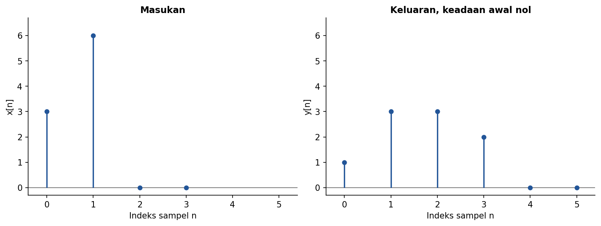
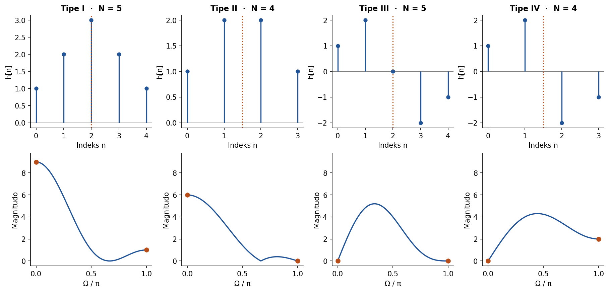
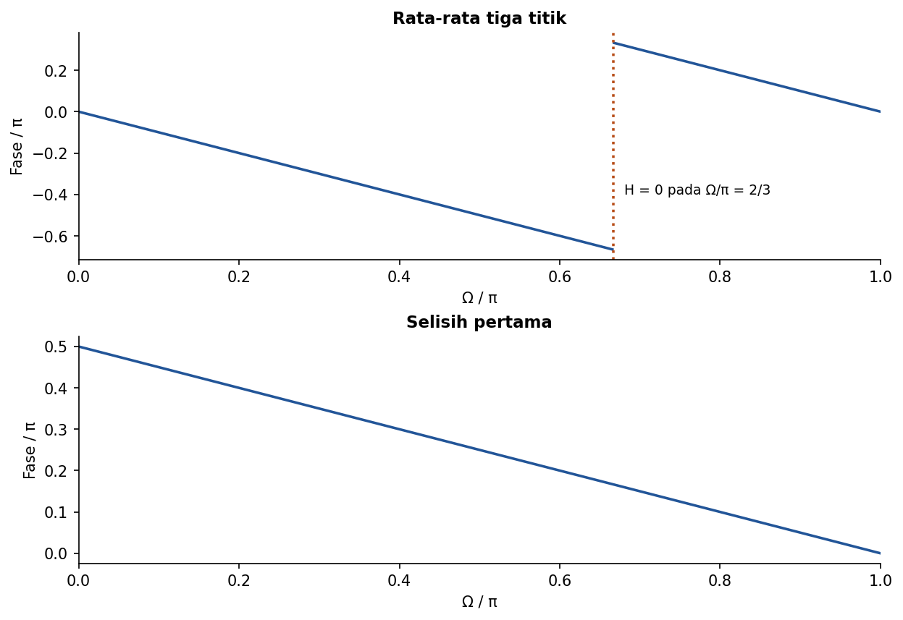
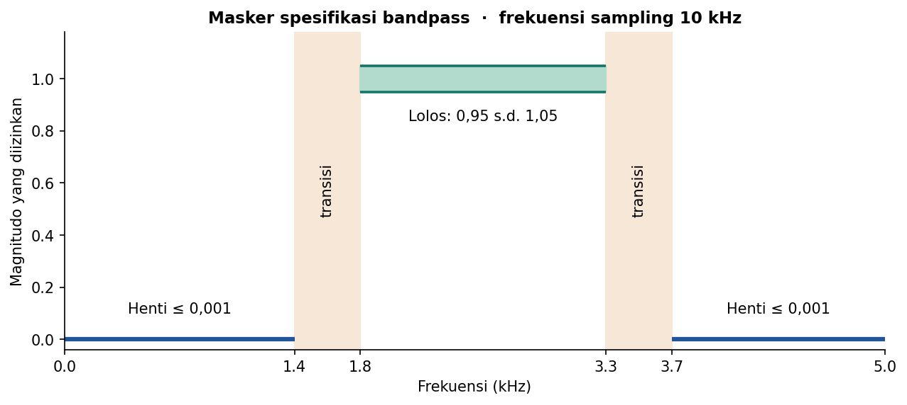
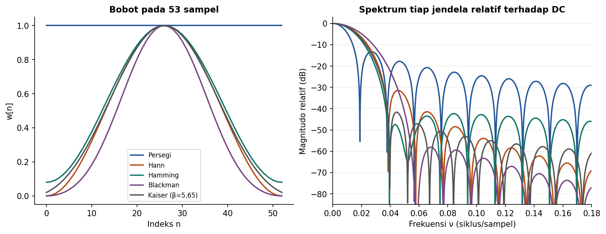
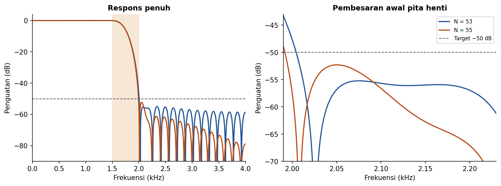
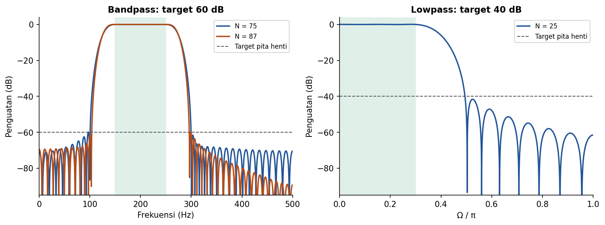
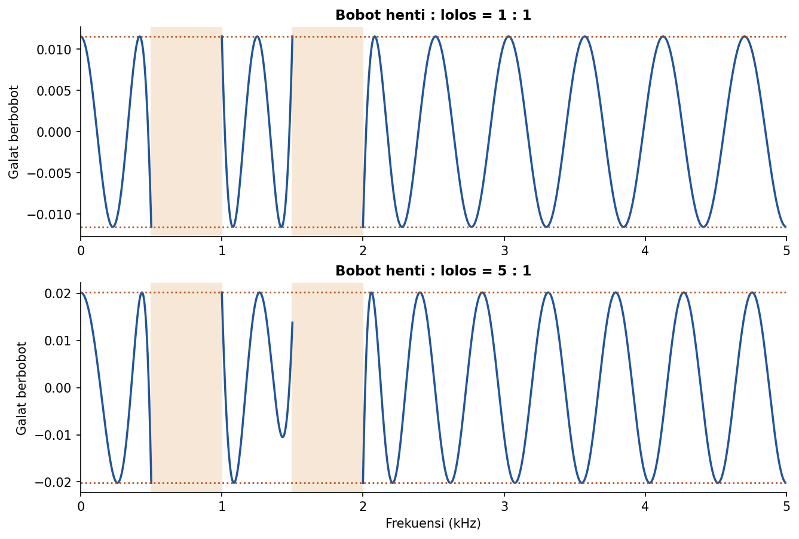
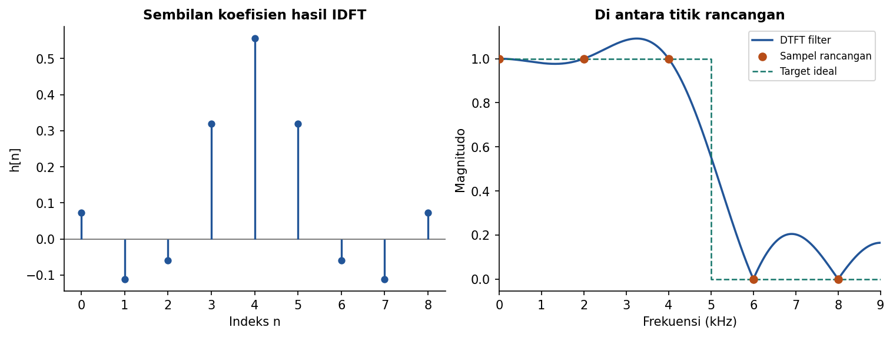
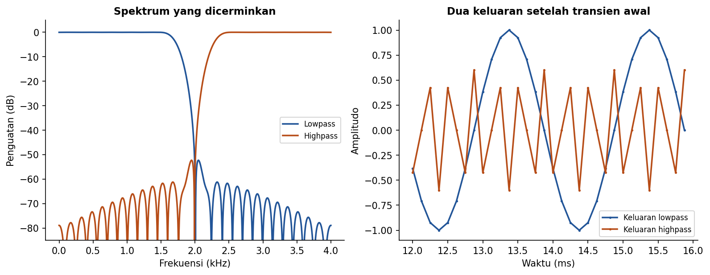

# Kuliah 7: Filter Digital FIR

## Tujuan pembelajaran

Pada pertemuan ke-6, kita memakai transformasi Z untuk memperoleh fungsi sistem dari respons impuls. Sekarang kita membalik pertanyaannya: **jika komponen frekuensi yang ingin diloloskan sudah diketahui, bagaimana kita menentukan respons impulsnya?** Jawaban akhirnya berupa sejumlah koefisien yang dapat langsung dipakai untuk menyaring data.

Setelah mengikuti kuliah ini, mahasiswa diharapkan dapat:

- menghitung keluaran filter FIR dan menjelaskan hubungan antara koefisien, fungsi sistem, dan respons frekuensi;
- membedakan tunda fase dan tunda kelompok serta memilih satu dari empat tipe FIR fase linear;
- menerjemahkan kebutuhan dalam Hz dan dB menjadi tepi pita serta toleransi amplitudo;
- menghitung koefisien dengan metode jendela, menjelaskan prinsip desain optimal, dan merancang filter kecil dengan IDFT;
- mengubah lowpass menjadi highpass, menguji hasil rancangan, dan menafsirkan keluarannya pada sinyal dua nada.

### Alokasi penyampaian: 120 menit

| Menit | Kegiatan | Hasil yang diperiksa di kelas |
|---|---|---|
| 0–12 | FIR sebagai penjumlahan sampel tertunda | Hitung satu sampel keluaran |
| 12–30 | Fase, tunda, dan empat tipe FIR | Tentukan tipe yang boleh meloloskan DC atau Nyquist |
| 30–42 | Spesifikasi dan tahapan perancangan | Ubah masker bandpass menjadi Hz dan dB |
| 42–70 | Respons ideal dan metode jendela | Hitung tiga koefisien Hamming dan uji panjangnya |
| 70–84 | Jendela Kaiser | Tentukan parameter dari spesifikasi dan periksa pita henti |
| 84–98 | Desain optimal berbobot | Hubungkan bobot dengan tinggi riak |
| 98–110 | Sampling frekuensi | Hitung koefisien tengah dan ujung melalui IDFT |
| 110–120 | Transformasi frekuensi dan rangkuman | Prediksi komponen yang lolos dari sinyal dua nada |

Untuk kelas, jalankan sel notebook pada contoh yang sedang dibahas. Kotak **Pendalaman** dan latihan akhir dapat dibaca atau dikerjakan setelah kelas. [Notebook dengan hasil dan grafik](../Notebook/pertemuan-07.ipynb) dan [program pembuat semua gambar](../Kode/pertemuan-07/demo_fir.py) menggunakan contoh numerik yang sama.

---

## Filter FIR: dari sampel masukan ke keluaran

Sebuah sensor dapat merekam getaran lambat yang ingin dipertahankan bersama getaran cepat yang ingin diredam. Filter digital memproses sampel hasil ADC. Koefisiennya dapat diubah tanpa mengganti rangkaian; sebagai gantinya, perancang harus memperhitungkan laju sampel, waktu komputasi, dan ketelitian bilangan.

FIR (*finite impulse response*) berarti **respons terhadap sebuah impuls memiliki durasi berhingga**. Ambil filter LTI kausal dengan koefisien real $h[0],\ldots,h[N-1]$, dan $h[n]=0$ di luar rentang itu. Panjang filter adalah $N$ koefisien (*tap*); ordenya $M=N-1$ bila koefisien terakhir tidak nol. Dalam keadaan awal nol, konvolusi menyusut menjadi

$$
y[n]=\sum_{k=0}^{N-1}h[k]x[n-k]
=h[0]x[n]+h[1]x[n-1]+\cdots+h[N-1]x[n-N+1].
$$

Masukkan $x[n]=\delta[n]$. Pada keluaran ke-$n$, hanya suku $k=n$ yang bertahan, sehingga $y[n]=h[n]$. Itulah sebabnya **koefisien filter adalah sampel respons impuls**. Mengambil transformasi Z, kemudian mengevaluasinya pada lingkaran satuan, memberi

$$
H(z)=\sum_{k=0}^{N-1}h[k]z^{-k},
\qquad H(e^{j\Omega})=\sum_{k=0}^{N-1}h[k]e^{-j\Omega k}.
$$

Dengan memasukkan $x[n]=e^{j\Omega n}$ ke dalam konvolusi, faktor $e^{j\Omega n}$ bisa dikeluarkan dari jumlah. Sisanya tepat $H(e^{j\Omega})$. Jadi magnitudo $H$ mengalikan amplitudo sinusoid, sedangkan sudutnya menambah fase sinusoid. Semua FIR dengan koefisien berhingga stabil secara BIBO: jika $\lvert x[n]\rvert\le B$, maka $\lvert y[n]\rvert\le B\sum_{k=0}^{N-1}\lvert h[k]\rvert<\infty$. **Fase linear memerlukan syarat tambahan** yang akan kita turunkan.

### Contoh 1: rata-rata tiga sampel

Ambil $h=[1,1,1]/3$ dan $x=[3,6,0,0]$ mulai dari $n=0$; sampel di luar daftar nol. Tiap keluaran memakai sampel sekarang dan dua sampel sebelumnya.

| $n$ | Perhitungan | $y[n]$ |
|---|---|---|
| 0 | $(3+0+0)/3$ | 1 |
| 1 | $(6+3+0)/3$ | 3 |
| 2 | $(0+6+3)/3$ | 3 |
| 3 | $(0+0+6)/3$ | 2 |
| 4 dan 5 | $(0+0+0)/3$ | 0 |



Puncak masukan 6 tersebar ke tiga waktu keluaran. Untuk masukan konstan yang telah berlangsung paling sedikit tiga sampel, jumlah bobot adalah 1 sehingga nilai konstan dipertahankan. Ini juga berarti $H(e^{j0})=1$.

```python
import numpy as np
x = [3, 6, 0, 0]
h = np.ones(3)/3
print(np.convolve(x, h))   # [1. 3. 3. 2. 0. 0.]
```

---

## Respons fase dan empat tipe FIR

### Apa yang ditunda?

Tuliskan $H(e^{j\Omega})=\lvert H(e^{j\Omega})\rvert e^{j\theta(\Omega)}$. Untuk masukan $\cos(\Omega n)$, keluaran sinusoidal adalah $\lvert H\rvert\cos(\Omega n+\theta)$. Membandingkan argumen ini dengan $\Omega(n-\tau_p)$ memberi **tunda fase**. Untuk dua frekuensi berdekatan, selisih fasenya mendekati $\theta'(\Omega)\Delta\Omega$. Membandingkannya dengan $-\tau_g\Delta\Omega$ memberi **tunda kelompok**, yaitu tunda lokal selubung sinyal berpita sempit bila penguatan hampir tetap di pita tersebut:

$$
\tau_p(\Omega)=-\frac{\theta(\Omega)}{\Omega},
\qquad
\tau_g(\Omega)=-\frac{d\theta(\Omega)}{d\Omega}.
$$

Keduanya dalam **sampel** bila $\Omega$ dalam rad/sampel; bagi dengan $F_s$ untuk memperoleh sekon. Gunakan cabang fase yang kontinu di sekitar frekuensi pengamatan. Tunda fase bergantung pada pilihan cabang dan rumus baginya tidak berlaku langsung di DC. Di titik $H=0$, fase dan kedua tunda tidak terdefinisi. Jika $\theta=\beta-\alpha\Omega$ pada suatu pita, maka $\tau_g=\alpha$, sedangkan $\tau_p=\alpha-\beta/\Omega$. Jadi tunda kelompok konstan belum berarti tunda fase konstan.

### Mengapa simetri menghasilkan fase linear?

Misalkan $\alpha=(N-1)/2$. Pasangkan tap ke-$n$ pada sisi kiri pusat dengan tap ke-$N-1-n$; tulis $q=\alpha-n>0$. Kedua indeks itu adalah $\alpha-q$ dan $\alpha+q$. Jika $h[N-1-n]=s h[n]$ dengan $s=+1$ (simetris) atau $s=-1$ (antisimetris), sumbangan satu pasang menjadi

$$
h[n]e^{-j\Omega(\alpha-q)}+s h[n]e^{-j\Omega(\alpha+q)}
=h[n]e^{-j\alpha\Omega}(e^{j q\Omega}+s e^{-j q\Omega}).
$$

Untuk $s=+1$, kurung sama dengan $2\cos(q\Omega)$; untuk $s=-1$, sama dengan $2j\sin(q\Omega)$. Jika $N$ ganjil, tap pusat menyumbang $h[\alpha]e^{-j\alpha\Omega}$ pada kasus simetris; pada kasus antisimetris $h[\alpha]=-h[\alpha]$, sehingga nilainya nol. Setelah semua pasangan dijumlah, bentuknya adalah $H=e^{-j\alpha\Omega}R(\Omega)$ atau $H=j e^{-j\alpha\Omega}S(\Omega)$ dengan $R,S$ real. Faktor real dapat berubah tanda dan menambah lompatan fase $\pi$; di setiap selang dengan respons tak nol, kemiringan fase tetap $-\alpha$.

| Tipe | Simetri | Panjang $N$ | Fungsi di dalam jumlah | Nol yang dipaksa oleh bentuknya |
|---|---|---|---|---|
| I | Simetris | Ganjil | Konstanta dan $\cos(q\Omega)$, $q$ bulat | Tidak ada di DC maupun Nyquist |
| II | Simetris | Genap | $\cos(q\Omega)$, $q=1/2,3/2,\ldots$ | Nyquist |
| III | Antisimetris | Ganjil | $\sin(q\Omega)$, $q$ bulat | DC dan Nyquist |
| IV | Antisimetris | Genap | $\sin(q\Omega)$, $q=1/2,3/2,\ldots$ | DC |

Misalnya, pada $\Omega=\pi$, setiap $\cos((k+1/2)\pi)=0$; inilah alasan tipe II tidak dapat dipakai untuk highpass yang harus meloloskan Nyquist. Semua suku sinus nol di DC. Di Nyquist, sinus dengan $q$ bulat juga nol, sedangkan sinus dengan $q$ setengah bulat tidak harus nol. Tipe I fleksibel untuk filter pemilih pita; tipe III dan IV berguna ketika faktor $j$ dibutuhkan, misalnya untuk pendekatan diferensiator.



Garis putus-putus pada baris atas menandai pusat simetri; titik jingga pada baris bawah adalah hasil di DC dan Nyquist. “Tidak dipaksa nol” berarti nilainya bergantung pada tap yang dipilih.

### Contoh 2: fase pada rata-rata dan selisih pertama

Untuk rata-rata tiga titik, faktorkan suku tengah:

$$
H(e^{j\Omega})=\frac{1+e^{-j\Omega}+e^{-j2\Omega}}{3}
=e^{-j\Omega}\frac{1+2\cos\Omega}{3}.
$$

Di $0\leq\Omega<2\pi/3$, faktor real positif, sehingga $\theta=-\Omega$. Di $\Omega=2\pi/3$ ia nol karena $\cos(2\pi/3)=-1/2$. Di atas frekuensi itu faktor real negatif, sehingga satu pilihan fase adalah $\pi-\Omega$. Tunda kelompok di kedua selang adalah **1 sampel**.

Sebaliknya, untuk selisih pertama $h=[1,-1]$,

$$
H(e^{j\Omega})=1-e^{-j\Omega}
=e^{-j\Omega/2}(e^{j\Omega/2}-e^{-j\Omega/2})
=2j e^{-j\Omega/2}\sin(\Omega/2).
$$

Pada $0<\Omega<\pi$, $\theta=\pi/2-\Omega/2$. Di $\Omega=\pi/2$ diperoleh $\theta=\pi/4$, $\tau_p=-1/2$ sampel pada cabang ini, sedangkan $\tau_g=1/2$ sampel. Nilai $\tau_p$ tersebut menyatakan pergeseran fase satu nada; sistem tetap kausal karena hanya memakai $x[n]$ dan $x[n-1]$.



---

## Dari kebutuhan pengukuran ke spesifikasi filter

Pada setengah spektrum positif, **lowpass** meloloskan frekuensi rendah, **highpass** frekuensi tinggi, **bandpass** satu pita di antaranya, dan **bandstop** menolak satu pita di antaranya. Dalam rancangan nyata, batas daerah lolos dan batas daerah henti dipisahkan oleh **pita transisi**. Di sana tidak ditentukan batas riak kecuali jika spesifikasi menyatakannya.

Gunakan $F_s$ untuk frekuensi sampling dalam Hz, $f$ untuk frekuensi sinyal dalam Hz, $\nu$ untuk frekuensi dalam siklus/sampel, dan $\Omega$ untuk rad/sampel. Nyquist mempunyai tiga penulisan setara:

$$
\nu=\frac{f}{F_s},\qquad \Omega=2\pi\nu,\qquad
f=F_s/2\ \Longleftrightarrow\ \nu=0.5\ \Longleftrightarrow\ \Omega=\pi.
$$

Untuk lowpass berpenguatan nominal 1, beri nama $f_p$ pada tepi lolos dan $f_{\mathrm{st}}$ pada awal pita henti. Lebarnya $\Delta f=f_{\mathrm{st}}-f_p$ dalam Hz, atau $\Delta\nu=\Delta f/F_s$. Toleransi **amplitudo** dirumuskan sebagai berikut.

| Pita | Batas yang diuji |
|---|---|
| Lolos | $1-\delta_p\leq\lvert H(e^{j\Omega})\rvert\leq1+\delta_p$ |
| Henti | $\lvert H(e^{j\Omega})\rvert\leq\delta_s$ |

Karena yang dibandingkan adalah amplitudo, atenuasi minimum pita henti adalah $A_s=-20\log_{10}\delta_s$. Untuk pita lolos, bedakan batas **atas terhadap 1**, $A_p^+=20\log_{10}(1+\delta_p)$, dari riak **puncak ke puncak**, $R_p=20\log_{10}((1+\delta_p)/(1-\delta_p))$. Dua spesifikasi dalam dB ini menghasilkan toleransi yang berbeda. Di sini “riak 0,1 dB” pada contoh Kaiser berarti $A_p^+=0{,}1$ dB.

### Contoh 3: menggambar masker bandpass

Diberikan $F_s=10$ kHz, pita lolos $\nu=0{,}18$ hingga $0{,}33$, lebar tiap transisi $0{,}04$, $\delta_p=0{,}05$, dan $\delta_s=0{,}001$.

1. Tepi henti bawah adalah $0{,}18-0{,}04=0{,}14$ dan tepi henti atas $0{,}33+0{,}04=0{,}37$.
2. Kalikan dengan 10 kHz. Pita henti ialah 0 hingga 1,4 kHz dan 3,7 hingga 5 kHz; pita lolosnya 1,8 hingga 3,3 kHz.
3. Magnitudo di pita lolos harus berada di $[0{,}95;1{,}05]$. Batas atasnya $20\log_{10}(1{,}05)=0{,}424$ dB; batas bawahnya $20\log_{10}(0{,}95)=-0{,}446$ dB. Jadi riak puncak ke puncak yang diizinkan adalah $0{,}869$ dB.
4. Di kedua pita henti, atenuasi minimum adalah $-20\log_{10}(0{,}001)=60$ dB.



**Urutan pekerjaan.** Tentukan masker dan $F_s$; hitung koefisien; pilih struktur realisasi; periksa ketelitian bilangan; lalu uji dan implementasikan. Misalnya, pada FIR simetris, sepasang operasi $h[k]x[n-k]+h[k]x[n-(N-1-k)]$ dapat dihitung dengan menjumlahkan dua sampel **sebelum** mengalikannya dengan $h[k]$. Ini mengurangi jumlah perkalian. Setelah tap dibulatkan untuk perangkat keras, ukur lagi responsnya. Periksa juga apakah akumulator bisa meluap: bila amplitudo masukan maksimum $B$, batas aman matematis untuk amplitudo keluaran adalah $B\sum_k\lvert h[k]\rvert$.

---

## Penghitungan koefisien dengan metode jendela

### Mulai dari lowpass ideal

Pada satu periode DTFT, tetapkan respons ideal tanpa tunda sama dengan 1 dari $-\Omega_c$ hingga $+\Omega_c$ dan nol di luar pita. Dari invers DTFT, untuk indeks bulat $m\ne0$,

$$
g_c[m]=\frac{1}{2\pi}\int_{-\Omega_c}^{\Omega_c}e^{j\Omega m}d\Omega
=\frac{e^{j\Omega_c m}-e^{-j\Omega_c m}}{2\pi j m}
=\frac{\sin(\Omega_c m)}{\pi m}.
$$

Untuk $m=0$, integrannya 1, sehingga $g_c[0]=2\Omega_c/(2\pi)=\Omega_c/\pi=2\nu_c$. Satu rumus yang mencakup keduanya adalah $g_c[m]=2\nu_c \mathrm{sinc}(2\nu_c m)$, dengan $\mathrm{sinc}(v)=\sin(\pi v)/(\pi v)$ untuk $v\ne0$ dan $\mathrm{sinc}(0)=1$. Nilai di satu titik diskontinuitas respons ideal tidak mengubah integral.

Dengan menambah atau mengurangkan respons ideal, kita langsung memperoleh tiga bentuk lain. Di tabel ini $g_i$ menyatakan lowpass dengan cutoff $\nu_i$ dan $\nu_1<\nu_2$; indeks $m$ dihitung dari pusat **bulat**.

| Filter ideal | Respons berpusat di nol | Nilai di pusat |
|---|---|---|
| Lowpass | $g_c[m]$ | $2\nu_c$ |
| Highpass | $\delta[m]-g_c[m]$ | $1-2\nu_c$ |
| Bandpass | $g_2[m]-g_1[m]$ | $2(\nu_2-\nu_1)$ |
| Bandstop | $\delta[m]-g_2[m]+g_1[m]$ | $1-2(\nu_2-\nu_1)$ |

Mengapa muncul $\delta[m]$? Respons frekuensi konstan 1 pada seluruh periode mempunyai invers DTFT $\delta[m]$. Mengurangi lowpass dari 1 menyisakan pita tinggi; selisih dua lowpass menyisakan pita di antara kedua cutoff.

### Potong, beri bobot, lalu buat kausal

Respons ideal meluas ke kedua arah waktu. Agar bisa dipakai, ambil $N$ sampel, beri bobot $w[n]$, dan letakkan pusat di $\alpha=(N-1)/2$. Untuk lowpass kausal:

$$
m=n-\alpha,\qquad h[n]=2\nu_c \mathrm{sinc}(2\nu_c m)w[n],
\qquad n=0,1,\ldots,N-1.
$$

Di luar rentang itu $h[n]=0$. Untuk $N$ ganjil, $m=0$ tepat di tengah. Untuk $N$ genap, $m$ setengah bulat; rumus sinc tetap berlaku karena menghitung respons dengan faktor tunda $e^{-j\alpha\Omega}$ dalam integral invers. Jendela simetris mempertahankan simetri koefisien.

Perkalian dengan jendela di domain waktu menjadi konvolusi periodik di domain frekuensi. Jika $W$ adalah DTFT jendela dan $H_d$ respons ideal dengan tunda yang dipilih, maka

$$
H(e^{j\Omega})=\frac{1}{2\pi}\int_{-\pi}^{\pi}H_d(e^{j\lambda})W(e^{j(\Omega-\lambda)})d\lambda.
$$

Artinya, tepi tajam respons ideal diratakan oleh bentuk spektrum jendela. **Lobus utama** yang lebar memperlebar transisi; **lobus samping** yang tinggi menimbulkan riak. Pada pemotongan persegi, menambah $N$ mempersempit daerah osilasi di sekitar loncatan, tetapi puncak limpasan di dekat loncatan tidak menuju nol (fenomena Gibbs). Karena itu “perpanjang filter” dan “ganti jendela” tidak selalu mempunyai akibat yang sama.

### Lima jendela yang lazim

Berikut bentuk simetris untuk desain filter, dengan indeks kausal $0\le n<N$, $N>1$, dan $u=2\pi n/(N-1)$. Di luar rentang tersebut bobot nol. Penyebut $N-1$ membuat tap pada kedua ujung berpasangan. Untuk analisis spektrum, pustaka juga menyediakan varian periodik; jangan tertukar saat merancang FIR fase linear.

| Jendela | $w[n]$ | Perkiraan $\Delta\nu$ | Atenuasi pita henti filter tipikal |
|---|---|---|---|
| Persegi (*rectangular*) | $1$ | $0{,}9/N$ | 21 dB |
| Hann | $0{,}5-0{,}5\cos u$ | $3{,}1/N$ | 44 dB |
| Hamming | $0{,}54-0{,}46\cos u$ | $3{,}3/N$ | 53 dB |
| Blackman | $0{,}42-0{,}50\cos u+0{,}08\cos(2u)$ | $5{,}5/N$ | sekitar 74 hingga 75 dB |
| Kaiser | Rasio fungsi Bessel, diberikan di bawah | Bergantung pada $\beta$ dan $N$ | Dapat diatur |

Angka pada dua kolom terakhir adalah pedoman empiris, bukan syarat yang otomatis dipenuhi. Bedakan atenuasi **filter** dari tinggi lobus samping **jendela**. Misalnya, lobus samping terbesar jendela persegi sekitar 13 dB di bawah lobus utamanya; angka 21 dB pada tabel mengacu pada pendekatan filter dengan jendela tersebut.



Pada panjang yang sama, persegi memberi lobus utama paling sempit di antara kurva ini; Blackman menurunkan lobus samping dengan memperlebar lobus utama. Grafik kanan dinormalisasi terhadap nilai DC **masing-masing jendela**.

### Contoh 4: lowpass Hamming untuk sinyal 8 kHz

Dikehendaki pita lolos sampai 1,5 kHz, lebar transisi 0,5 kHz, atenuasi pita henti lebih dari 50 dB, dan $F_s=8$ kHz.

**1. Pisahkan tiga frekuensi.** Akhir pita lolos adalah 1.500 Hz, awal pita henti 2.000 Hz, dan cutoff **ideal** yang kita letakkan di tengah transisi adalah $f_c=(1500+2000)/2=1750$ Hz. Maka $\Delta\nu=500/8000=0{,}0625$ dan $\nu_c=1750/8000=0{,}21875$. Cutoff ini mendekati titik setengah amplitudo dalam desain jendela, bukan batas lolos 1.500 Hz.

**2. Perkirakan panjang.** Hamming layak dicoba karena nilai tipikalnya 53 dB. Dari $3{,}3/N\approx0{,}0625$ diperoleh $N\approx52{,}8$, sehingga kita mulai dengan 53 koefisien, orde 52, dan pusat $\alpha=26$.

**3. Hitung dari pusat.** Substitusi $n=26+m$ ke jendela kausal memberi $\cos(\pi+2\pi m/52)=-\cos(2\pi m/52)$. Jadi $w[26+m]=0{,}54+0{,}46\cos(2\pi m/52)$. Koefisien adalah hasil kali tiap baris berikut.

| $m$ | $n$ kausal | Respons ideal | Jendela | $h[n]$ |
|---|---|---|---|---|
| 0 | 26 | $2(0{,}21875)=0{,}437500$ | $1$ | $0{,}437500$ |
| 1 | 27 | $\sin(0{,}4375\pi)/\pi=0{,}312194$ | $0{,}996646$ | $0{,}311147$ |
| 2 | 28 | $\sin(0{,}875\pi)/(2\pi)=0{,}060906$ | $0{,}986633$ | $0{,}060092$ |

Berdasarkan simetri, $h[25]=h[27]$ dan $h[24]=h[28]$. Jika yang diminta tiga tap **paling awal**, gunakan $n=0,1,2$, yakni $m=-26,-25,-24$.

**4. Ukur, lalu putuskan.** Evaluasi DTFT pada kisi rapat termasuk tepi pita. Untuk $N=53$, magnitudo terbesar di pita henti adalah $0{,}004140$, setara dengan 47,66 dB. Syarat 50 dB mengharuskan magnitudo lebih kecil dari $10^{-50/20}=0{,}003162$. Ulangi cara yang sama dengan $N=55$ dan pusat 27: atenuasi menjadi **52,29 dB** dan deviasi maksimum di pita lolos sekitar $0{,}00193$. Rancangan kedua memenuhi syarat yang diberikan pada kisi pemeriksaan.

```python
import numpy as np
from scipy import signal

for N in [53, 55]:
    m = np.arange(N) - (N-1)/2
    h = 0.4375*np.sinc(0.4375*m)*np.hamming(N)
    f = np.linspace(0, 4000, 50001)  # memuat 2000 Hz dan Nyquist
    H = signal.freqz(h, worN=f, fs=8000)[1]
    print(N, -20*np.log10(np.max(np.abs(H[f >= 2000]))))
```



Pada panel kanan, lihat kurva di **2,00 kHz**, tempat syarat pita henti mulai berlaku. Nilai di sebelah kirinya masih termasuk transisi.

---

## Jendela Kaiser: memilih bentuk dari toleransi

Kaiser menambah satu parameter bentuk, $\beta$. Dengan $\alpha=(N-1)/2$ dan $0\leq n<N$, bobotnya adalah

$$
w[n]=\frac{I_0(\beta\sqrt{1-((n-\alpha)/\alpha)^2})}{I_0(\beta)},
\qquad I_0(x)=\sum_{r=0}^{\infty}\frac{(x/2)^{2r}}{(r!)^2}.
$$

Di pusat, argumen pembilang sama dengan $\beta$ sehingga bobotnya 1 jika pusat jatuh pada sampel. Saat $\beta=0$, semua bobot 1. Pada panjang tetap, $\beta$ yang lebih besar biasanya menekan lobus samping dan memperlebar lobus utama.

Ambil toleransi yang lebih ketat, $\delta=\min(\delta_p,\delta_s)$ dan $A=-20\log_{10}\delta$. Salah satu aturan empiris untuk memilih $\beta$ adalah:

| Rentang $A$ (dB) | $\beta$ |
|---|---|
| $A<21$ | $0$ |
| $21\leq A\leq50$ | $0{,}5842(A-21)^{0{,}4}+0{,}07886(A-21)$ |
| $A>50$ | $0{,}1102(A-8{,}7)$ |

Dengan $\Delta\Omega=2\pi\Delta\nu$, untuk $A>21$ dB gunakan perkiraan

$$
N_{\mathrm{est}}\approx1+\frac{A-7{,}95}{2{,}285\Delta\Omega}
\approx1+\frac{A-7{,}95}{14{,}36\Delta\nu}.
$$

Untuk $A\leq21$ dB, pedoman kasar dari jendela persegi adalah $N_{\mathrm{est}}\approx1+0{,}9222/\Delta\nu$. Bulatkan panjang ke atas, lalu sesuaikan paritas dengan tipe yang diinginkan. Pada fungsi Python `kaiserord`, lebar transisi dinyatakan terhadap **Nyquist**, sehingga argumennya $\Delta f/(F_s/2)=2\Delta\nu$; keluarannya adalah **jumlah tap**.

### Contoh 5: Kaiser bandpass, 150 hingga 250 Hz

Diberikan $F_s=1000$ Hz, lebar tiap transisi 50 Hz, batas atas riak lolos 0,1 dB, dan atenuasi henti sekurang-kurangnya 60 dB.

1. Pita henti adalah 0 hingga 100 Hz dan 300 hingga 500 Hz. Cutoff ideal berada di tengah kedua transisi: $f_1=(100+150)/2=125$ Hz dan $f_2=(250+300)/2=275$ Hz.
2. $\delta_p=10^{0{,}1/20}-1\approx0{,}01158$ dan $\delta_s=10^{-60/20}=0{,}001$. Maka $A=60$ dB dan $\beta=0{,}1102(60-8{,}7)=5{,}65326$.
3. Dengan $\Delta\nu=50/1000=0{,}05$, diperoleh $N_{\mathrm{est}}\approx1+52{,}05/(14{,}36\cdot0{,}05)=73{,}49$. Bulatkan ke 74, lalu pilih $N=75$ agar tipe I. Pusatnya $\alpha=37$.
4. Dari selisih dua lowpass, untuk $m=n-37\ne0$, nilai ideal sebelum dijendelakan adalah $[\sin(0{,}55\pi m)-\sin(0{,}25\pi m)]/(\pi m)$. Di pusat, $h[37]=2(0{,}275-0{,}125)=0{,}30000$. Untuk $m=1$, $h[38]=[(\sin(0{,}55\pi)-\sin(0{,}25\pi))/\pi]\cdot0{,}99813\approx0{,}08914$. Simetri memberi $h[36]=h[38]$.
5. Di kedua pita henti, desain 75 tap mencapai **59,92 dB**, sedikit di bawah 60 dB. Dengan $\beta$ tetap dan $N=87$, deviasi lolos menjadi $0{,}001123<0{,}01158$ dan atenuasi henti **60,85 dB**. Ini satu rancangan yang lulus uji numerik. Riak terukur tidak harus turun secara monoton setiap kali dua tap ditambahkan.

### Contoh 6: Kaiser lowpass dari satuan rad/sampel

Ambil $\Omega_p=0{,}3\pi$, $\Omega_{\mathrm{st}}=0{,}5\pi$, dan target $A_s=40$ dB. Pakai toleransi bersama $0{,}01$ untuk rancangan awal. Cutoff tengahnya $\Omega_c=0{,}4\pi$, jadi $\nu_c=0{,}2$. Lebar transisi adalah $(0{,}5\pi-0{,}3\pi)/(2\pi)=0{,}1$ siklus/sampel. Substitusi $A=40$ memberi

$$
\beta=0{,}5842(19)^{0{,}4}+0{,}07886(19)\approx3{,}3953,
\qquad N_{\mathrm{est}}\approx1+\frac{32{,}05}{14{,}36(0{,}1)}=23{,}32.
$$

Pilih panjang ganjil 25. Di pusat $h[12]=\Omega_c/\pi=0{,}4$. Tetangganya $h[13]=[\sin(0{,}4\pi)/\pi]w[13]\approx0{,}29976$ dan $h[11]=h[13]$. Hasil pengukuran: deviasi lolos $0{,}00772$ dan magnitudo henti maksimum $0{,}00826$, sehingga atenuasi henti adalah 41,66 dB.

```python
from scipy import signal

N0, beta = signal.kaiserord(60, 50/(1000/2))  # 74 tap sebelum penyesuaian paritas
h_bp = signal.firwin(87, [125, 275], fs=1000, pass_zero=False,
                     window=("kaiser", beta), scale=False)
```

Pilihan `scale=False` mempertahankan koefisien persis dari hasil kali respons ideal dan jendela. Jika koefisien dinormalisasi ulang agar penguatan tepat satu di suatu frekuensi, ulangi pengujian seluruh pita.



---
## Metode optimal: membagi galat di antara pita

Pada metode jendela, kita memilih bentuk jendela lebih dahulu. Dalam desain optimal, kita memilih panjang dan pita, lalu mencari koefisien yang **memperkecil galat terburuk**. Untuk FIR tipe I, lepaskan fase linear dan definisikan amplitudo bertanda $R(\Omega)=e^{j\alpha\Omega}H(e^{j\Omega})$. Dari pembuktian simetri, $R$ real dan, dengan $a_0=h[\alpha]$ serta $a_q=2h[\alpha-q]$,

$$
R(\Omega)=a_0+\sum_{q=1}^{\alpha}a_q\cos(q\Omega).
$$

Misalkan $D(\Omega)$ adalah target real (1 atau 0) dan $W(\Omega)>0$ bobot. Kita memilih koefisien agar nilai berikut sekecil mungkin, dengan $\mathcal B$ gabungan pita lolos dan henti:

$$
E(\Omega)=W(\Omega)[D(\Omega)-R(\Omega)],
\qquad \min_{a_0,\ldots,a_\alpha}\ \max_{\Omega\in\mathcal B}\lvert E(\Omega)\rvert.
$$

Gunakan amplitudo **bertanda** $R$, bukan magnitudo, untuk menghitung galat ini. Di pita henti, $R$ dapat berosilasi di kedua sisi nol. Jika tinggi ekstrem berbobot kira-kira $\epsilon$, maka $W_p\delta_{p,\mathrm{ukur}}\approx W_s\delta_{s,\mathrm{ukur}}\approx\epsilon$. Karena itu rasio bobot yang sesuai target adalah $W_s/W_p=\delta_p/\delta_s$. Bobot henti lebih besar jika toleransi hentinya lebih kecil.

### Contoh 7: melihat prinsip equiripple dengan tiga tap

Rancang lowpass tipe I dengan $N=3$, lolos sampai $\pi/3$, henti mulai $2\pi/3$, dan bobot sama. Tulis $R(\Omega)=a+b\cos\Omega$. Kedua pita saling bercermin terhadap $\pi/2$ dan targetnya saling melengkapi. Kita dapat memilih $R(\pi-\Omega)=1-R(\Omega)$: merata-ratakan satu rancangan dengan pasangannya yang dicerminkan tidak memperbesar galat maksimum. Karena $\cos(\pi-\Omega)=-\cos\Omega$, diperoleh $a=1/2$.

Di dua ujung pita lolos, galat adalah $E(0)=1/2-b$ dan $E(\pi/3)=1/2-b/2$. Keduanya berubah monoton terhadap $\Omega$ di pita itu. Untuk menyeimbangkan besar galat terburuk, ambil $E(0)=-E(\pi/3)$:

$$
\frac12-b=-\frac12+\frac b2
\quad\Longrightarrow\quad b=\frac23.
$$

Maka tap kausal adalah $h=[b/2,a,b/2]=[1/3,1/2,1/3]$. Di empat tepi $0,\pi/3,2\pi/3,\pi$, galat berturut-turut $-1/6,+1/6,-1/6,+1/6$. Dengan tiga tap, penguatan DC menjadi $7/6$: desain ini mengizinkan galat di DC agar galat terburuk di kedua pita seimbang.

**Untuk filter yang lebih panjang**, algoritma pertukaran Remez yang digunakan pada desain Parks–McClellan menjalankan ide yang sama. Untuk $r$ koefisien bebas, pilih mula-mula $r+1$ calon frekuensi ekstrem. Pada frekuensi itu selesaikan persamaan linear $W_i(D_i-R_i)=(-1)^i\epsilon$ untuk koefisien dan $\epsilon$. Hitung galat di seluruh pita, ganti titik acuan dengan ekstrem yang berurutan dan berganti tanda, lalu ulangi sampai ekstrem stabil. Tipe I mempunyai $r=(N+1)/2$. Riak yang hampir sama tingginya adalah **riak galat berbobot**, bukan selalu riak amplitudo fisik yang sama besar di tiap pita.

### Contoh 8: bandpass dengan bobot yang dapat diubah

Ambil $F_s=10$ kHz, $N=41$, pita lolos 1.000 hingga 1.500 Hz, dan lebar transisi 500 Hz di kedua sisi. Maka tepi pita berturut-turut adalah $[0,500,1000,1500,2000,5000]$ Hz dan target tiap pasangan tepi adalah $[0,1,0]$. Rancangan untuk dua pilihan bobot memberikan:

| Bobot (henti bawah, lolos, henti atas) | Deviasi lolos maksimum | Deviasi henti maksimum | Rasio deviasi lolos terhadap henti |
|---|---|---|---|
| $(1,1,1)$ | 0,01156 | 0,01156 | 1,00 |
| $(5,1,5)$ | 0,02020 | 0,00404 | 5,00 |

Dengan panjang tetap, penekanan riak henti dibayar dengan riak lolos yang lebih besar. Di Python, `remez` menerima jumlah tap, dua tepi per pita, dan **satu** target serta satu bobot per pita.

```python
from scipy import signal
h = signal.remez(41, [0, 500, 1000, 1500, 2000, 5000], [0, 1, 0],
                 weight=[5, 1, 5], fs=10000, grid_density=64)
```



**Pendalaman: perkiraan panjang desain optimal.** Bila panjang belum ditentukan, kita dapat menguji beberapa $N$ dengan masker yang sama. Untuk tebakan awal tersedia pula pendekatan empiris Herrmann–Rabiner–Chan (lowpass) dan Mintzer–Liu (bandpass). Definisikan $p=\log_{10}\delta_p$, $s=\log_{10}\delta_s$, dan $d=\Delta f/F_s$; untuk bandpass gunakan transisi yang lebih sempit. Bentuk yang dapat langsung dihitung adalah

$$
D=s(0.005309p^2+0.07114p-0.4761)-0.00266p^2-0.5941p-0.4278,
$$

$$
C=s(0.01201p^2+0.09664p-0.51325)+0.00203p^2-0.5705p-0.44314.
$$

Perkiraan **panjang** lowpass adalah $1+D/d-[11.01217+0.51244(p-s)]d$. Untuk bandpass, gunakan $1+C/d+[-14.6(p-s)-16.9]d$. Sebagai cek, $\delta_p=0{,}01$, $\delta_s=0{,}001$, $d=0{,}05$ memberi $p=-2$, $s=-3$, dan panjang perkiraan masing-masing $51{,}25$ dan $53{,}05$. Pilih bilangan bulat dengan paritas yang sesuai, lalu uji responsnya. Estimasi ini tidak menentukan panjang minimum secara pasti.

---

## Metode sampling frekuensi: dari sampel spektrum ke tap

Pilih $N$ titik berjarak sama, $\Omega_k=2\pi k/N$, lalu tentukan sampel **kompleks** $H[k]$ yang diinginkan. Jika tap $h[0],\ldots,h[N-1]$ dianggap satu blok, DFT dan inversnya memberi

$$
H[k]=\sum_{n=0}^{N-1}h[n]e^{-j2\pi kn/N},
\qquad h[n]=\frac1N\sum_{k=0}^{N-1}H[k]e^{j2\pi kn/N}.
$$

Supaya $h[n]$ real, ambil $H[N-k]=\overline{H[k]}$ untuk pasangan frekuensi positif dan negatif. $H[0]$ harus real. Untuk $N$ genap, $H[N/2]$ juga harus real karena tidak memiliki pasangan yang berbeda; nilainya **harus nol** bila kita mensyaratkan simetri tipe II. Real saja tidak memaksa nol di Nyquist untuk FIR umum.

Mengapa cukup menghitung setengah spektrum? Pada pasangan $k$ dan $N-k$, suku eksponensial kedua adalah $e^{j2\pi n}e^{-j2\pi kn/N}=e^{-j2\pi kn/N}$. Jadi kedua suku saling konjugat dan jumlahnya $2\Re(H[k]e^{j2\pi kn/N})$.

Untuk $N$ **ganjil**, hasilnya adalah

$$
h[n]=\frac{1}{N}\left(H[0]+2\sum_{k=1}^{(N-1)/2}\Re(H[k]e^{j2\pi kn/N})\right).
$$

Untuk $N$ **genap**, pisahkan juga suku $k=N/2$, karena $e^{j\pi n}=(-1)^n$:

$$
h[n]=\frac{1}{N}\left(H[0]+(-1)^n H[N/2]+2\sum_{k=1}^{N/2-1}\Re(H[k]e^{j2\pi kn/N})\right).
$$

Untuk filter simetris fase linear, tetapkan sampel positif sebagai $H[k]=D_k e^{-j\alpha\Omega_k}$ dengan $D_k$ amplitudo bertanda yang diinginkan. Isi sisi negatif melalui konjugasi. Tanpa faktor tunda, IDFT target magnitudo saja biasanya menempatkan pusat simetri di indeks nol **secara melingkar**, bukan di tengah daftar tap kausal.

### Contoh 9: lowpass sembilan tap dengan sampling 18 kHz

Diinginkan lowpass ideal sampai 5 kHz. Dengan $N=9$, jarak titiknya $F_s/N=2$ kHz dan pusatnya $\alpha=4$. Titik 0, 2, dan 4 kHz lolos; 6 dan 8 kHz ditolak. Empat titik berikutnya mewakili frekuensi negatif.

| Indeks $k$ | Frekuensi fisik (kHz) | Nilai yang ditetapkan |
|---|---|---|
| 0 | 0 | $H[0]=1$ |
| 1, 2 | 2, 4 | $H[k]=e^{-j8\pi k/9}$ |
| 3, 4, 5, 6 | 6, 8, −8, −6 | $H[k]=0$ |
| 7, 8 | −4, −2 | $H[7]=\overline{H[2]}$, $H[8]=\overline{H[1]}$ |

Di IDFT, pasangan $k=1$ memberi $2\cos(2\pi(n-4)/9)$ dan pasangan $k=2$ memberi $2\cos(4\pi(n-4)/9)$. Jadi

$$
h[n]=\frac{1+2\cos(2\pi(n-4)/9)+2\cos(4\pi(n-4)/9)}{9}.
$$

Di pusat $n=4$, kedua kosinus bernilai 1, maka $h[4]=5/9=0{,}55556$. Di ujung $n=0$, kosinusnya $\cos(-8\pi/9)=-0{,}93969$ dan $\cos(-16\pi/9)=0{,}76604$, sehingga $h[0]=(1-1{,}87939+1{,}53209)/9=0{,}07252$. Di $n=1$, kedua kosinus bernilai $-1/2$ sehingga $h[1]=-1/9$. Lima nilai independen beserta pasangannya adalah:

| Indeks kausal | 0 dan 8 | 1 dan 7 | 2 dan 6 | 3 dan 5 | 4 |
|---|---|---|---|---|---|
| $h[n]$ | 0,072523 | −0,111111 | −0,059121 | 0,319932 | 0,555556 |

```python
import numpy as np
N, Fs = 9, 18000
f = np.fft.fftfreq(N, d=1/Fs)                  # juga memuat frekuensi negatif
Hk = (np.abs(f) <= 5000)*np.exp(-2j*np.pi*f*4/Fs)
h = np.fft.ifft(Hk)
assert np.max(np.abs(h.imag)) < 1e-12
print(h.real)
```



Lingkaran jingga adalah titik yang dipaksakan oleh rancangan. Pada 5 kHz tidak ada sampel DFT. Menilai seluruh pita dari sembilan angka $H[k]$ dapat menyesatkan: kurva biru melalui lingkaran dengan tepat, tetapi sempat melebihi 1 di antara dua titik lolos. Evaluasi DTFT pada kisi yang jauh lebih rapat untuk melihatnya.

---

## Transformasi frekuensi: dari lowpass menjadi highpass

Kita dapat memindahkan respons lowpass ke sekitar Nyquist tanpa menghitung ulang seluruh desain. Kalikan setiap tap kausal dengan $(-1)^n=e^{j\pi n}$. Dari definisi DTFT,

$$
h_{\mathrm{HP}}[n]=(-1)^n h_{\mathrm{LP}}[n],
$$

$$
H_{\mathrm{HP}}(e^{j\Omega})=\sum_{n=0}^{N-1}h_{\mathrm{LP}}[n]e^{-j(\Omega-\pi)n}
=H_{\mathrm{LP}}(e^{j(\Omega-\pi)}).
$$

Karena koefisien real memiliki magnitudo genap dan DTFT periodik, pada $0\leq f\leq F_s/2$ magnitudo yang baru sama dengan magnitudo lama pada $F_s/2-f$. Dalam variabel Z, hasil yang sama ditulis $H_{\mathrm{HP}}(z)=H_{\mathrm{LP}}(-z)$. Cara ini **mencerminkan pita terhadap $F_s/4$**. Bedakan dari komplemen $\delta[n-\alpha]-h_{\mathrm{LP}}[n]$ untuk tipe I, yang membalik target lolos dan henti **di sekitar transisi semula**.

### Contoh 10: ke mana perginya nada 500 Hz dan 3.000 Hz?

Gunakan lowpass Hamming 55 tap yang sudah lulus pengujian. $F_s=8000$ Hz, jadi Nyquist 4.000 Hz. Akhir lolos lowpass 1.500 Hz dipetakan ke **awal lolos highpass** $4000-1500=2500$ Hz. Awal henti lowpass 2.000 Hz dipetakan ke **akhir henti highpass** $4000-2000=2000$ Hz. Cutoff ideal berpindah dari 1.750 Hz ke 2.250 Hz. Tanda koefisien untuk $n=0,1,2,3,\ldots$ berturut-turut dikalikan $+1,-1,+1,-1,\ldots$.

Berikan masukan

$$
x[n]=\cos(2\pi\cdot 500n/8000)+0{,}6\cos(2\pi\cdot 3000n/8000).
$$

Di keadaan tunak, amplitudo tiap komponen adalah amplitudo masukan dikalikan magnitudo respons pada **frekuensi komponen tersebut**. Sebagai contoh, untuk komponen kedua pada highpass, hasilnya $0{,}6\lvert H_{\mathrm{HP}}(e^{j2\pi(3000/8000)})\rvert\approx0{,}60095$.

| Frekuensi masukan | Amplitudo masukan | Amplitudo keluaran lowpass | Amplitudo keluaran highpass |
|---|---|---|---|
| 500 Hz | 1,0 | 1,00033 | 0,00021 |
| 3.000 Hz | 0,6 | 0,00003 | 0,60095 |



Tunda kelompok kedua filter adalah $(55-1)/2=27$ sampel atau 3,375 ms. Jangan menyamakan angka ini dengan durasi pengisian memori saat masukan mulai dari nol: keluaran baru memakai seluruh 55 sampel masukan setelah $n\geq54$. Panel kanan memperlihatkan selang setelah transien awal tersebut.

---

## Rangkuman

| Pertanyaan | Cara menjawab |
|---|---|
| Apakah filter dapat meloloskan DC atau Nyquist? | Periksa tipe simetri dan panjangnya sebelum menghitung tap. |
| Bagaimana memperoleh fase linear? | Pasangkan tap simetris atau antisimetris; pusatnya memberi tunda kelompok $(N-1)/2$. |
| Kapan memakai jendela? | Bila ada respons ideal yang mudah diinverskan. Lebar transisi memandu panjang; toleransi memandu pemilihan jendela. |
| Kapan memakai metode optimal? | Bila yang ingin ditekan ialah galat maksimum pada pita-pita tertentu. Gunakan bobot untuk membedakan toleransi. |
| Kapan memakai sampling frekuensi? | Bila target mudah dinyatakan sebagai $N$ sampel kompleks. Gunakan pasangan konjugat, lalu IDFT. |
| Bagaimana memastikan hasilnya? | Ukur deviasi di **semua** pita, sertakan tepinya, lalu uji dengan sinyal yang frekuensinya diketahui. |

## Latihan hitungan tangan

### 1. Memori dan keluaran FIR

Diberikan $h=[1/4,1/2,1/4]$ dan $x=[4,0,4]$ mulai $n=0$, nol di luar rentang. Tuliskan persamaan selisih, hitung konvolusi penuh, dan tentukan penguatan di DC serta di Nyquist. Hubungkan hasilnya dengan bobot tap.

### 2. Fase dan tunda

Untuk $h=[1,0,-1]$, faktorkan $H(e^{j\Omega})$ menjadi tunda murni dikalikan fungsi sinus. Hitung tunda kelompok dan tunda fase pada $\Omega=\pi/4$ dengan cabang fase yang kontinu di $0<\Omega<\pi$. Berapa tunda kelompok dalam milisekon jika $F_s=8$ kHz?

### 3. Pilih tipe sebelum menghitung

Klasifikasikan $[1,3,3,1]$, $[1,2,0,-2,-1]$, dan $[1,2,-2,-1]$. Untuk setiap barisan, hitung $H(e^{j0})$ dengan menjumlahkan tap dan $H(e^{j\pi})$ dengan menjumlahkan tap berselang tanda. Mana yang mungkin dipakai sebagai highpass yang meloloskan Nyquist dan menolak DC?

### 4. Spesifikasi bandpass

Pada $F_s=48$ kHz, sebuah bandpass harus meloloskan 8 hingga 12 kHz, dengan transisi 3 kHz di setiap sisi. Ambil $\delta_p=0{,}01$ dan $\delta_s=0{,}001$. Tentukan semua tepi pita dalam Hz dan siklus/sampel, kedua cutoff ideal di tengah transisi, batas atas lolos dalam dB, dan atenuasi henti.

### 5. Lima koefisien dari pusat

Rancang lowpass Hamming dengan $F_s=8$ kHz, $f_p=1$ kHz, dan $f_{\mathrm{st}}=2$ kHz. Gunakan $\Delta\nu\approx3{,}3/N$ dan panjang ganjil yang dibulatkan ke atas. Hitung $h[\alpha+m]$ untuk $m=0,1,2,3,4$, lalu tulis indeks kausal pasangan simetrinya. Gunakan jendela simetris dengan penyebut $N-1$.

### 6. Kaiser lowpass

Sebuah lowpass mempunyai $\Omega_p=0{,}2\pi$, $\Omega_{\mathrm{st}}=0{,}4\pi$, $\delta_p=0{,}02$ dan $\delta_s=0{,}01$. Hitung $A,\beta,\Delta\nu,N_{\mathrm{est}}$, pilih panjang ganjil, dan hitung tap pusat. Apakah nilai $N$ dari rumus sudah membuktikan spesifikasi terpenuhi? Jelaskan.

### 7. Riak optimal dan bobot

Gunakan $R(\Omega)=1/2+b\cos\Omega$ untuk filter tiga tap dengan pita sama seperti Contoh 7. Turunkan $b$ dengan menyamakan besar galat di kedua tepi lolos; hitung keempat nilai galat bertanda. Dalam rancangan terpisah dengan lebih banyak tap, jika pita henti boleh memiliki galat maksimum $0{,}002$ dan pita lolos $0{,}02$, tentukan rasio bobot henti terhadap lolos.

### 8. Empat sampel spektrum

Rancang filter tipe II dengan $N=4$. Tetapkan $H[0]=1$, $H[1]=(1/2)e^{-j3\pi/4}$, dan $H[2]=0$. Tentukan $H[3]$, hitung empat tap dengan IDFT, dan periksa simetri serta jumlah tap. Mengapa $H[2]=0$ sesuai dengan tipe filter ini?

### 9. Highpass hasil modulasi

Sebuah lowpass tipe I mempunyai $F_s=12$ kHz, batas lolos 2 kHz dan awal henti 3 kHz. Petakan kedua batas ke highpass dengan modulasi $(-1)^n$. Sebagai contoh tap, terapkan transformasi yang sama pada $[1,4,6,4,1]/16$ dan periksa pertukaran penguatan DC dan Nyquist. Barisan pendek ini hanya untuk menguji aljabar, tidak diasumsikan memenuhi spesifikasi pertama.

### 10. Ketelitian koefisien

Filter simetris $h=[0{,}13;0{,}24;0{,}26;0{,}24;0{,}13]$ akan dibulatkan ke kelipatan $1/16$ terdekat. Tentukan tap baru, penguatan di DC dan Nyquist sebelum serta sesudah pembulatan, dan tunda kelompok di pita dengan respons tak nol. Untuk masukan dengan $\lvert x[n]\rvert\leq1$, hitung batas amplitudo keluaran setelah pembulatan.

## Latihan pemrograman

### 1. Realisasi langsung dan terlipat

Untuk filter simetris lima tap pada latihan 10, buat dua fungsi: satu memakai definisi konvolusi, satu menjumlahkan sampel berpasangan sebelum perkalian. Bandingkan keluaran penuh terhadap `np.convolve` pada 100 sampel acak dengan benih acak 7. Laporkan selisih maksimum dan banyak perkalian per sampel.

### 2. Empat tipe dan fase

Gunakan empat barisan pada demo tipe FIR. Plot magnitudo dan fase tiap barisan serta estimasi tunda kelompok dari beda hingga fase terhadap $\Omega$. Abaikan lingkungan nol spektral dan pisahkan ruas sebelum membuka lipatan fase. Bandingkan median tunda pada masing-masing ruas dengan $(N-1)/2$.

### 3. Pengaruh jendela pada transisi

Pakai cutoff 1.750 Hz, $F_s=8$ kHz, dan $N=55$. Bandingkan jendela persegi, Hann, Hamming, dan Blackman tanpa penskalaan ulang. Ukur deviasi lolos untuk 0 hingga 1.500 Hz dan atenuasi henti mulai 2.000 Hz hingga Nyquist. Jelaskan mengapa atenuasi terbaik pada kisi ini perlu dinilai bersama lebar transisi.

### 4. Periksa panjang Hamming

Ulangi Contoh 4 untuk semua panjang ganjil dari 45 sampai 65. Buat tabel atenuasi henti dan temukan panjang terkecil **di antara kandidat yang diuji** yang melampaui 50 dB. Sertakan 2.000 Hz dan Nyquist, lalu periksa apakah keputusan berubah bila kisi diperhalus.

### 5. Kaiser dari spesifikasi bandpass

Gunakan spesifikasi latihan hitungan 4 dan rancang bandpass Kaiser. Mulai dari hasil `kaiserord`, lalu uji panjang ganjil berturut-turut hingga kedua toleransi tercapai. Plot magnitudo dalam dB, tandai keempat tepi, dan laporkan deviasi terbesar di masing-masing pita henti.

### 6. Equiripple berbobot

Pada bandpass 41 tap Contoh 8, uji $W_s/W_p=1,2,5,10$. Plot galat bertanda dengan dan tanpa pembobotan untuk pita yang dibatasi spesifikasi. Bandingkan rasio riak terukur dengan rasio bobot dan jelaskan ke mana galat berpindah.

### 7. Sampling frekuensi untuk panjang genap dan ganjil

Ulangi lowpass 5 kHz, $F_s=18$ kHz, untuk $N=9,16,17$. Pakai frekuensi bertanda atau isi pasangan konjugat secara eksplisit; tetapkan nol di Nyquist untuk tipe II. Periksa bagian imajiner IDFT, simetri tap, kecocokan DFT pada titik rancangan, dan respons di antara titik tersebut.

### 8. Pergeseran spektrum atau inversi spektrum?

Dari lowpass Hamming 55 tap Contoh 4, bentuk dua highpass: satu dengan $(-1)^n$ dan satu dengan $\delta[n-27]-h[n]$. Tumpangtindihkan respons magnitudo. Ukur frekuensi yang paling dekat dengan setengah amplitudo pada setiap transisi dan jelaskan selisihnya.

### 9. Sinyal dua nada: prediksi dan pengukuran

Ulangi Contoh 10. Estimasikan amplitudo 500 dan 3.000 Hz pada kedua keluaran, misalnya dengan mencocokkan komponen sinus dan kosinus pada sampel sesudah transien. Bandingkan dengan prediksi $\lvert H\rvert$ dikalikan amplitudo masukan. Ulangi dengan menyertakan transien awal dan jelaskan perbedaannya.

### 10. Kuantisasi tap dan pengujian ulang

Bulatkan tap Hamming 55 titik ke kelipatan $2^{-b}$ untuk $b=6,8,12,16$. Pertahankan pasangan simetris, hitung galat penguatan DC, lalu ukur atenuasi pita henti dengan masker Contoh 4. Untuk nilai $b$ mana spesifikasi 50 dB masih terpenuhi?

## Referensi

1. Gunawan, D., dan Juwono, F. H. *Dasar Pengolahan Sinyal Digital*, Bab 6: Filter Digital FIR.
2. SciPy. [Desain FIR dengan metode jendela: firwin](https://docs.scipy.org/doc/scipy/reference/generated/scipy.signal.firwin.html) dan [perkiraan panjang serta parameter Kaiser: kaiserord](https://docs.scipy.org/doc/scipy/reference/generated/scipy.signal.kaiserord.html).
3. SciPy. [Desain minimaks dengan algoritma pertukaran Remez](https://docs.scipy.org/doc/scipy/reference/generated/scipy.signal.remez.html).
4. Herrmann, O., Rabiner, L. R., dan Chan, D. S. K. (1973). [Practical Design Rules for Optimum Finite Impulse Response Low-Pass Digital Filters](https://doi.org/10.1002/j.1538-7305.1973.tb01990.x). Mintzer, F., dan Liu, B. (1979). *Practical Design Rules for Optimum FIR Bandpass Digital Filters*, IEEE Transactions on Acoustics, Speech, and Signal Processing, 27(2), 204–206.

