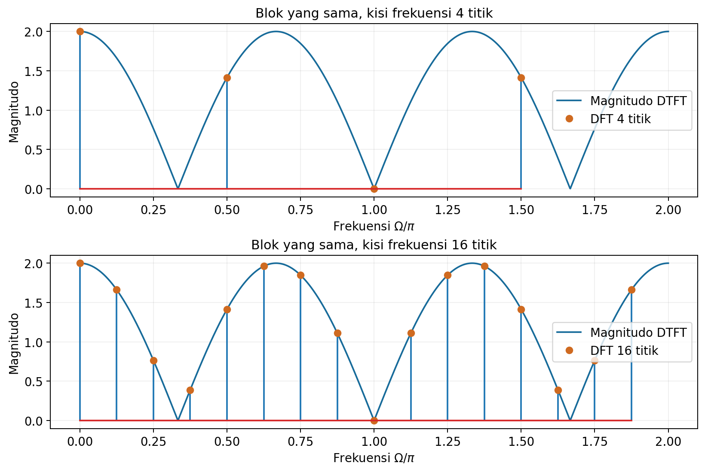
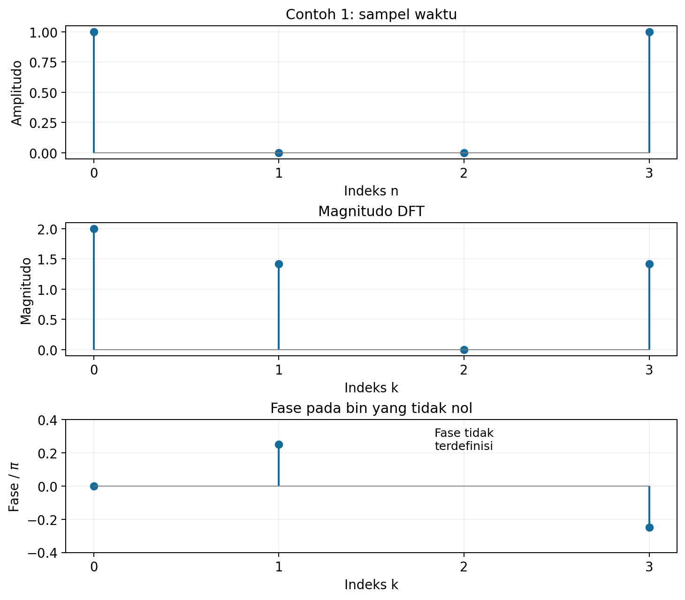
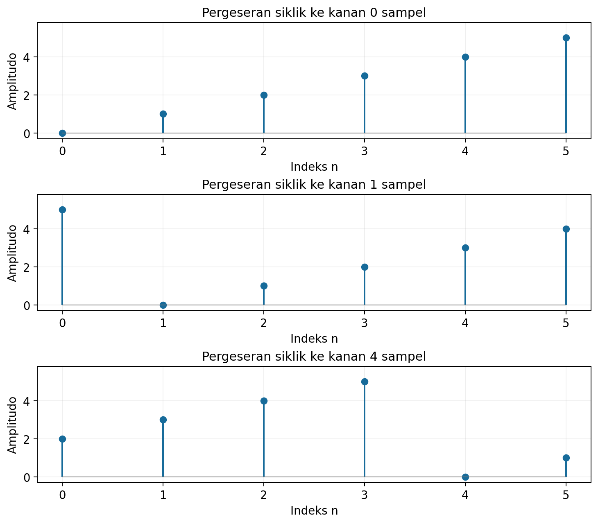
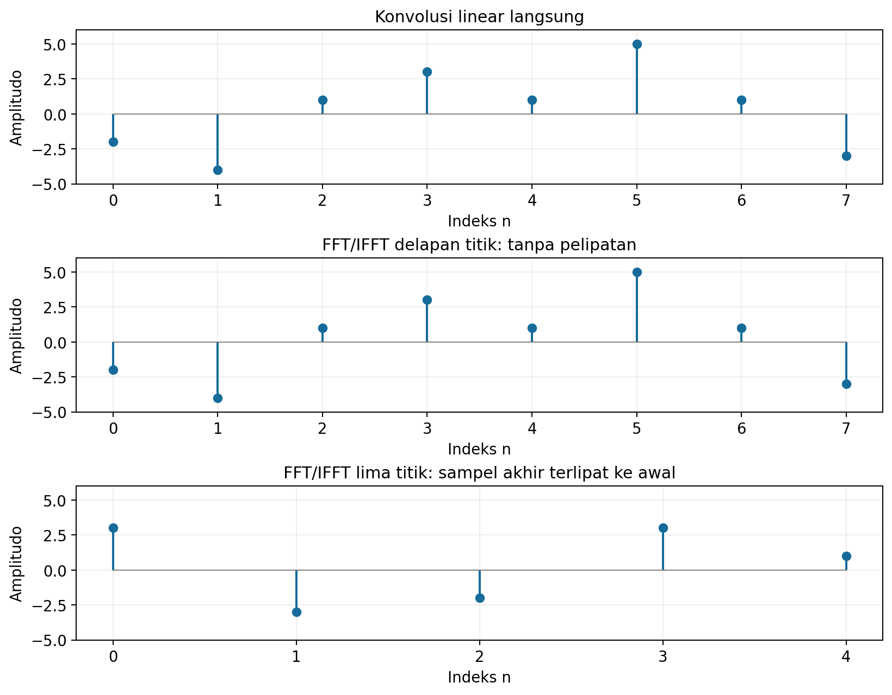
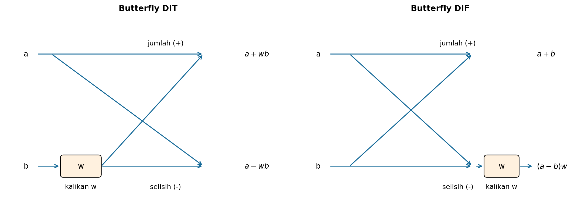
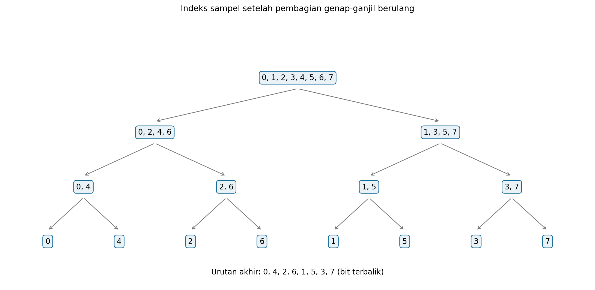
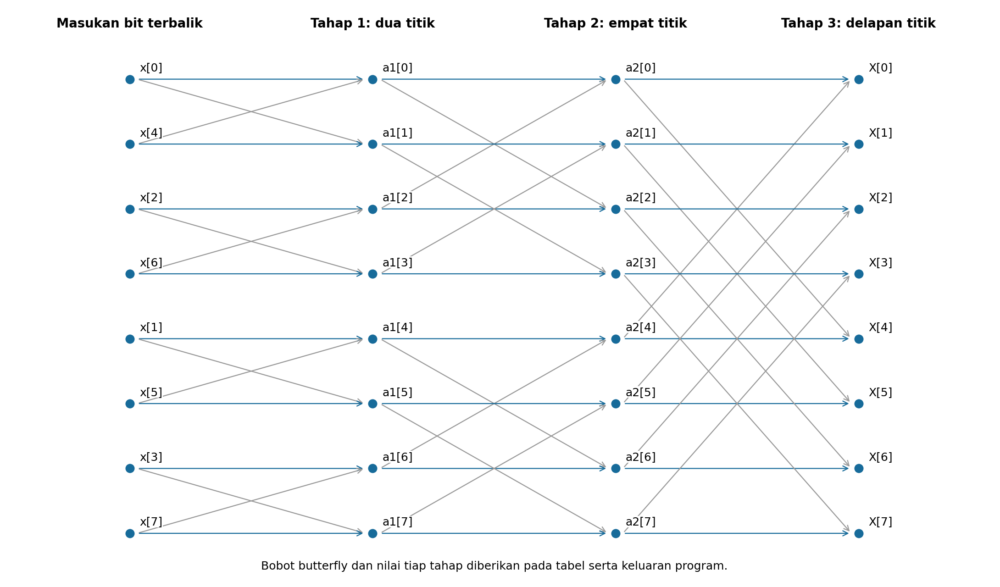
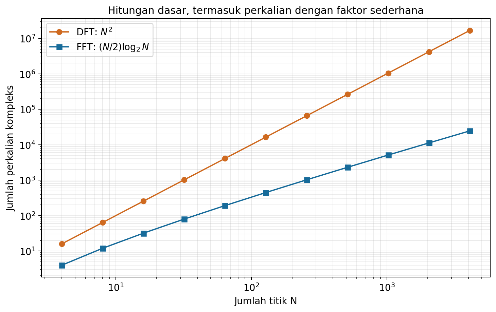
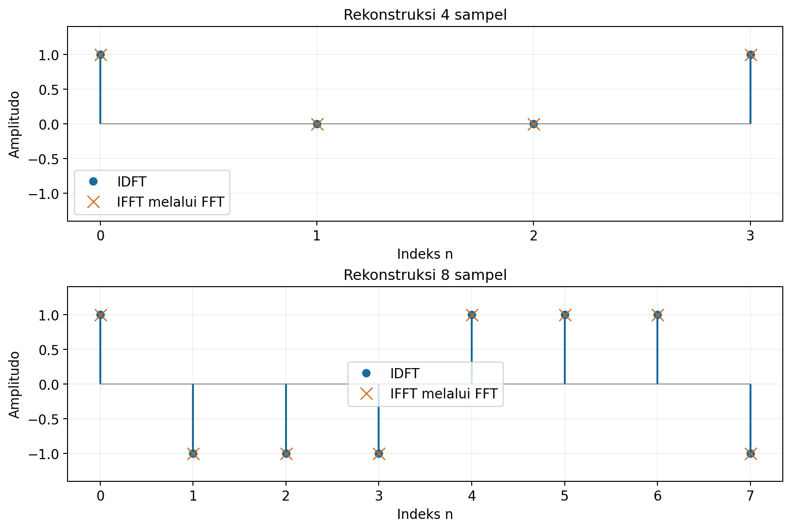
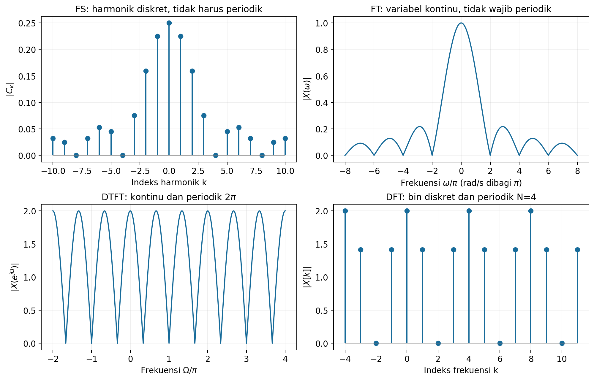

# Kuliah 5: DFT, FFT, Invers DFT/FFT, dan Sifat Representasi Fourier

Pada materi kuliah sebelumnya, kita menyatakan sinyal melalui FS, FT, dan DTFT. Kali ini, kita akan mempelajari cara menghitung representasi frekuensi dengan sejumlah data berhingga serta cara mempercepat perhitungannya.

Setelah mengikuti kuliah ini, mahasiswa diharapkan dapat melakukan hal-hal berikut.

- Menghubungkan DFT dengan sampel DTFT dan perluasan periodik suatu blok data.
- Menghitung DFT melalui penjumlahan dan perkalian matriks.
- Menerapkan pergeseran, simetri, serta konvolusi siklik pada DFT.
- Menghitung konvolusi linear dengan penambahan nol yang tepat.
- Menurunkan FFT radix-2 desimasi dalam waktu dan frekuensi.
- Membaca pembalikan bit dan operasi dasar *butterfly*.
- Menghitung IDFT dan memperoleh IFFT melalui FFT.
- Membedakan sifat domain waktu dan frekuensi pada FS, FT, DTFT, dan DFT.

---

## Konvensi notasi

Indeks $n$ menyatakan waktu diskret dan $k$ menyatakan indeks frekuensi DFT. Semua deret berhingga pada contoh dimulai pada $n=0$, kecuali dinyatakan lain, dan bernilai nol di luar bloknya ketika dibaca sebagai sinyal berhingga.

| Simbol | Makna |
|---|---|
| $N$ | Banyak titik DFT. |
| $j$ | Bilangan imajiner, $j^2=-1$. |
| $W_N=e^{-j2\pi/N}$ | Faktor dasar eksponensial DFT. |
| $(a)_N$ | Sisa pembagian $a$ oleh $N$, dipilih dalam $0,\ldots,N-1$. |
| $\Omega$ | Frekuensi sudut diskret dalam rad/sampel. |
| $\omega$ | Frekuensi sudut kontinu dalam rad/s. |
| $x^{\ast}[n]$ | Konjugat kompleks $x[n]$. |
| $\ast$ dan $\circledast_N$ | Konvolusi linear dan konvolusi siklik sepanjang $N$. |

Transformasi maju menggunakan eksponen negatif dan tidak diberi faktor $1/N$. Transformasi balik menggunakan eksponen positif dengan faktor $1/N$, sesuai konvensi buku dan nilai baku `numpy.fft`.

---

## Discrete Fourier Transform

### DFT sebagai sampel DTFT

Ambil blok $x[0],x[1],\ldots,x[N-1]$ dan baca dahulu sebagai sinyal berhingga. DTFT-nya adalah fungsi kontinu dari frekuensi:

$$
X(e^{j\Omega})=\sum_{n=0}^{N-1}x[n]e^{-j\Omega n}.
$$

Pilih $N$ frekuensi yang berjarak sama dalam satu periode spektrum, yaitu $\Omega_k=2\pi k/N$. Substitusi frekuensi tersebut memberikan definisi DFT:

$$
\boxed{X[k]=\sum_{n=0}^{N-1}x[n]e^{-j2\pi kn/N}
=\sum_{n=0}^{N-1}x[n]W_N^{kn}},
\qquad k=0,1,\ldots,N-1.
$$

Jadi, $X[k]=X(e^{j\Omega_k})$ untuk blok berhingga yang sama. DFT mempunyai $N$ nilai kompleks, sedangkan DTFT tetap berupa fungsi kontinu dan periodik terhadap $\Omega$.



Garis kontinu pada gambar adalah DTFT blok $\{1,0,0,1\}$. Titik-titik menunjukkan DFT empat titik dan DFT enam belas titik setelah penambahan nol, yang semuanya terletak pada DTFT blok semula.

### Pembacaan sebagai satu periode

Blok yang sama juga dapat dibaca sebagai satu periode dari barisan periodik 
```math
\tilde{x}[n] = x[(n)_N]. 
```
Pembacaan ini menjelaskan penggunaan indeks modulo dan konvolusi siklik dalam DFT, tanpa mengharuskan sinyal pengukuran semula benar-benar periodik.

Untuk barisan periodik tersebut, koefisien DTFS dengan normalisasi analisis $1/N$ adalah $c[k]=X[k]/N$. Maka sintesis satu periodenya memberikan pasangan invers:

$$
\boxed{x[n]=\frac1N\sum_{k=0}^{N-1}X[k]e^{j2\pi kn/N}
=\frac1N\sum_{k=0}^{N-1}X[k]W_N^{-kn}},
\qquad n=0,1,\ldots,N-1.
$$

Jika rumus DFT dan invers tersebut diperluas ke indeks bulat, keduanya mengulang dengan periode $N$. Sebagai contoh, $W_N^{(k+N)n}=W_N^{kn}e^{-j2\pi n}=W_N^{kn}$, sehingga $X[k+N]=X[k]$.

### Penambahan nol dan kisi frekuensi

Jika ada $M$ sampel dan kita memilih $N\geq M$, tambahkan $N-M$ nol di akhir blok sebelum menghitung DFT. Untuk data $\{1,3,5,7\}$, DFT delapan titik menggunakan blok $\{1,3,5,7,0,0,0,0\}$.

Penambahan nol, atau *zero padding*, membuat kisi frekuensi lebih rapat karena $\Delta\Omega=2\pi/N$. Operasi ini tidak menambah data pengukuran dan tidak mempersempit lobus spektrum yang ditentukan oleh panjang pengamatan; manfaatnya adalah mengambil lebih banyak sampel dari DTFT blok yang sama.

Jika frekuensi sampling diketahui, jarak 'bin' (selang atau interval tertentu) dalam Hz adalah $\Delta f=f_s/N$. Untuk indeks $0 \leq k \leq \lfloor N/2 \rfloor$, frekuensinya adalah:
```math
f_k=\frac{kf_s}{N}.
```
Untuk indeks $\lfloor N/2 \rfloor < k < N$, frekuensinya dibaca sebagai frekuensi negatif:
```math
f_k=\frac{(k-N)f_s}{N}.
```

Untuk $N$ genap, bin $k=N/2$ dapat dilabeli $+f_s/2$ atau $-f_s/2$ karena keduanya ekuivalen setelah sampling. Fungsi `np.fft.fftfreq` menggunakan label negatif untuk bin tersebut.

### Contoh 1: DFT dari empat sampel

Tentukan DFT $x[n]=\{1,0,0,1\}$ dengan $N=4$. Karena hanya sampel ke-0 dan ke-3 yang tidak nol, jumlahnya menjadi dua suku:

$$
X[k]=1+e^{-j2\pi(3)k/4}=1+e^{-j3\pi k/2}.
$$

Gunakan nilai eksponensial pada kelipatan $\pi/2$, lalu hitung setiap indeks. Tidak ada faktor $1/4$ pada transformasi maju ini.

| $k$ | $e^{-j3\pi k/2}$ | $X[k]$ | $\lvert X[k]\rvert$ | Fase utama |
|:---:|:---:|:---:|:---:|:---:|
| 0 | 1 | 2 | 2 | 0 |
| 1 | $j$ | $1+j$ | $\sqrt2$ | $\pi/4$ |
| 2 | $-1$ | 0 | 0 | Tidak terdefinisi |
| 3 | $-j$ | $1-j$ | $\sqrt2$ | $-\pi/4$ |

Dengan demikian, $X[k]=\{2,1+j,0,1-j\}$. 

Untuk $z=a+jb$, magnitudo adalah $\sqrt{a^2+b^2}$ dan fase dihitung menggunakan $\text{atan2}(b,a)$. Bentuk $\arctan(b/a)$ saja tidak selalu memilih kuadran yang benar, dan fase tidak terdefinisi apabila magnitudo nol.



Program [`02_dft_empat.py`](../Kode/pertemuan-05/02_dft_empat.py) memeriksa DFT langsung dan hasil NumPy. Demo singkatnya ditunjukkan berikut, dengan fase pada bin nol dikeluarkan dari penafsiran.

```python
import numpy as np

x = np.array([1, 0, 0, 1], dtype=complex)
X = np.fft.fft(x)
fase = np.angle(X)
fase[np.abs(X) < 1e-12] = np.nan
print(np.round(X, 6))
print(fase)
```

### DFT dalam bentuk matriks

Definisikan vektor kolom $\mathbf{x}$ dan $\mathbf{X}$ dari sampel waktu dan frekuensi. Dengan elemen matriks $`[\mathbf{D}_N]_{k,n}=W_N^{kn}`$, definisi DFT dapat ditulis sebagai berikut.

$$
\mathbf{X}=\mathbf{D}_N\mathbf{x},\qquad
\mathbf{D}_N=
\begin{bmatrix}
1&1&\cdots&1\\
1&W_N&\cdots&W_N^{N-1}\\
\vdots&\vdots&\ddots&\vdots\\
1&W_N^{N-1}&\cdots&W_N^{(N-1)^2}
\end{bmatrix}.
$$

Matriks ini adalah matriks Vandermonde dengan titik-titik pada lingkaran satuan. Barisnya saling ortogonal dalam perkalian dengan konjugat, sehingga inversnya memenuhi:

$$
\mathbf{D}_N^{-1}=\frac1N\mathbf{D}_N^H,
\qquad \mathbf{D}_N^H\mathbf{D}_N=N\mathbf{I}.
$$

Superskrip $H$ berarti transpose-konjugat. Karena matriks DFT simetris, transpose-konjugatnya juga sama dengan konjugat elemen demi elemen; penulisan $H$ tetap membantu menunjukkan operasi invers matriks dengan jelas.

### Contoh 2: perhitungan matriks empat titik

Ambil $x[n]=\{0,1,2,3\}$ dengan $W_4=-j$. Pangkat-pangkatnya adalah $1,-j,-1,j$, kemudian berulang, sehingga matriks dan hasil perkaliannya menjadi:

```math
\mathbf{X}=
\begin{bmatrix}
1&1&1&1\\
1&-j&-1&j\\
1&-1&1&-1\\
1&j&-1&-j
\end{bmatrix}
\begin{bmatrix}
0\\
1\\
2\\
3
\end{bmatrix}.
```

Setiap baris memberikan satu nilai DFT. Perhitungan lengkapnya adalah:

$$
\begin{aligned}
X[0]&=0+1+2+3=6,\\
X[1]&=0-j-2+3j=-2+2j,\\
X[2]&=0-1+2-3=-2,\\
X[3]&=0+j-2-3j=-2-2j.
\end{aligned}
$$

Jadi, $\mathbf{X}=[6,-2+2j,-2,-2-2j]^T$. Potongan program berikut membentuk matriks dari rumusnya, sehingga tidak perlu menulis setiap elemen secara manual.

```python
import numpy as np

x = np.array([0, 1, 2, 3], dtype=complex)
N = len(x)
k = np.arange(N)[:, None]
n = np.arange(N)[None, :]
D = np.exp(-2j*np.pi*k*n/N)
X = D @ x
print(np.round(X, 6))
```

### Pergeseran siklik

Pergeseran linear dapat memindahkan sampel keluar dari blok, sedangkan pergeseran siklik mengembalikannya melalui indeks modulo. Untuk penundaan $n_0$ dalam blok sepanjang $N$, definisinya adalah:

$$
x_s[n]=x[(n-n_0)_N],\qquad 0\leq n<N.
$$

Sebagai contoh, $(-1)_6=5$, sehingga sampel terakhir menjadi sampel pertama ketika suatu blok enam titik digeser satu sampel ke kanan. Pergeseran kanan satu sampel juga sama dengan pergeseran kiri lima sampel.

### Contoh 3: menggeser blok enam sampel

Ambil $x[n]=\{0,1,2,3,4,5\}$ dan $N=6$. Gunakan modulo untuk membaca setiap indeks, sehingga diperoleh hasil berikut.

| Operasi | Hasil pada $n=0,\ldots,5$ |
|---|---|
| Blok semula | $\{0,1,2,3,4,5\}$ |
| $x[(n-1)_6]$ | $\{5,0,1,2,3,4\}$ |
| $x[(n-4)_6]$ | $\{2,3,4,5,0,1\}$ |

Misalnya, nilai pertama pada pergeseran kanan empat adalah $x[(-4)_6]=x[2]=2$. Seluruh nilai tetap berada dalam blok dan tidak ada sampel yang hilang.



Dalam Python, `np.roll(x, n0)` melakukan pergeseran siklik ke kanan sebanyak `n0`. Program [`03_pergeseran_siklik.py`](../Kode/pertemuan-05/03_pergeseran_siklik.py) juga memeriksa perubahan fase spektrumnya.

### Sifat umum DFT

Misalkan $x[n]\leftrightarrow X[k]$ dan $h[n]\leftrightarrow H[k]$ adalah pasangan DFT sepanjang $N$ yang sama. Semua indeks pada operasi siklik dibaca modulo $N$ dan $n_0,k_0$ adalah bilangan bulat.

| Sifat | Domain waktu | DFT |
|---|---|---|
| Linearitas | $\alpha x[n]+\beta h[n]$ | $\alpha X[k]+\beta H[k]$ |
| Pergeseran waktu siklik | $x[(n-n_0)_N]$ | $W_N^{kn_0}X[k]$ |
| Pergeseran frekuensi siklik | $W_N^{-k_0n}x[n]$ | $X[(k-k_0)_N]$ |
| Dualitas | Blok $X[n]$ | $Nx[(-k)_N]$ |
| Konvolusi siklik | $x[n]\circledast_N h[n]$ | $X[k]H[k]$ |
| Perkalian waktu | $x[n]h[n]$ | $\frac1N\sum_{m=0}^{N-1}X[m]H[(k-m)_N]$ |

**Penurunan pergeseran waktu:** ganti indeks dengan $m=(n-n_0)_N$. Indeks $m$ tetap melintasi seluruh blok satu kali, dan eksponensial tidak berubah apabila indeks ditambah kelipatan $N$, sehingga:

$$
\begin{aligned}
X_s[k]
&=\sum_{n=0}^{N-1}x[(n-n_0)_N]W_N^{kn}\\
&=\sum_{m=0}^{N-1}x[m]W_N^{k(m+n_0)}\\
&=W_N^{kn_0}X[k].
\end{aligned}
$$

Karena $|W_N^{kn_0}|=1$, pergeseran siklik mempertahankan magnitudo. Fasenya berubah sebesar $-2\pi kn_0/N$ modulo $2\pi$ pada bin yang tidak nol.

Untuk pergeseran frekuensi, perkalian $W_N^{-k_0n}$ mengubah $W_N^{kn}$ menjadi $W_N^{(k-k_0)n}$. Untuk dualitas, gunakan invers DFT dengan indeks waktu $(-k)_N$: penjumlahan yang sama tanpa faktor $1/N$ adalah DFT dari blok $X[n]$.

### Sifat simetri DFT kompleks

Konjugasi mengubah tanda eksponen, sehingga konjugasi pada waktu berhubungan dengan pembalikan indeks dan konjugasi pada frekuensi. Definisikan bagian konjugat-simetri dan konjugat-antisimetri periodik sebagai:

$$
x_{\text{cs}}[n]=\frac{x[n]+x^{\ast}[(-n)_N]}2,
\qquad
x_{\text{ca}}[n]=\frac{x[n]-x^{\ast}[(-n)_N]}2.
$$

Keduanya memenuhi $x=x_{\text{cs}}+x_{\text{ca}}$. Sifat-sifat berikut merangkum hubungan bagian real dan imajiner dengan kedua jenis simetri tersebut.

| Domain waktu | DFT |
|---|---|
| $x^{\ast}[n]$ | $X^{\ast}[(-k)_N]$ |
| $x^{\ast}[(-n)_N]$ | $X^{\ast}[k]$ |
| $\text{Re}\{x[n]\}$ | $\frac12\{X[k]+X^{\ast}[(-k)_N]\}$ |
| $j\text{Im}\{x[n]\}$ | $\frac12\{X[k]-X^{\ast}[(-k)_N]\}$ |
| $x_{\text{cs}}[n]$ | $\text{Re}\{X[k]\}$ |
| $x_{\text{ca}}[n]$ | $j\text{Im}\{X[k]\}$ |

Sebagai contoh pembuktian baris pertama, konjugat dari $X[(-k)_N]$ adalah $\sum_n x^{\ast}[n]W_N^{kn}$, tepat DFT $x^{\ast}[n]$. Baris lainnya diperoleh dengan pembalikan indeks dan linearitas.

### Sifat simetri untuk sinyal real

Jika $x[n]$ real, $x^{\ast}[n]=x[n]$, sehingga $X[k]=X^{\ast}[(-k)_N]$. Akibatnya, separuh spektrum menentukan separuh lainnya melalui konjugasi.

| Besaran | Hubungan simetri |
|---|---|
| Bagian real | $\text{Re}\{X[k]\}=\text{Re}\{X[(-k)_N]\}$ |
| Bagian imajiner | $\text{Im}\{X[k]\}=-\text{Im}\{X[(-k)_N]\}$ |
| Magnitudo | $\lvert X[k]\rvert=\lvert X[(-k)_N]\rvert$ |
| Fase | $\angle X[k]=-\angle X[(-k)_N]$ modulo $2\pi$, jika keduanya tidak nol. |

Pada sinyal real, bagian genap siklik $x_e[n]=(x[n]+x[(-n)_N])/2$ mempunyai DFT $\text{Re}\{X[k]\}$. Bagian ganjil siklik $x_o[n]=(x[n]-x[(-n)_N])/2$ mempunyai DFT $j\text{Im}\{X[k]\}$.

Bin DC selalu real, dan untuk $N$ genap bin $N/2$ juga real karena masing-masing berpasangan dengan dirinya sendiri. Pada Contoh 1, $X[3]=X^{\ast}[1]$ dan $X[0],X[2]$ real, sesuai hubungan ini.

### Konvolusi siklik melalui DFT

Definisi konvolusi siklik adalah penjumlahan sepanjang satu blok dengan indeks kedua dibaca modulo $N$. Bentuknya berbeda dari konvolusi linear yang hasilnya dapat lebih panjang daripada masing-masing masukan.

$$
y_c[n]=\sum_{m=0}^{N-1}x[m]h[(n-m)_N].
$$

Ambil DFT kedua sisi dan tukarkan dua jumlah berhingga. Dengan $r=(n-m)_N$, kita memperoleh penurunan berikut.

$$
\begin{aligned}
Y_c[k]
&=\sum_{n=0}^{N-1}\sum_{m=0}^{N-1}x[m]h[(n-m)_N]W_N^{kn}\\
&=\sum_{m=0}^{N-1}x[m]\sum_{r=0}^{N-1}h[r]W_N^{k(r+m)}\\
&=\left(\sum_{m=0}^{N-1}x[m]W_N^{km}\right)
\left(\sum_{r=0}^{N-1}h[r]W_N^{kr}\right)\\
&=X[k]H[k].
\end{aligned}
$$

Jadi, IDFT dari $X[k]H[k]$ menghasilkan konvolusi siklik sepanjang $N$. Untuk memperoleh konvolusi linear, panjang transformasi harus dipilih agar tidak ada sampel hasil yang terlipat.

### Konvolusi linear melalui penambahan nol

Jika panjang masukan adalah $L_x$ dan $L_h$, hasil konvolusi linear memiliki paling banyak $L_x+L_h-1$ sampel. Pilih panjang transformasi $P\geq L_x+L_h-1$ dan tambahkan nol pada kedua masukan sampai panjangnya sama-sama $P$.

Langkah perhitungannya berurutan sebagai berikut. Panjang $P$ boleh tepat pada batas tersebut atau lebih besar, misalnya agar cocok dengan FFT radix-2.

1. Tambahkan nol pada $x[n]$ dan $h[n]$ sampai panjang $P$.
2. Hitung $X_P[k]$ dan $H_P[k]$ dengan DFT $P$ titik.
3. Kalikan per bin: $Y_P[k]=X_P[k]H_P[k]$.
4. Lakukan IDFT $P$ titik, lalu ambil $L_x+L_h-1$ sampel pertama.

Untuk kedua sinyal yang dimulai pada nol, konvolusi linear aktif paling jauh sampai indeks $L_x+L_h-2<P$. Karena hasilnya muat di dalam satu blok, konvolusi siklik sepanjang $P$ tidak melipat sampel ke awal dan sama dengan konvolusi linear pada rentang tersebut.

### Contoh 4: konvolusi linear delapan titik

Ambil $x[n]=\{-2,0,1,-1,3\}$ dan $h[n]=\{1,2,0,-1\}$. Panjang hasilnya $5+4-1=8$, sehingga gunakan $P=8$ dan blok berikut.

$$
x_P=\{-2,0,1,-1,3,0,0,0\},\qquad
h_P=\{1,2,0,-1,0,0,0,0\}.
$$

Hitung DFT, kemudian kalikan pasangan bin. Tabel berikut menggunakan empat angka di belakang koma; transformasi balik sebaiknya menggunakan nilai sebelum pembulatan.

| $k$ | $X_P[k]$ | $H_P[k]$ | $Y_P[k]$ |
|:---:|---|---|---|
| 0 | $1$ | $2$ | $2$ |
| 1 | $-4.2929-0.2929j$ | $3.1213-0.7071j$ | $-13.6066+2.1213j$ |
| 2 | $-j$ | $1-3j$ | $-3-j$ |
| 3 | $-5.7071+1.7071j$ | $-1.1213-0.7071j$ | $7.6066+2.1213j$ |
| 4 | $3$ | $0$ | $0$ |
| 5 | $-5.7071-1.7071j$ | $-1.1213+0.7071j$ | $7.6066-2.1213j$ |
| 6 | $j$ | $1+3j$ | $-3+j$ |
| 7 | $-4.2929+0.2929j$ | $3.1213+0.7071j$ | $-13.6066-2.1213j$ |

IDFT memberikan $y[n]=\{-2,-4,1,3,1,5,1,-3\}$. Hasil ini dapat diperiksa tanpa transformasi dengan $y[n]=x[n]+2x[n-1]-x[n-3]$:

| $n$ | $x[n]$ | $2x[n-1]$ | $-x[n-3]$ | $y[n]$ |
|:---:|:---:|:---:|:---:|:---:|
| 0 | $-2$ | 0 | 0 | $-2$ |
| 1 | 0 | $-4$ | 0 | $-4$ |
| 2 | 1 | 0 | 0 | 1 |
| 3 | $-1$ | 2 | 2 | 3 |
| 4 | 3 | $-2$ | 0 | 1 |
| 5 | 0 | 6 | $-1$ | 5 |
| 6 | 0 | 0 | 1 | 1 |
| 7 | 0 | 0 | $-3$ | $-3$ |

Jika hanya digunakan DFT lima titik, hasilnya terlipat menjadi $\{3,-3,-2,3,1\}$, karena sampel ke-5, ke-6, dan ke-7 dijumlahkan ke indeks 0, 1, dan 2. Ini menunjukkan alasan penambahan nol diperlukan.



Demo berikut memeriksa kesamaan dua cara menghitung konvolusi. Program lengkap dan gambar tersedia pada [`04_konvolusi.py`](../Kode/pertemuan-05/04_konvolusi.py).

```python
import numpy as np

x = np.array([-2, 0, 1, -1, 3])
h = np.array([1, 2, 0, -1])
P = len(x) + len(h) - 1
y = np.fft.ifft(np.fft.fft(x, P)*np.fft.fft(h, P))
assert np.allclose(y, np.convolve(x, h))
print(np.round(y.real, 6))
```

### Contoh 5: konvolusi siklik empat titik

Gunakan blok $x=\{1,2,3,0\}$ dan $h=\{2,1,0,0\}$. DFT empat titik dan hasil perkaliannya adalah:

$$
X=\{6,-2-2j,2,-2+2j\},\qquad
H=\{3,2-j,1,2+j\},
$$

$$
Y_c=\{18,-6-2j,2,-6+2j\}.
$$

Misalnya, $(-2-2j)(2-j)=-6-2j$. Dengan IDFT, hasilnya $y_c=\{2,5,8,3\}$, yang dapat diperiksa melalui $y_c[n]=2x[n]+x[(n-1)_4]$.

Pada contoh ini, panjang konvolusi linear dari bagian tidak nol juga empat, sehingga hasil linear dan siklik kebetulan sama. Kesamaan ini tidak berlaku untuk setiap pasangan deret.

---

## Fast Fourier Transform

### Mengapa diperlukan algoritma cepat?

DFT langsung menghitung $N$ keluaran, masing-masing melalui $N$ perkalian dan $N-1$ penjumlahan kompleks. Dengan menghitung semua perkalian termasuk faktor 1, jumlah operasinya adalah $N^2$ perkalian dan $N(N-1)$ penjumlahan.

FFT adalah algoritma untuk menghitung DFT yang sama dengan lebih sedikit operasi. Pada bagian ini, kita membahas **FFT radix-2**, sehingga $N=2^v$ untuk bilangan bulat $v\geq0$; FFT secara umum tidak terbatas pada panjang pangkat dua.

Gagasan dasarnya adalah membagi DFT besar menjadi DFT lebih kecil dan menggunakan kembali hasil antara. Kita mempelajari dua cara pembagian, yaitu desimasi dalam waktu (*decimation-in-time*, DIT) dan desimasi dalam frekuensi (*decimation-in-frequency*, DIF).

### Penurunan FFT desimasi dalam waktu

Pisahkan sampel waktu berindeks genap dan ganjil. Dengan $n=2r$ dan $n=2r+1$, masing-masing bagian berisi $N/2$ sampel:

$$
\begin{aligned}
X[k]
&=\sum_{r=0}^{N/2-1}x[2r]W_N^{2rk}
+\sum_{r=0}^{N/2-1}x[2r+1]W_N^{(2r+1)k}\\
&=\sum_{r=0}^{N/2-1}x[2r]W_N^{2rk}
+W_N^k\sum_{r=0}^{N/2-1}x[2r+1]W_N^{2rk}.
\end{aligned}
$$

Karena $W_N^2=e^{-j4\pi/N}=W_{N/2}$, kedua jumlah adalah DFT $N/2$ titik. Definisikan:

$$
E[k]=\sum_{r=0}^{N/2-1}x[2r]W_{N/2}^{rk},
\qquad
O[k]=\sum_{r=0}^{N/2-1}x[2r+1]W_{N/2}^{rk}.
$$

Maka $X[k]=E[k]+W_N^kO[k]$. Untuk memperoleh separuh keluaran lainnya, gunakan periodisitas $E[k+N/2]=E[k]$, $O[k+N/2]=O[k]$, dan identitas:

$$
W_N^{k+N/2}=W_N^k e^{-j\pi}=-W_N^k.
$$

Dengan demikian, untuk $k=0,\ldots,N/2-1$:

$$
\boxed{X[k]=E[k]+W_N^kO[k]},
\qquad
\boxed{X[k+N/2]=E[k]-W_N^kO[k]}.
$$

Satu hasil perkalian $W_N^kO[k]$ dipakai pada dua keluaran. Operasi yang membentuk pasangan jumlah dan selisih ini disebut *butterfly* atau operasi kupu-kupu.



Pada DIT, cabang kedua dikalikan faktor $w$ sebelum penjumlahan dan pengurangan: keluaran adalah $a+wb$ dan $a-wb$. Pada DIF yang dibahas sesudahnya, penjumlahan dan pengurangan dilakukan lebih dahulu, lalu cabang selisih dikalikan faktor $w$.

### Pembagian berulang dan pembalikan bit

Pembagian genap-ganjil diulangi sampai hanya tersisa DFT satu titik. Untuk $N=8$, terdapat $\log_2 8=3$ tahap, dan urutan sampel pada tingkat paling bawah adalah $0,4,2,6,1,5,3,7$.

Urutan ini dapat diperoleh dengan membalik susunan bit indeks. Gunakan tepat $v=\log_2N$ bit, termasuk nol di depan, lalu ubah hasil pembalikannya kembali ke bilangan desimal.

| Indeks | Biner tiga bit | Bit dibalik | Indeks hasil |
|:---:|:---:|:---:|:---:|
| 0 | 000 | 000 | 0 |
| 1 | 001 | 100 | 4 |
| 2 | 010 | 010 | 2 |
| 3 | 011 | 110 | 6 |
| 4 | 100 | 001 | 1 |
| 5 | 101 | 101 | 5 |
| 6 | 110 | 011 | 3 |
| 7 | 111 | 111 | 7 |

Untuk $N=16$, urutannya adalah $0,8,4,12,2,10,6,14,1,9,5,13,3,11,7,15$. Gambar berikut memperlihatkan bahwa urutan ini sama dengan membaca hasil pemisahan genap-ganjil secara berulang.



Pada bentuk DIT iteratif yang digunakan di sini, masukan ditata dalam urutan bit terbalik dan keluaran berakhir dalam urutan biasa. Implementasi rekursif dapat memisahkan genap-ganjil melalui pemanggilan fungsi, sehingga tidak memerlukan langkah pembalikan bit yang terlihat secara terpisah.

### Contoh 6: FFT delapan titik secara bertahap

Ambil $x=\{1,-1,-1,-1,1,1,1,-1\}$ dan $N=8$. Kita akan mengerjakan ketiga tahap butterfly, sehingga setiap hasil antara dapat diperiksa.

**Langkah 1: tata masukan dengan pembalikan bit.** Urutan indeks $0,4,2,6,1,5,3,7$ memberikan:

$$
a^{(0)}=\{1,1,-1,1,-1,1,-1,-1\}.
$$

**Langkah 2: kerjakan butterfly dua titik.** Faktor pada setiap pasangan adalah $W_2^0=1$, sehingga gunakan $(a+b,a-b)$:

$$
\begin{aligned}
(1,1)&\longrightarrow(2,0),\\
(-1,1)&\longrightarrow(0,-2),\\
(-1,1)&\longrightarrow(0,-2),\\
(-1,-1)&\longrightarrow(-2,0).
\end{aligned}
$$

Hasil tahap pertama adalah $a^{(1)}=\{2,0,0,-2,0,-2,-2,0\}$. Pasangan berikutnya dibentuk dalam masing-masing blok empat titik.

**Langkah 3: kerjakan butterfly empat titik.** Dalam setiap blok, pasangkan posisi 0 dengan 2 menggunakan $W_4^0=1$, dan posisi 1 dengan 3 menggunakan $W_4^1=-j$:

$$
\begin{aligned}
\{2,0,0,-2\}&\longrightarrow\{2,2j,2,-2j\},\\
\{0,-2,-2,0\}&\longrightarrow\{-2,-2,2,-2\}.
\end{aligned}
$$

Sebagai contoh, $0+(-j)(-2)=2j$ dan $0-(-j)(-2)=-2j$. Hasil tahap kedua adalah $a^{(2)}=\{2,2j,2,-2j,-2,-2,2,-2\}$.

**Langkah 4: kerjakan butterfly delapan titik.** Pasangkan posisi $k$ dan $k+4$, dengan faktor berikut:

$$
W_8^0=1,\quad W_8^1=\frac{1-j}{\sqrt2},\quad
W_8^2=-j,\quad W_8^3=-\frac{1+j}{\sqrt2}.
$$

Setiap pasangan menggunakan rumus $a+w b$ dan $a-w b$. Semua keluaran diperoleh melalui tabel berikut.

| $k$ | $a=a^{(2)}[k]$ | $b=a^{(2)}[k+4]$ | $w b$ | $X[k]$ | $X[k+4]$ |
|:---:|:---:|:---:|:---:|---|---|
| 0 | 2 | $-2$ | $-2$ | 0 | 4 |
| 1 | $2j$ | $-2$ | $-\sqrt2+j\sqrt2$ | $-\sqrt2+j(2+\sqrt2)$ | $\sqrt2+j(2-\sqrt2)$ |
| 2 | 2 | 2 | $-2j$ | $2-2j$ | $2+2j$ |
| 3 | $-2j$ | $-2$ | $\sqrt2+j\sqrt2$ | $\sqrt2+j(\sqrt2-2)$ | $-\sqrt2-j(2+\sqrt2)$ |

Tuliskan hasil dalam urutan $k=0,\ldots,7$, bukan urutan pasangan pada baris tabel. Secara numerik, hasilnya adalah:

```math
\begin{aligned}
X=\{&0,\ -1.4142+3.4142j,\ 2-2j,\ 1.4142-0.5858j,\\
&4,\ 1.4142+0.5858j,\ 2+2j,\ -1.4142-3.4142j\}.
\end{aligned}
```

Komponen DC adalah nol karena jumlah sampel masukan nol. Karena semua sampel real, pasangan $X[1],X[7]$, $X[2],X[6]$, dan $X[3],X[5]$ juga harus saling konjugat.



Gambar menunjukkan hubungan antarsampel pada tiap tahap, sedangkan bobot dan nilai lengkapnya diberikan dalam rumus serta tabel di atas. Program [`06_fft_contoh.py`](../Kode/pertemuan-05/06_fft_contoh.py) mencetak semua nilai antara dan membandingkan hasilnya dengan DFT langsung.

### Jumlah operasi FFT radix-2

Setiap tahap berisi $N/2$ butterfly dan terdapat $\log_2N$ tahap. Satu butterfly menggunakan satu perkalian kompleks dan dua penjumlahan/pengurangan kompleks, sehingga hitungan dasarnya adalah:

$$
M_{\text{FFT}}=\frac N2\log_2N,\qquad
A_{\text{FFT}}=N\log_2N.
$$

| $N$ | Perkalian DFT langsung | Penjumlahan DFT langsung | Perkalian FFT | Penjumlahan FFT |
|---:|---:|---:|---:|---:|
| 4 | 16 | 12 | 4 | 8 |
| 8 | 64 | 56 | 12 | 24 |
| 16 | 256 | 240 | 32 | 64 |
| 64 | 4096 | 4032 | 192 | 384 |
| 256 | 65536 | 65280 | 1024 | 2048 |
| 1024 | 1048576 | 1047552 | 5120 | 10240 |

Hitungan ini belum menghilangkan perkalian sederhana dengan $1,-1,j,-j$, dan bukan hitungan waktu eksekusi sebuah pustaka tertentu. Perbandingan tersebut menunjukkan perubahan pertumbuhan kerja dari $O(N^2)$ menjadi $O(N\log_2N)$.



### Penurunan FFT desimasi dalam frekuensi

Pada DIF, pisahkan separuh awal dan separuh akhir sampel, kemudian pisahkan keluaran frekuensi genap dan ganjil. Penurunan dimulai dengan mengubah indeks separuh akhir menjadi $n+N/2$:

$$
\begin{aligned}
X[k]
&=\sum_{n=0}^{N/2-1}x[n]W_N^{nk}
+\sum_{n=0}^{N/2-1}x[n+N/2]W_N^{(n+N/2)k}\\
&=\sum_{n=0}^{N/2-1}
\bigl(x[n]+(-1)^k x[n+N/2]\bigr)W_N^{nk}.
\end{aligned}
$$

Pada langkah terakhir digunakan $W_N^{(N/2)k}=e^{-j\pi k}=(-1)^k$. Untuk $k=2r$, tanda ini positif dan $W_N^{2nr}=W_{N/2}^{nr}$, sehingga:

$$
X[2r]=\sum_{n=0}^{N/2-1}
\bigl(x[n]+x[n+N/2]\bigr)W_{N/2}^{nr}.
$$

Untuk $k=2r+1$, tanda tersebut negatif dan $W_N^{n(2r+1)}=W_N^nW_{N/2}^{nr}$. Dengan demikian:

$$
X[2r+1]=\sum_{n=0}^{N/2-1}
\bigl(x[n]-x[n+N/2]\bigr)W_N^nW_{N/2}^{nr}.
$$

Definisikan dua deret sepanjang $N/2$ sebagai $a[n]=x[n]+x[n+N/2]$ dan $b[n]=(x[n]-x[n+N/2])W_N^n$. DFT $N/2$ titik dari $a$ memberikan $X[2r]$, sedangkan DFT dari $b$ memberikan $X[2r+1]$.

Inilah butterfly DIF: keluarannya $a+b$ dan $(a-b)w$ jika dua masukannya dinamai $a,b$. Faktor eksponensial pada cabang selisih wajib disertakan sebelum DFT lebih kecil pada cabang ganjil.

### Contoh 7: satu pembagian DIF empat titik

Gunakan lagi $x=\{0,1,2,3\}$. Pasangkan sampel 0 dengan 2 dan sampel 1 dengan 3, kemudian gunakan $W_4^0=1$ dan $W_4^1=-j$:

$$
a=\{0+2,1+3\}=\{2,4\},
$$

$$
b=\{(0-2)\cdot1,(1-3)(-j)\}=\{-2,2j\}.
$$

DFT dua titik dari $a$ adalah $\{6,-2\}$, yaitu $X[0],X[2]$. DFT dua titik dari $b$ adalah $\{-2+2j,-2-2j\}$, yaitu $X[1],X[3]$.

Menggabungkannya dalam urutan frekuensi biasa memberikan $\{6,-2+2j,-2,-2-2j\}$, sama dengan Contoh 2. Pada DIF iteratif yang bekerja di dalam satu larik, hasil sebelum penataan ulang adalah urutan bit terbalik, yaitu $X[0],X[2],X[1],X[3]$ untuk empat titik.

| Bentuk iteratif yang digunakan | Urutan masukan | Urutan keluaran sebelum penataan akhir | Butterfly |
|---|---|---|---|
| DIT | Bit terbalik | Biasa | $(a+wb,a-wb)$ |
| DIF | Biasa | Bit terbalik | $(a+b,(a-b)w)$ |

Urutan ini berlaku untuk bentuk algoritma yang dijelaskan, bukan syarat mutlak semua implementasi FFT. Demo [`07_fft_dif.py`](../Kode/pertemuan-05/07_fft_dif.py) mencetak keluaran mentah DIF dan hasil setelah pembalikan bit.

### Demo FFT dengan Python

Fungsi berikut menerapkan langsung pembagian DIT genap-ganjil. Fungsi ini ditujukan untuk pembelajaran dan hanya menerima panjang pangkat dua, sedangkan `np.fft.fft` dapat menghitung panjang umum.

```python
import numpy as np

def fft_dit(x):
    x = np.asarray(x, dtype=complex)
    N = len(x)
    if N == 0 or (N & (N-1)) != 0:
        raise ValueError("Panjang harus berupa pangkat dua positif.")
    if N == 1:
        return x.copy()
    E = fft_dit(x[::2])
    O = fft_dit(x[1::2])
    W = np.exp(-2j*np.pi*np.arange(N//2)/N)
    T = W*O
    return np.concatenate((E + T, E - T))

x = [1, -1, -1, -1, 1, 1, 1, -1]
X = fft_dit(x)
assert np.allclose(X, np.fft.fft(x))
print(np.round(X, 4))
```

Implementasi DFT langsung, DIT iteratif yang menyimpan hasil tiap tahap, DIF, dan invers tersedia pada [`fourier.py`](../Kode/pertemuan-05/fourier.py). Fungsi rekursif di atas juga disertakan agar penurunan matematis dapat dibandingkan dengan kode.

---

## Invers DFT dan invers FFT

### Mengapa IDFT mengembalikan sinyal?

Mulai dengan rumus IDFT, kemudian substitusikan definisi DFT dan tukarkan jumlah berhingga. Indeks $m$ digunakan pada sinyal asal agar tidak tertukar dengan indeks keluaran $n$.

$$
\begin{aligned}
\widehat{x}[n]
&=\frac1N\sum_{k=0}^{N-1}X[k]W_N^{-kn}\\
&=\frac1N\sum_{k=0}^{N-1}\sum_{m=0}^{N-1}
x[m]W_N^{km}W_N^{-kn}\\
&=\sum_{m=0}^{N-1}x[m]
\left(\frac1N\sum_{k=0}^{N-1}W_N^{k(m-n)}\right).
\end{aligned}
$$

Jika $m=n$, semua suku dalam kurung bernilai 1 sebelum dijumlahkan dan dibagi $N$. Jika $m\ne n$, tetapkan $q=W_N^{m-n}$, sehingga $q\ne1$ dan $q^N=1$:

$$
\sum_{k=0}^{N-1}q^k=\frac{1-q^N}{1-q}=0.
$$

Dengan demikian, jumlah dalam kurung adalah 1 ketika $m=n$ dan 0 untuk indeks lain pada blok. Hanya suku $x[n]$ yang tersisa, sehingga $\widehat{x}[n]=x[n]$; ini juga membuktikan ortogonalitas matriks DFT.

### Contoh 8: IDFT empat titik

Ambil hasil Contoh 1, $X=\{2,1+j,0,1-j\}$. Rumus inversnya hanya mempunyai tiga suku tak nol:

$$
x[n]=\frac14\left[2+(1+j)e^{j\pi n/2}
+(1-j)e^{j3\pi n/2}\right].
$$

Hitung untuk $n=0,1,2,3$ menggunakan pangkat $j$. Tabel berikut memperlihatkan hasil perkalian pada kedua suku kompleks agar perubahan tanda dapat diperiksa.

| $n$ | $(1+j)e^{j\pi n/2}$ | $(1-j)e^{j3\pi n/2}$ | $x[n]$ |
|:---:|:---:|:---:|:---:|
| 0 | $1+j$ | $1-j$ | $(2+1+j+1-j)/4=1$ |
| 1 | $-1+j$ | $-1-j$ | $(2-1+j-1-j)/4=0$ |
| 2 | $-1-j$ | $-1+j$ | $(2-1-j-1+j)/4=0$ |
| 3 | $1-j$ | $1+j$ | $(2+1-j+1+j)/4=1$ |

Hasilnya kembali $x=\{1,0,0,1\}$. Faktor $1/4$ harus digunakan agar amplitudo hasil rekonstruksi sama dengan masukan.

### IFFT melalui perubahan tanda eksponen

IDFT dapat dihitung menggunakan struktur FFT yang sama, dengan faktor $W_N^k$ diganti menjadi $W_N^{-k}$ dan hasil dibagi $N$. Faktor $1/N$ dapat diterapkan pada masukan atau pada keluaran karena semua operasi FFT linear.

Cara lain adalah menggunakan konjugasi, sehingga fungsi FFT maju dapat dipakai tanpa mengubah butterfly. Konjugat rumus IDFT memberikan:

$$
\begin{aligned}
x^{\ast}[n]
&=\frac1N\sum_{k=0}^{N-1}X^{\ast}[k]W_N^{kn}\\
&=\frac1N\text{DFT}\{X^{\ast}\}[n].
\end{aligned}
$$

Lakukan konjugasi kembali pada kedua sisi. Karena FFT menghitung DFT yang sama, diperoleh:

$$
\boxed{x[n]=\frac1N\left(\text{FFT}\{X^{\ast}\}[n]\right)^{\ast}.}
$$

Urutan operasinya adalah konjugasi masukan, FFT maju, konjugasi hasil, kemudian pembagian dengan $N$. Kedua konjugasi diperlukan, dan pembagian dengan $N$ dilakukan satu kali.

### Contoh 9: IFFT dengan FFT maju

Untuk $X=\{2,1+j,0,1-j\}$, konjugasinya adalah $X^{\ast}=\{2,1-j,0,1+j\}$. DFT atau FFT empat titik dari blok tersebut memberikan $\{4,0,0,4\}$, kemudian konjugasi hasil dan pembagian dengan 4 mengembalikan $\{1,0,0,1\}$.

Demo berikut membandingkan operasi tersebut dengan `np.fft.ifft`. Pada masukan yang berasal dari sinyal real, bagian imajiner rekonstruksi dapat sangat kecil akibat pembulatan, sehingga harus diperiksa sebelum hanya mengambil bagian real.

```python
import numpy as np

X = np.array([2, 1+1j, 0, 1-1j])
x_fft = np.conj(np.fft.fft(np.conj(X)))/len(X)
x_ifft = np.fft.ifft(X)
assert np.allclose(x_fft, x_ifft)
assert np.max(np.abs(x_ifft.imag)) < 1e-12
print(np.round(x_ifft.real, 6))
```



Program [`08_invers.py`](../Kode/pertemuan-05/08_invers.py) juga mengembalikan sinyal delapan titik pada Contoh 6. Untuk spektrum kompleks sembarang, hasil invers tidak harus real dan bagian imajinernya tidak boleh langsung dibuang.

---

## Rangkuman sifat representasi Fourier

### Hubungan diskret, kontinu, dan periodik

Representasi Fourier dipilih berdasarkan jenis variabel waktu dan struktur sinyal. Tabel berikut menggabungkan materi pertemuan keempat dengan DFT pada pertemuan ini.

| Representasi | Domain waktu yang digunakan | Variabel frekuensi | Periodisitas dalam frekuensi |
|---|---|---|---|
| FS waktu kontinu | Sinyal kontinu periodik, periode $T_0$ | Harmonik diskret $k\omega_0$ | Koefisien tidak harus periodik terhadap $k$. |
| FT | Sinyal waktu kontinu; bentuk biasa terutama untuk sinyal aperiodik yang memenuhi syarat transformasi | Kontinu, $\omega\in\mathbb{R}$ | Tidak diwajibkan periodik. |
| DTFT | Sinyal waktu diskret; bentuk biasa terutama untuk barisan aperiodik yang memenuhi syarat transformasi | Kontinu, $\Omega$ | Selalu mengulang setelah $2\pi$. |
| DTFS | Barisan waktu diskret periodik, periode $N$ | Harmonik diskret $k$ | Koefisien mengulang setelah $N$. |
| DFT | Blok $N$ sampel, dapat diperluas secara periodik | $N$ bin berbeda | Indeks frekuensi yang diperluas mengulang setelah $N$. |

Buku mengelompokkan DFT dan DTFS dalam pembahasan representasi sinyal diskret periodik. Di sini keduanya dipisahkan pada tabel agar normalisasi $X[k]=Nc[k]$ dan penggunaan DFT pada blok data berhingga tetap jelas.



Panel FS dan FT menggunakan pulsa dengan lebar satu, sedangkan panel DTFT dan DFT menggunakan blok $\{1,0,0,1\}$. Grafik menunjukkan perbedaan variabel frekuensi; tinggi pada panel yang berbeda menggunakan normalisasi masing-masing dan tidak harus sama.

### Dua hubungan yang perlu diingat

**Waktu diskret menghasilkan periodisitas frekuensi.** Penyebabnya adalah $e^{-j(\Omega+2\pi)n}=e^{-j\Omega n}$ untuk setiap indeks bulat $n$, sehingga DTFT mengulang setelah $2\pi$ dan sampel DFT-nya mengulang setelah $N$ indeks.

**Periodisitas waktu menghasilkan harmonik frekuensi diskret.** Untuk sinyal kontinu periodik, harmoniknya berada pada $k\omega_0$; untuk barisan periodik, harmoniknya pada $2\pi k/N$ dan hanya ada $N$ harmonik berbeda.

Sinyal waktu kontinu tidak diwajibkan memiliki spektrum periodik, tetapi kata “kontinu” saja tidak membuktikan spektrum pasti nonperiodik. Sebagai contoh khusus, impuls waktu kontinu mempunyai FT konstan, dan konstanta dapat mengulang untuk setiap pergeseran frekuensi.

Demikian pula, spektrum garis sinyal periodik dapat ditulis sebagai FT atau DTFT yang memuat impuls dalam pengertian distribusi. Pernyataan bahwa FT/DTFT mempunyai variabel frekuensi kontinu tidak berarti semua sinyal menghasilkan kurva spektrum yang mulus tanpa impuls.

### Normalisasi dan operasi yang berbeda

Konvensi transformasi memengaruhi faktor pengali, sehingga faktor pada FS/DTFS tidak boleh dipindahkan langsung ke DFT. Tabel berikut merangkum hubungan yang paling sering digunakan.

| Operasi atau besaran | FS/FT/DTFT | DFT sepanjang $N$ |
|---|---|---|
| Komponen rata-rata | Koefisien indeks nol FS/DTFS adalah rata-rata dengan normalisasi analisis $1/T_0$ atau $1/N$. | Rata-rata blok adalah $X[0]/N$. |
| Konvolusi waktu | FT/DTFT: konvolusi linear menjadi perkalian transformasi. | Konvolusi siklik menjadi perkalian; linear membutuhkan penambahan nol. |
| Penundaan waktu | FT: $e^{-j\omega t_0}$; DTFT: $e^{-j\Omega n_0}$. | Pergeseran siklik: $W_N^{kn_0}$. |
| Perkalian waktu | FT/DTFT: konvolusi frekuensi dengan faktor $1/(2\pi)$; pada DTFT integral cukup satu periode. | Konvolusi siklik frekuensi dengan faktor $1/N$. |
| Invers | FS: jumlah harmonik; FT/DTFT: integral dengan faktor $1/(2\pi)$. | Jumlah $N$ bin dengan faktor $1/N$. |

Sebagai pemeriksaan amplitudo, Parseval DFT dengan konvensi ini adalah $\sum_{n=0}^{N-1}|x[n]|^2=(1/N)\sum_{k=0}^{N-1}|X[k]|^2$. Pada Contoh 1, kedua sisi bernilai $2$, karena jumlah kuadrat magnitudo spektrumnya $4+2+0+2=8$ dan $8/4=2$.

Program [`09_verifikasi.py`](../Kode/pertemuan-05/09_verifikasi.py) memeriksa sifat umum, simetri kompleks dan real, Parseval, serta kesamaan DFT langsung dengan FFT. Program [`10_representasi.py`](../Kode/pertemuan-05/10_representasi.py) menghasilkan ilustrasi perbandingan representasi Fourier.

---

## Cek pemahaman

Gunakan tiga pertanyaan ini pada akhir kuliah, masing-masing dengan satu alasan atau contoh. Jawabannya menghubungkan definisi transformasi dengan cara menghitungnya.

- Apakah FFT menghitung transformasi yang berbeda dari DFT? Mengapa hasil keduanya harus sama?
- Mengapa IDFT dari hasil kali dua DFT bisa berbeda dari konvolusi linear?
- Jika empat sampel ditambah nol menjadi enam belas, informasi apa yang bertambah dan apa yang tetap?

---

## Latihan hitungan tangan

### 1. DFT empat titik

Diberikan $x[n]=\{0,1,1,0\}$. Hitung keempat nilai DFT, magnitudo dan fase pada bin yang tidak nol, lalu periksa hubungan konjugat untuk sinyal real.

### 2. Matriks DFT

Bentuk matriks DFT empat titik dan gunakan untuk menghitung DFT $x[n]=\{1,2,1,0\}$. Tentukan jumlah sampel, rata-rata blok, dan energi blok menggunakan hasil DFT.

### 3. DFT sebagai sampel DTFT

Untuk $x[n]=\{1,1\}$, turunkan DTFT dan hitung DFT dua titik. Tambahkan nol sehingga panjangnya empat, hitung DFT empat titik, lalu tunjukkan bahwa keempat nilai merupakan sampel DTFT semula pada $\Omega=0,\pi/2,\pi,3\pi/2$.

### 4. Pergeseran waktu dan frekuensi siklik

Ambil $x=\{1,2,3,4\}$ dengan DFT $X$. Tuliskan $y[n]=x[(n-1)_4]$ dan $z[n]=e^{j\pi n/2}x[n]$, lalu tentukan DFT keduanya dari sifat pergeseran; hitung $X$ seperlunya untuk memberikan hasil numerik.

### 5. Konvolusi siklik

Hitung konvolusi siklik empat titik dari $x=\{1,2,0,1\}$ dan $h=\{1,-1,0,0\}$ secara langsung. Periksa menggunakan perkalian DFT dan jelaskan mengapa hasilnya berbeda dari konvolusi linear kedua blok tersebut.

### 6. Konvolusi linear dengan DFT

Untuk $x=\{1,2,3\}$ dan $h=\{1,1,1\}$, tentukan panjang DFT minimum dan hitung keluaran linear secara manual. Jika justru dipakai DFT empat titik, tentukan hasil konvolusi sikliknya melalui pelipatan keluaran linear.

### 7. FFT DIT delapan titik

Hitung FFT DIT $x=\{1,1,1,1,0,0,0,0\}$ dengan tiga tahap butterfly. Tuliskan urutan bit terbalik, hasil setiap tahap, dan semua bin akhirnya; periksa komponen DC serta pasangan konjugat.

### 8. FFT DIF dan jumlah operasi

Untuk $x=\{1,2,3,4\}$, kerjakan DIF empat titik dan tuliskan keluaran mentah serta urutan frekuensi biasanya. Untuk $N=16$, bandingkan jumlah perkalian dan penjumlahan DFT langsung dengan FFT radix-2 memakai hitungan dasar yang digunakan pada kuliah.

### 9. IDFT dan IFFT

Diberikan $X=\{4,0,0,0\}$ dan $Y=\{0,4,0,0\}$. Hitung invers masing-masing dengan IDFT empat titik, lalu tunjukkan langkah konjugasi-FFT-konjugasi-pembagian untuk salah satunya dan jelaskan mengapa invers $Y$ tidak real.

### 10. Simetri dan pilihan representasi

Suatu barisan real memiliki DFT enam titik dengan $X[0]=3$, $X[1]=1-2j$, $X[2]=-1+j$, dan $X[3]=2$. Lengkapi dua bin lain dan hitung energi blok melalui Parseval; kemudian pilih representasi yang sesuai untuk pulsa kontinu tunggal, pulsa kontinu periodik, barisan aperiodik, dan blok enam sampel tersebut.

---

## Latihan pemrograman

### 1. DFT langsung dan matriks

Buat DFT langsung melalui dua perulangan dan DFT melalui matriks eksponensial. Uji pada deret real dan kompleks berpanjang 4, 7, dan 10, lalu bandingkan keduanya dengan `np.fft.fft` serta laporkan galat maksimum.

### 2. Sampling DTFT dan penambahan nol

Untuk $x=\{1,0,0,1\}$, gambar DTFT pada kisi rapat dan DFT dengan panjang 4, 8, serta 32. Periksa kesamaan pada frekuensi yang sama dan jelaskan mengapa penambahan nol tidak menambah sampel waktu yang diukur.

### 3. Pergeseran dan modulasi siklik

Bangkitkan blok kompleks delapan titik dengan generator acak ber-*seed* tetap. Periksa pergeseran siklik sebesar 1 dan 3 serta modulasi pada bin 2; bandingkan hasil DFT dengan rumus sifat transformasi dan periksa perubahan magnitudo.

### 4. Simetri DFT

Untuk blok real sembilan titik dan blok kompleks delapan titik, verifikasi hubungan konjugasi dan pembalikan indeks. Pisahkan bagian genap/ganjil pada blok real dan konjugat-simetri/antisimetri pada blok kompleks, lalu periksa tabel sifat masing-masing.

### 5. Konvolusi siklik dan linear

Implementasikan konvolusi siklik melalui modulo dan bandingkan dengan IFFT hasil kali FFT. Untuk pasangan pada Contoh 4, ulangi memakai panjang 5, 8, dan 16, lalu jelaskan hasil yang terlipat dan hasil yang sama dengan `np.convolve`.

### 6. FFT DIT radix-2

Implementasikan pembalikan bit dan FFT DIT iteratif. Simpan serta tampilkan semua tahap untuk Contoh 6, lalu bandingkan hasil akhir dengan DFT langsung dan FFT NumPy; periksa juga penolakan panjang yang bukan pangkat dua.

### 7. FFT DIF radix-2

Implementasikan DIF iteratif yang menghasilkan keluaran mentah dalam urutan bit terbalik. Tampilkan hasil sebelum dan sesudah penataan ulang, lalu periksa kesamaan DIT dan DIF untuk deret kompleks dengan panjang 4, 8, dan 16.

### 8. IFFT menggunakan FFT maju

Buat IFFT dengan dua konjugasi dan faktor $1/N$. Uji pada spektrum sinyal real serta spektrum kompleks sembarang, bandingkan dengan `np.fft.ifft`, dan tunjukkan satu contoh yang hasil inversnya mempunyai bagian imajiner tidak nol.

### 9. Jumlah operasi dan waktu komputasi

Gambar jumlah operasi DFT langsung dan FFT radix-2 untuk $N=2^v$ dengan $v=2,\ldots,12$. Ukur waktu DFT langsung dan FFT NumPy pada beberapa panjang yang masih nyaman dijalankan, ulangi pengukuran, lalu bedakan hitungan operasi algoritma dari pengaruh bahasa, pustaka, dan komputer.

### 10. Sumbu frekuensi dan rekonstruksi

Bangkitkan $x[n]=\cos(2\pi\cdot50n/f_s)+0.5\cos(2\pi\cdot120n/f_s)$ dengan $f_s=1000$ Hz dan $N=100$. Tampilkan spektrum dua sisi menggunakan `fftfreq` dan `fftshift`, periksa amplitudo kosinus dari pasangan bin, lalu rekonstruksi melalui IFFT dan laporkan galat maksimum.

---

## Rangkuman

DFT mengambil $N$ sampel frekuensi dari DTFT suatu blok dan dapat dibaca sebagai representasi satu periode. Pembacaan periodik ini menyebabkan pergeseran serta konvolusi DFT bersifat siklik.

FFT menghitung DFT yang sama melalui pembagian dan penggunaan ulang hasil antara. Pada radix-2, DIT memisahkan sampel waktu genap-ganjil, sedangkan DIF memisahkan keluaran frekuensi genap-ganjil; keduanya memiliki $\log_2N$ tahap.

IDFT menggunakan eksponen positif dan faktor $1/N$, sedangkan IFFT mempercepat perhitungan invers tersebut. Konvolusi linear dapat dihitung melalui FFT dan IFFT jika panjang transformasi cukup untuk memuat semua sampel hasil tanpa pelipatan.

Waktu diskret menyebabkan periodisitas spektrum, sedangkan periodisitas waktu menyebabkan harmonik frekuensi diskret. FS, FT, DTFT, DTFS, dan DFT perlu dibedakan berdasarkan variabel, periodisitas, serta normalisasi masing-masing.

---

## Referensi

1. Gunawan, D., dan Juwono, F. H. *Dasar Pengolahan Sinyal Digital*, Bab 4, bagian 4.5, 4.7, 4.8, dan 4.6, disampaikan dalam urutan tersebut.

2. Oppenheim, A. V. [MIT OpenCourseWare: Computation of the Discrete Fourier Transform, Part 1](https://ocw.mit.edu/courses/res-6-008-digital-signal-processing-spring-2011/resources/lecture-18-computation-of-the-discrete-fourier-transform-part-1/).

3. Oppenheim, A. V. [MIT OpenCourseWare: Computation of the Discrete Fourier Transform, Part 2](https://ocw.mit.edu/courses/res-6-008-digital-signal-processing-spring-2011/resources/lecture-19-computation-of-the-discrete-fourier-transform-part-2/).

4. NumPy. [Discrete Fourier Transform (`numpy.fft`)](https://numpy.org/doc/stable/reference/routines.fft.html), [fungsi FFT](https://numpy.org/doc/stable/reference/generated/numpy.fft.fft.html), dan [fungsi IFFT](https://numpy.org/doc/stable/reference/generated/numpy.fft.ifft.html).
