# Kuliah 6: Transformasi Z

## Tujuan pembelajaran

Pada salah satu kuliah terdahulu, kita telah mempelajari representasi Fourier dan respons frekuensi sistem LTI. Kita  juga sudah menghitung DFT dan FFT untuk blok data berhingga. Sekarang kita memperluas DTFT ke variabel kompleks agar deret yang tidak mempunyai DTFT biasa juga dapat dianalisis.

Transformasi Z membantu menghubungkan sinyal, persamaan selisih, dan fungsi sistem. Setelah mengikuti kuliah kali ini, mahasiswa diharapkan mampu melakukan hal-hal berikut.

- Menghitung transformasi Z dua sisi dan menentukan daerah konvergensinya.
- Menjelaskan hubungan transformasi Z dengan DTFT, titik "kutub" (pole), dan titik "nol" (zero).
- Menerapkan sifat linearitas, pergeseran, perkalian eksponensial, diferensiasi, dan konvolusi.
- Memakai teorema nilai awal dan nilai akhir dengan syarat yang sesuai.
- Menurunkan fungsi sistem LTI dari persamaan selisih pada keadaan awal nol.
- Menghitung invers melalui pembagian langsung, pecahan parsial, dan integral kontur sederhana.
- Menggunakan transformasi Z satu sisi serta suku batas pada pergeseran waktu.

---

## Jembatan dari DTFT ke transformasi Z

### Definisi dan variabel kompleks

Transformasi Z dua sisi, atau *bilateral*, dari sinyal waktu diskret didefinisikan sebagai berikut. Indeks $n$ meliputi seluruh bilangan bulat, termasuk indeks negatif.

$$
X(z)=\mathcal{Z}\{x[n]\}=\sum_{n=-\infty}^{\infty}x[n]z^{-n}.
$$

Variabel $z$ adalah bilangan kompleks dan dapat ditulis sebagai $z=r e^{j\Omega}$, dengan $r>0$. Substitusi bentuk polar itu menghasilkan:

$$
X(r e^{j\Omega})=\sum_{n=-\infty}^{\infty}x[n]r^{-n}e^{-j\Omega n}.
$$

Untuk suatu radius $r$, ekspresi ini adalah DTFT dari barisan berbobot $x[n]r^{-n}$. Faktor radial dapat membuat deret konvergen meskipun DTFT barisan semula tidak konvergen sebagai fungsi biasa.

Jika lingkaran satuan termasuk daerah konvergensi, kita dapat mengambil $r=1$. Hasilnya adalah DTFT sinyal semula:

$$
X(e^{j\Omega})=X(z)\text{ pada }z=e^{j\Omega}.
$$

Syarat mengenai daerah konvergensi tidak boleh dihilangkan. Mengganti $z$ dengan $e^{j\Omega}$ pada ekspresi rasional saja belum membuktikan bahwa jumlah DTFT asalnya konvergen.

### Daerah konvergensi, pole, dan zero

**Daerah konvergensi**, atau *region of convergence* (ROC), adalah kumpulan nilai $z$ tempat jumlah transformasi konvergen. Di dalam ROC yang dibahas di sini, konvergensi absolut memenuhi:

$$
\sum_{n=-\infty}^{\infty}|x[n]z^{-n}|<\infty.
$$

Pada transformasi rasional, ROC umumnya berupa bagian dalam lingkaran, bagian luar lingkaran, atau cincin yang berpusat di nol. Pole tidak termasuk ROC; perlakuan terhadap $z=0$ dan titik tak berhingga ditentukan oleh ada tidaknya pangkat negatif dan positif yang tersisa.

**Zero** adalah titik tempat ekspresi transformasi bernilai nol, sedangkan **pole** adalah singularitas tempat nilainya tidak terbatas. Untuk fungsi rasional, zero dan pole ditentukan setelah faktor pembilang dan penyebut yang sama disederhanakan; pada gambar, zero ditandai lingkaran dan pole ditandai silang.

Ekspresi $X(z)$ dan ROC harus dibaca bersama untuk menentukan sinyal secara unik. Sebuah ekspresi rasional dapat mewakili barisan sisi kanan maupun sisi kiri jika ROC-nya berbeda.

### Konvensi sinyal dan notasi

Kita menggunakan $u[n]=1$ untuk $n\geq0$ dan $u[n]=0$ untuk $n<0$. Impuls satuan memenuhi $\delta[0]=1$ dan bernilai nol pada indeks lain; semua nilai frekuensi diskret ditulis dengan $\Omega$ dalam rad/sampel.

Sinyal **sisi kanan** bernilai nol sebelum suatu indeks berhingga, sedangkan sinyal **sisi kiri** bernilai nol setelah suatu indeks berhingga. Istilah **kausal** untuk sinyal digunakan jika nilainya nol pada semua $n<0$; dengan demikian, sinyal sisi kanan tidak selalu dimulai tepat pada nol.

### Contoh 1: eksponensial kausal

Tentukan transformasi $x[n]=a^{n}u[n]$ untuk $a\ne0$. Karena sinyal hanya aktif pada $n\geq0$, definisinya menjadi deret geometri:

$$
X(z)=\sum_{n=0}^{\infty}a^{n}z^{-n}=\sum_{n=0}^{\infty}(az^{-1})^{n}.
$$

Deret geometri $\sum_{n=0}^{\infty}q^{n}$ berjumlah $1/(1-q)$ apabila $|q|<1$. Ambil $q=az^{-1}$, sehingga:

$$
\boxed{X(z)=\frac{1}{1-az^{-1}}=\frac{z}{z-a}},\qquad |z|>|a|.
$$

Pole berada pada $z=a$ dan zero pada $z=0$ sebagai zero ekspresi rasionalnya. Zero tersebut tidak termasuk ROC untuk sinyal kausal ini, sehingga zero rasional tidak harus merupakan titik tempat deret asal dapat dievaluasi.

Jika $a=0.5$, ROC adalah $|z|>0.5$ dan mencakup lingkaran satuan. Karena itu, DTFT tersedia dan nilainya pada $\Omega=0$ adalah $1/(1-0.5)=2$.

Jika $a=2$, ROC adalah $|z|>2$ dan tidak mencakup lingkaran satuan. Transformasi Z tetap ada, tetapi DTFT biasa dari $2^{n}u[n]$ tidak konvergen.

### Contoh 2: eksponensial sisi kiri

Ambil $x[n]=-b^{n}u[-n-1]$ dengan $b\ne0$. Sinyal aktif pada $n\leq-1$, sehingga:

$$
X(z)=-\sum_{n=-\infty}^{-1}b^{n}z^{-n}.
$$

Ganti indeks dengan $m=-n$, sehingga $m=1,2,\ldots$. Jumlahnya menjadi:

$$
X(z)=-\sum_{m=1}^{\infty}(z/b)^{m}.
$$

Untuk $|z/b|<1$, gunakan $\sum_{m=1}^{\infty}q^{m}=q/(1-q)$. Dengan demikian:

$$
X(z)=-\frac{z/b}{1-z/b}=\frac{z}{z-b},\qquad |z|<|b|.
$$

Bentuk aljabarnya sama dengan eksponensial kausal apabila $b=a$, tetapi ROC dan sinyalnya berbeda. Untuk $b=0.5$, sampel $x[-1]=-2$, $x[-2]=-4$, dan $x[-3]=-8$, sedangkan semua sampel pada $n\geq0$ bernilai nol.

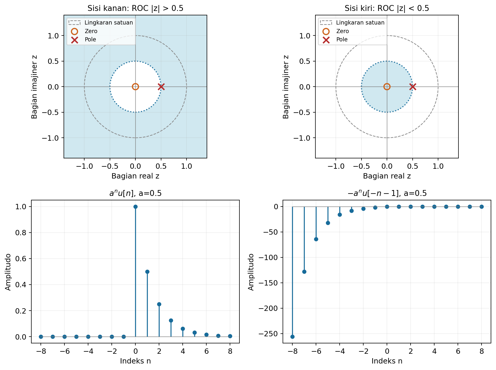

Gambar menggunakan $a=b=0.5$ agar perbedaan ROC untuk ekspresi rasional yang sama terlihat langsung. Lingkaran pembatas melalui pole tidak termasuk daerah yang diarsir.

Program [`01_roc_eksponensial.py`](../Kode/pertemuan-06/01_roc_eksponensial.py) membuat gambar dan memeriksa jumlah berhingga terhadap rumus analitik di dalam masing-masing ROC. Potongan berikut memperlihatkan pemeriksaan untuk sinyal kausal.

```python
import numpy as np

a = 0.5
z = 1.2*np.exp(0.4j)
n = np.arange(120)
X_num = np.sum(a**n*z**(-n))
X = z/(z-a)
assert np.allclose(X_num, X)
print(X_num)
```

### Contoh 3: sinyal berhingga dan posisi indeks nol

Dua sinyal mempunyai nilai sampel yang sama, tetapi posisi indeks nolnya berbeda. Gunakan tabel berikut agar tidak perlu menebak penanda asal pada sebuah deret.

| Sinyal | Indeks $n$ | Nilai sampel berurutan |
|---|---|---|
| $x_1[n]$ | $0,1,2,3,4,5$ | $1,2,5,7,0,1$ |
| $x_2[n]$ | $-2,-1,0,1,2,3$ | $1,2,5,7,0,1$ |

Masukkan setiap pasangan nilai dan indeks ke definisi. Karena sampelnya berhingga, penjumlahannya langsung memberikan:

$$
X_1(z)=1+2z^{-1}+5z^{-2}+7z^{-3}+z^{-5},
$$

$$
X_2(z)=z^{2}+2z+5+7z^{-1}+z^{-3}.
$$

Untuk $X_1$, ROC mencakup semua $z$ berhingga selain nol dan juga mencakup titik tak berhingga dalam pengertian limit. Untuk $X_2$, pangkat positif maupun negatif membuat nol dan titik tak berhingga dikecualikan.

Perhatikan bahwa $x_2[n]=x_1[n+2]$ dan $X_2(z)=z^{2}X_1(z)$. Jadi, letak asal indeks memengaruhi transformasi walaupun daftar amplitudonya sama.

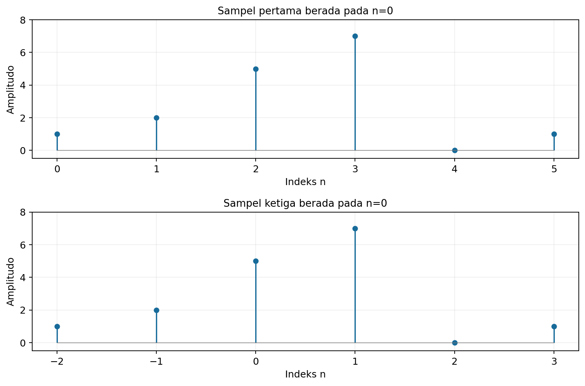

Program [`02_sinyal_berhingga.py`](../Kode/pertemuan-06/02_sinyal_berhingga.py) menerima indeks secara eksplisit dan memeriksa kedua polinomial. Cara ini juga menghindari kesalahan ketika sinyal memiliki sampel pada waktu negatif.

### Pasangan transformasi yang sering dipakai

Tabel berikut menggunakan transformasi dua sisi dan asumsi $a\ne0$. Ekspresi dengan $u[n]$ adalah sisi kanan, sedangkan ekspresi dengan $u[-n-1]$ adalah sisi kiri.

| Sinyal | Transformasi Z | ROC |
|---|---|---|
| $\delta[n]$ | $1$ | Seluruh bidang, termasuk limit di tak berhingga. |
| $\delta[n-m]$ | $z^{-m}$ | Untuk $m>0$ mengecualikan nol; untuk $m<0$ mengecualikan tak berhingga. |
| $u[n]$ | $z/(z-1)$ | $\lvert z\rvert>1$ |
| $nu[n]$ | $z/(z-1)^2$ | $\lvert z\rvert>1$ |
| $n^2u[n]$ | $z(z+1)/(z-1)^3$ | $\lvert z\rvert>1$ |
| $n^3u[n]$ | $z(z^2+4z+1)/(z-1)^4$ | $\lvert z\rvert>1$ |
| $a^{n}u[n]$ | $z/(z-a)$ | $\lvert z\rvert>\lvert a\rvert$ |
| $-a^{n}u[-n-1]$ | $z/(z-a)$ | $\lvert z\rvert<\lvert a\rvert$ |
| $na^{n}u[n]$ | $az/(z-a)^2$ | $\lvert z\rvert>\lvert a\rvert$ |
| $-na^{n}u[-n-1]$ | $az/(z-a)^2$ | $\lvert z\rvert<\lvert a\rvert$ |
| $n^2a^{n}u[n]$ | $az(z+a)/(z-a)^3$ | $\lvert z\rvert>\lvert a\rvert$ |
| $n^3a^{n}u[n]$ | $az(z^2+4az+a^2)/(z-a)^4$ | $\lvert z\rvert>\lvert a\rvert$ |
| $\sin(\Omega_0 n)u[n]$ | $z\sin\Omega_0/(z^2-2z\cos\Omega_0+1)$ | $\lvert z\rvert>1$ untuk sinus yang tidak identik nol. |
| $\cos(\Omega_0 n)u[n]$ | $z(z-\cos\Omega_0)/(z^2-2z\cos\Omega_0+1)$ | $\lvert z\rvert>1$ |

Pasangan sinus dan kosinus dapat diturunkan dengan rumus Euler dan pasangan eksponensial. Untuk sudut yang menyebabkan faktor pembilang dan penyebut saling menghilangkan, sederhanakan dahulu ekspresinya sebelum membaca jumlah pole.

### Karakteristik ROC

Pada sinyal rasional tak berhingga, hubungan antara arah waktu dan bentuk ROC dirangkum dalam tabel berikut. Untuk sinyal berhingga, periksa pangkat $z$ yang benar-benar tidak nol, termasuk kemungkinan sinyal hanya berupa impuls pada nol.

| Jenis sinyal | Bentuk ROC yang sesuai |
|---|---|
| Berhingga dengan sampel tak nol pada indeks positif | Nol dikecualikan. |
| Berhingga dengan sampel tak nol pada indeks negatif | Titik tak berhingga dikecualikan. |
| Berhingga dengan sampel pada kedua sisi nol | Nol dan tak berhingga dikecualikan. |
| Tak berhingga sisi kanan | Di luar pole terluar, dengan perlakuan titik ujung sesuai deret. |
| Tak berhingga sisi kiri | Di dalam pole terdalam, dengan perlakuan titik ujung sesuai deret. |
| Tak berhingga pada kedua sisi | Cincin di antara lingkaran pole; dapat kosong. |

---

## Sifat-sifat transformasi Z

### Linearitas dan ROC gabungan

Jika $x_1[n]$ dan $x_2[n]$ mempunyai transformasi $X_1(z)$ dan $X_2(z)$, distribusikan penjumlahan terhadap kombinasi linear. Hasilnya adalah:

$$
\mathcal{Z}\{\alpha x_1[n]+\beta x_2[n]\}=\alpha X_1(z)+\beta X_2(z).
$$

ROC hasil sekurang-kurangnya mencakup irisan kedua ROC jika irisan itu tidak kosong. ROC dapat lebih luas apabila komponen saling menghilangkan, sehingga pernyataan bahwa ROC selalu tepat sama dengan irisan perlu diperiksa kembali setelah penyederhanaan.

### Pergeseran waktu dua sisi

Untuk $y[n]=x[n-n_0]$, ambil $m=n-n_0$ pada jumlah dua sisi. Karena $m$ tetap meliputi seluruh bilangan bulat:

$$
Y(z)=\sum_{m=-\infty}^{\infty}x[m]z^{-(m+n_0)}=z^{-n_0}X(z).
$$

Lingkaran-lingkaran konvergensi dengan radius positif berhingga tetap sama. Titik $z=0$ atau tak berhingga dapat berubah status karena faktor $z^{-n_0}$; transformasi satu sisi memerlukan aturan berbeda yang dibahas di bagian akhir.

### Perkalian dengan eksponensial

Ambil $y[n]=a^{n}x[n]$ untuk $a\ne0$. Gabungkan faktor eksponensial dengan pangkat $z$:

$$
Y(z)=\sum_n {x[n]}(z/a)^{-n}=X(z/a).
$$

Jika ROC semula adalah $r_1<|z|<r_2$, ROC baru memenuhi $r_1<|z/a|<r_2$. Dengan demikian, kedua radius batas dikalikan $|a|$.

### Perkalian dengan indeks waktu

Turunkan deret transformasi terhadap $z$ di bagian dalam ROC. Turunan tiap suku adalah $d(z^{-n})/dz=-nz^{-n-1}$, sehingga:

$$
\frac{dX(z)}{dz}=\sum_n(-n)x[n]z^{-n-1}.
$$

Kalikan dengan $-z$ untuk memperoleh transformasi dari $nx[n]$. Radius konvergensinya tetap sama pada bagian dalam ROC, dengan titik ujung diperiksa bila diperlukan.

$$
\boxed{\mathcal{Z}\{nx[n]\}=-z\frac{dX(z)}{dz}.}
$$

Sebagai contoh, mulai dari $X(z)=z/(z-a)$. Turunannya adalah $-a/(z-a)^2$, sehingga transformasi $na^{n}u[n]$ adalah $az/(z-a)^2$, sesuai tabel pasangan.

### Konvolusi dalam domain waktu

Untuk $y[n]=(x\ast h)[n]$, masukkan definisi konvolusi ke transformasi Z. Pada daerah tempat kedua deret konvergen absolut, urutan penjumlahan boleh dipertukarkan:

$$
Y(z)=\sum_n\sum_k x[k]h[n-k]z^{-n}.
$$

Gunakan $m=n-k$, sehingga $z^{-n}=z^{-k}z^{-m}$. Kedua jumlah kemudian terpisah:

$$
Y(z)=\left(\sum_k x[k]z^{-k}\right)\left(\sum_m h[m]z^{-m}\right)=X(z)H(z).
$$

ROC hasil mencakup irisan ROC kedua faktor dan dapat meluas akibat penghilangan pole. Seperti pada DTFT, konvolusi waktu menjadi perkalian transformasi, tetapi di sini daerah konvergensinya juga harus diperhatikan.

### Perkalian waktu dan integral dalam domain Z

Sifat pasangan dari konvolusi menyatakan bahwa perkalian dua sinyal waktu berkaitan dengan integral kontur. Rumus ini disediakan sebagai rujukan; cara mengevaluasi integral invers diperkenalkan sesudah pecahan parsial.

$$
\mathcal{Z}\{x[n]h[n]\}=\frac{1}{2\pi j}\oint_C X(v)H(z/v)\frac{dv}{v}.
$$

Untuk melihat asal rumusnya, masukkan invers $x[n]=(1/(2\pi j))\oint_C X(v)v^{n-1}dv$ ke jumlah $\sum_n x[n]h[n]z^{-n}$. Setelah jumlah dan integral dipertukarkan, jumlah di dalam integral adalah $\sum_n {h[n]}(z/v)^{-n}=H(z/v)$.

Kontur dipilih agar $v$ berada di ROC $X$ dan $z/v$ berada di ROC $H$. Jika kedua ROC berupa cincin dengan batas $r_1,r_2$ dan $s_1,s_2$ yang positif berhingga, daerah $r_1s_1<|z|<r_2s_2$ dijamin dapat digunakan; penghilangan komponen dapat memperluasnya.

### Teorema nilai awal

Untuk sinyal kausal, ekspansi transformasinya diawali $X(z)=x[0]+x[1]z^{-1}+x[2]z^{-2}+\cdots$. Ketika $z$ menuju tak berhingga di dalam ROC, suku berpangkat negatif menghilang, sehingga:

$$
\boxed{x[0]=\lim_{z\to\infty}X(z).}
$$

Syarat kausal diperlukan untuk pembacaan sederhana ini. Sampel pada indeks negatif menghasilkan pangkat positif $z$ dan dapat mengubah limitnya.

### Teorema nilai akhir

Untuk barisan kausal dengan transformasi rasional, syarat cukup yang biasa digunakan adalah semua pole dari $(1-z^{-1})X(z)$ berada ketat di dalam lingkaran satuan setelah penyederhanaan. Syarat ini mengizinkan $X(z)$ mempunyai pole sederhana di $z=1$, tetapi tidak mengizinkan pole lain pada lingkaran satuan atau pole di luarnya.

Jika syarat tersebut dipenuhi, nilai akhirnya adalah:

$$
\boxed{\lim_{n\to\infty}x[n]=\lim_{z\to1}(1-z^{-1})X(z).}
$$

Faktor $(1-z^{-1})$ berasal dari transformasi selisih $x[n]-x[n-1]$ untuk sinyal kausal. Jumlah selisih dari $n=0$ sampai $N$ adalah $x[N]$, sehingga ketika jumlah selisih konvergen, evaluasinya pada $z=1$ memberikan nilai akhir.

Faktor $(z-1)$ juga memberikan limit yang sama jika syaratnya terpenuhi, karena $z-1=z(1-z^{-1})$ dan $z\to1$. Pada $x[n]=u[n]$, hasilnya 1; pada $x[n]=(0.5)^nu[n]$, hasilnya 0.

Pemeriksaan pole harus dilakukan sebelum menghitung limit aljabar. Misalnya, $(-1)^nu[n]$ tidak memiliki nilai akhir meskipun substitusi formal ke $(1-z^{-1})z/(z+1)$ menghasilkan nol, sebab masih ada pole pada $z=-1$.

### Contoh 4: penjumlahan dua sinyal dan ROC cincin

Ambil $y[n]=a^{n}u[n]-b^{n}u[-n-1]$. Dengan linearitas, jumlah kedua transformasinya adalah:

$$
Y(z)=\frac{z}{z-a}+\frac{z}{z-b}.
$$

Komponen pertama memerlukan $|z|>|a|$ dan komponen kedua memerlukan $|z|<|b|$. Untuk $|a|<|b|$, ROC hasilnya adalah cincin $|a|<|z|<|b|$.

Sebagai contoh, $a=0.5$ dan $b=2$ memberikan ROC $0.5<|z|<2$, yang mencakup lingkaran satuan. Jika $|a|\geq|b|$, tidak terdapat daerah tempat kedua ekor deret ini konvergen dan transformasi Z dua sisi sinyal tersebut tidak tersedia melalui jumlah absolutnya.

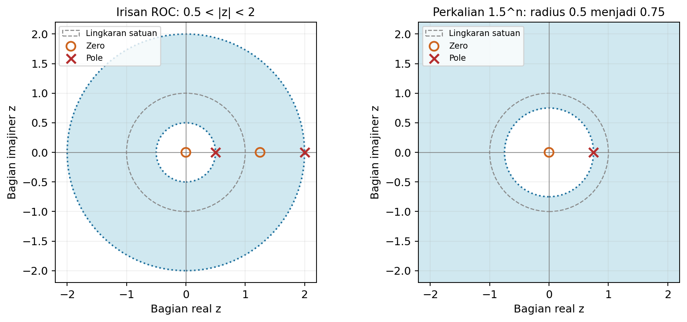

Program [`03_sifat.py`](../Kode/pertemuan-06/03_sifat.py) memeriksa linearitas, pergeseran, perkalian eksponensial, diferensiasi, dan konvolusi pada titik kompleks. Pemeriksaan dilakukan pada titik di dalam ROC, sehingga perbandingan tidak menggunakan nilai deret yang divergen.

Demo berikut memeriksa sifat perkalian dengan indeks untuk eksponensial kausal. Penjumlahan berhingga dibandingkan dengan hasil $-zX'(z)=az/(z-a)^2$.

```python
import numpy as np

a = 0.5
z = 1.2 + 0.3j
n = np.arange(160)
Y_num = np.sum(n*a**n*z**(-n))
Y = a*z/(z-a)**2
assert np.allclose(Y_num, Y)
print(Y_num)
```

### Pole dan karakteristik sinyal kausal

Transformasi rasional dapat ditulis sebagai perbandingan polinomial dalam $z^{-1}$. Jika suku pertama pembilang dan penyebut tidak nol, bentuk umumnya adalah:

$$
X(z)=\frac{b_0+b_1z^{-1}+\cdots+b_Mz^{-M}}{a_0+a_1z^{-1}+\cdots+a_Nz^{-N}}.
$$

Setelah faktorisasi, bentuk yang sama dapat ditulis sebagai hasil kali faktor pole dan zero. Faktor $z^{N-M}$ harus tetap dibawa agar pole atau zero di asal tidak hilang dari pembacaan:

$$
X(z)=\frac{b_0}{a_0}z^{N-M}\frac{\prod_{k=1}^{M}(z-\zeta_k)}{\prod_{k=1}^{N}(z-p_k)}.
$$

Untuk komponen kausal $p^{n}u[n]$, magnitudo pole menentukan perubahan amplitudo dan sudutnya menentukan osilasi. Jika $p=r e^{j\theta}$, maka $p^{n}=r^{n}e^{jn\theta}$.

| Jenis pole atau komponen kausal | Bentuk sinyal |
|---|---|
| Pole real $0<p<1$ | Eksponensial menurun. |
| Pole real $-1<p<0$ | Eksponensial menurun dengan tanda berganti. |
| Pole sederhana dengan $\lvert p\rvert=1$ | Amplitudo komponen tetap; dapat berosilasi. |
| Pole dengan $\lvert p\rvert>1$ | Amplitudo komponen tumbuh. |
| Pole kompleks-konjugat $r e^{\pm j\theta}$ | Kombinasi real $r^n\cos(n\theta)$ dan $r^n\sin(n\theta)$. |
| Pole berulang | Muncul faktor polinomial dalam $n$, misalnya $np^n$. |

Pole ganda pada lingkaran satuan dapat menghasilkan $n\cos(n\theta)$ atau $n\sin(n\theta)$, yang amplitudonya tidak terbatas. Pole sederhana pada lingkaran satuan dapat menghasilkan respons impuls terbatas, tetapi sifat ini saja belum membuktikan kestabilan BIBO yang memerlukan jumlah absolut respons impuls berhingga.

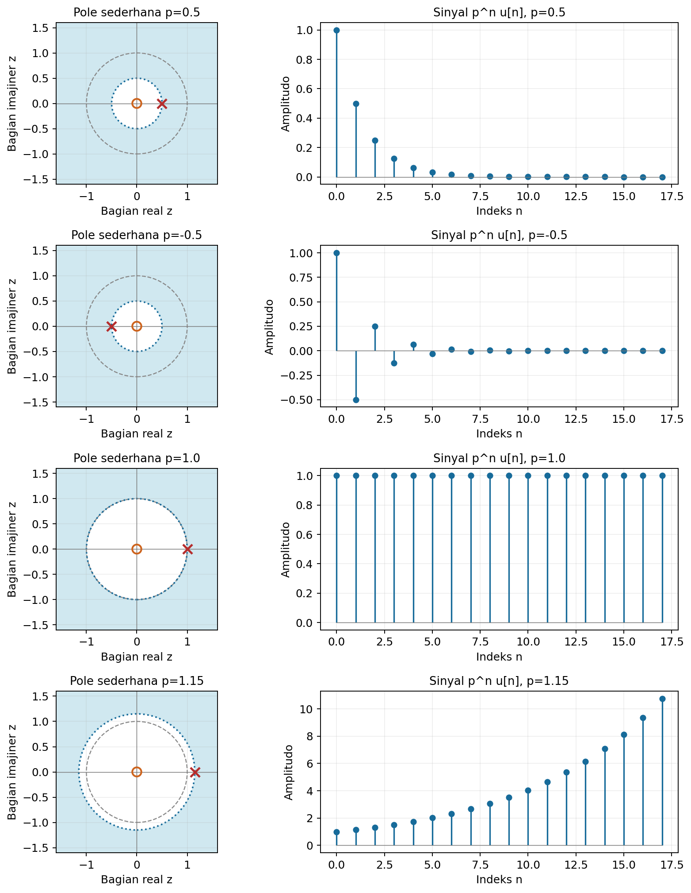

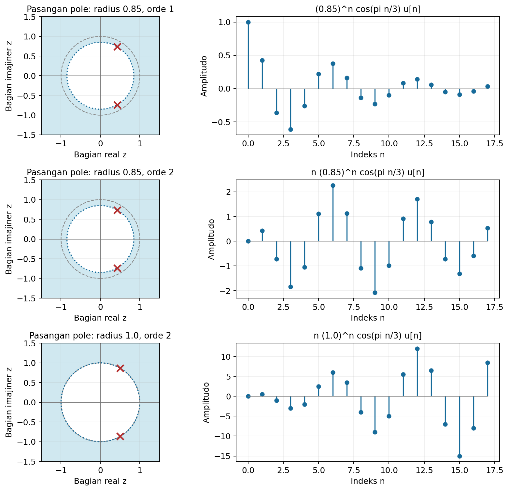

Program [`04_pole_dan_sinyal.py`](../Kode/pertemuan-06/04_pole_dan_sinyal.py) membuat kedua ilustrasi tersebut. Pada pembacaan ini diasumsikan sinyal kausal; pole saja tanpa ROC tidak menentukan arah waktu sinyal.

---

## Fungsi sistem LTI

### Respons impuls dan fungsi sistem

Untuk sistem LTI pada keadaan awal nol, keluaran memenuhi $y[n]=(h\ast x)[n]$. Sifat konvolusi memberikan hubungan pada domain Z:

$$
Y(z)=H(z)X(z),\qquad H(z)=\mathcal{Z}\{h[n]\}.
$$

Fungsi $H(z)$ disebut **fungsi sistem** dan mewakili respons impuls dalam domain Z. Jika masukan dan keluaran diketahui, kita dapat menghitung $H(z)=Y(z)/X(z)$ pada daerah yang sesuai, kemudian mencari inversnya dengan ROC yang konsisten dengan sistem.

### Menurunkan fungsi sistem dari persamaan selisih

Gunakan bentuk persamaan selisih dengan $a_0=1$. Parameter $a_k$ dan $b_k$ adalah konstanta yang tidak berubah terhadap waktu.

$$
y[n]+\sum_{k=1}^{N}a_k y[n-k]=\sum_{k=0}^{M}b_k x[n-k].
$$

Untuk hubungan respons keadaan nol, transformasi setiap sinyal yang tertunda menghasilkan faktor $z^{-k}$. Kumpulkan faktor keluaran dan masukan:

$$
Y(z)\left(1+\sum_{k=1}^{N}a_kz^{-k}\right)=X(z)\sum_{k=0}^{M}b_kz^{-k}.
$$

Maka fungsi sistemnya adalah:

$$
\boxed{H(z)=\frac{\sum_{k=0}^{M}b_kz^{-k}}{1+\sum_{k=1}^{N}a_kz^{-k}}.}
$$

Rumus ini menyatakan fungsi sistem, bukan seluruh keluaran akibat keadaan awal sembarang. Suku yang membawa keadaan awal muncul ketika transformasi satu sisi dipakai pada pergeseran keluaran.

### Sistem FIR dan IIR

Jika semua $a_k=0$ untuk $k\geq1$, fungsi sistem menjadi $H(z)=\sum_{k=0}^{M}b_kz^{-k}$. Respons impulsnya adalah deret berhingga $h[n]=\sum_{k=0}^{M}b_k\delta[n-k]$, sehingga sistem disebut FIR atau *finite impulse response*.

Bentuk FIR tersebut sering disebut *all-zero* karena parameter pembilang menentukan zero nontrivial. Setelah ditulis dalam pangkat positif $z$, masih dapat terdapat pole di asal akibat faktor penundaan; istilah *all-zero* tidak menghapus pole trivial tersebut.

Jika hanya $b_0$ yang tidak nol, fungsi sistemnya berbentuk *all-pole*, yaitu $H(z)=b_0/(1+\sum_{k=1}^{N}a_kz^{-k})$. Pole nontrivial yang tidak terhapus umumnya menghasilkan respons impuls tak berhingga, sehingga sistemnya IIR atau *infinite impulse response*.

### Contoh 5: fungsi sistem orde satu

Sistem kausal memenuhi $y[n]=0.5y[n-1]+2x[n]$ pada keadaan awal nol. Terapkan sifat pergeseran dan kelompokkan suku $Y(z)$:

$$
Y(z)=0.5z^{-1}Y(z)+2X(z),
$$

$$
(1-0.5z^{-1})Y(z)=2X(z).
$$

Dengan demikian, fungsi sistem dan ROC kausalnya adalah:

$$
H(z)=\frac{2}{1-0.5z^{-1}}=\frac{2z}{z-0.5},\qquad |z|>0.5.
$$

Pasangan eksponensial memberikan $h[n]=2(0.5)^nu[n]$. Sebagai pemeriksaan, masukan impuls menghasilkan sampel keluaran $2,1,0.5,0.25,\ldots$, sesuai persamaan selisihnya.

ROC mencakup lingkaran satuan, sehingga respons frekuensinya adalah $H(e^{j\Omega})=2/(1-0.5e^{-j\Omega})$. Pada frekuensi nol, penguatannya 4; pada $\Omega=\pi$, penguatannya $4/3$.

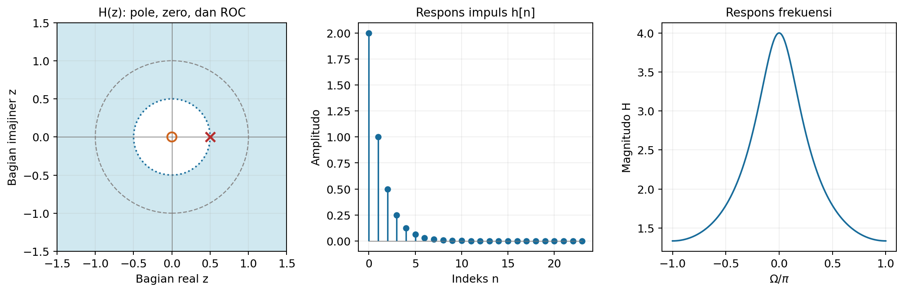

Program [`05_fungsi_sistem.py`](../Kode/pertemuan-06/05_fungsi_sistem.py) membandingkan respons impuls analitik dengan iterasi persamaan selisih. Perhitungan respons frekuensinya juga menghubungkan fungsi sistem ini dengan materi pertemuan keempat.

Potongan berikut menghitung respons impuls dari persamaan selisih dengan kondisi awal nol. Impuls diberikan hanya pada indeks pertama, kemudian respons berikutnya dihitung secara rekursif.

```python
import numpy as np

h = np.zeros(20)
for n in range(len(h)):
    sebelumnya = h[n-1] if n > 0 else 0.0
    h[n] = 0.5*sebelumnya + 2*(n == 0)
assert np.allclose(h, 2*0.5**np.arange(len(h)))
print(h[:6])
```

---

## Invers transformasi Z

Tujuan invers adalah memperoleh $x[n]$ dari ekspresi $X(z)$ **beserta ROC-nya**. Tiga cara yang dibahas adalah pembagian langsung, pecahan parsial, dan integral invers kompleks.

### Pembagian langsung dan deret pangkat

Definisi transformasi Z adalah ekspansi $X(z)=\sum_n x[n]z^{-n}$. Setelah ekspresi rasional dikembangkan dalam pangkat yang sesuai dengan ROC, koefisien di depan $z^{-n}$ langsung memberikan $x[n]$.

Untuk ROC sisi luar, ekspansi umumnya menggunakan pangkat negatif $z$. Untuk ROC sisi dalam, ekspansi menggunakan pangkat positif $z$, sehingga koefisiennya berhubungan dengan sampel pada indeks negatif.

### Contoh 6: pembagian langsung dengan dua ROC

Ambil $X(z)=1/(1-1.5z^{-1}+0.5z^{-2})$. Pole-nya adalah $0.5$ dan 1; kita mula-mula membandingkan ROC $|z|>1$ dengan ROC $|z|<0.5$.

**ROC $|z|>1$.** Tetapkan $q=z^{-1}$ dan tulis $X=\sum_{m=0}^{\infty}c_mq^m$. Kalikan dengan penyebut, sehingga:

$$
(1-1.5q+0.5q^2)\sum_{m=0}^{\infty}c_mq^m=1.
$$

Penyamaan koefisien memberi $c_0=1$ dan $c_1-1.5c_0=0$, sehingga $c_1=1.5$. Untuk $m\geq2$, persamaan koefisiennya adalah $c_m-1.5c_{m-1}+0.5c_{m-2}=0$.

$$
c_2=1.5(1.5)-0.5(1)=1.75,
$$

$$
c_3=1.5(1.75)-0.5(1.5)=1.875,
$$

$$
c_4=1.5(1.875)-0.5(1.75)=1.9375.
$$

Jadi, ekspansinya adalah $X(z)=1+(3/2)z^{-1}+(7/4)z^{-2}+(15/8)z^{-3}+(31/16)z^{-4}+\cdots$. Sampel-sampel tersebut berada pada $n=0,1,2,3,4,\ldots$.

**ROC $|z|<0.5$.** Kalikan pembilang dan penyebut dengan $z^2$, kemudian ekspansikan di sekitar nol:

$$
X(z)=\frac{z^2}{z^2-1.5z+0.5}=\sum_{m=0}^{\infty}d_mz^m.
$$

Penyamaan koefisien pada $(0.5-1.5z+z^2)\sum_m d_mz^m=z^2$ menghasilkan $d_0=d_1=0$ dan $0.5d_2=1$. Maka $d_2=2$, dan untuk $m\geq3$ berlaku $0.5d_m-1.5d_{m-1}+d_{m-2}=0$.

$$
d_3=3(2)-2(0)=6,\qquad d_4=3(6)-2(2)=14,
$$

$$
d_5=3(14)-2(6)=30,\qquad d_6=3(30)-2(14)=62.
$$

Dengan demikian, $X(z)=2z^2+6z^3+14z^4+30z^5+62z^6+\cdots$. Karena $z^m=z^{-(-m)}$, nilainya adalah $x[-2]=2$, $x[-3]=6$, dan seterusnya, sedangkan $x[-1]=x[0]=0$.

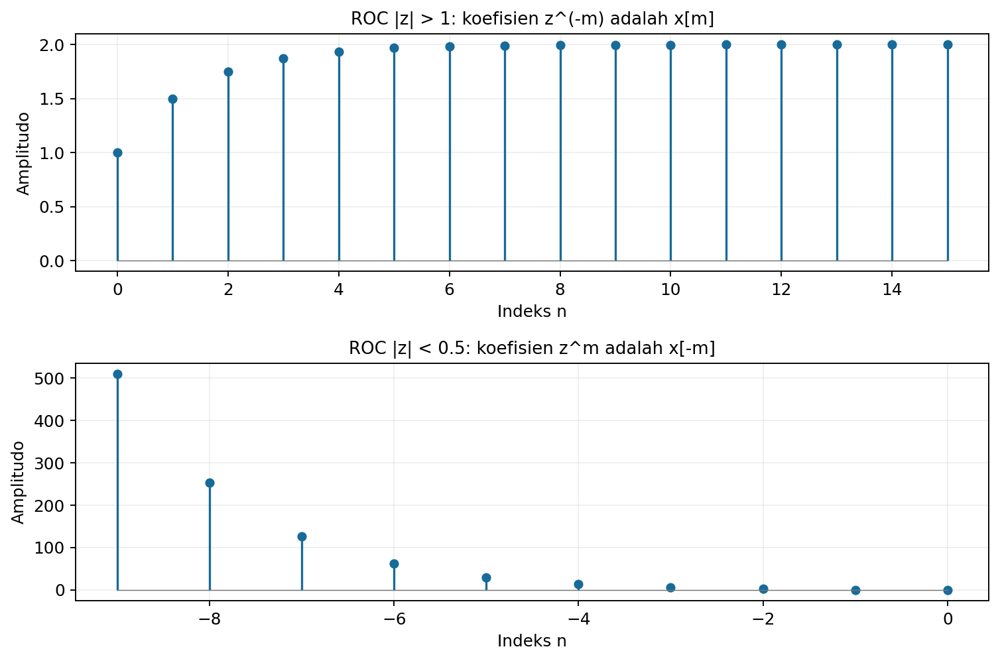

Program [`06_pembagian_langsung.py`](../Kode/pertemuan-06/06_pembagian_langsung.py) membangkitkan koefisien dengan kedua hubungan rekursif tersebut. Program tidak menukar koefisien $z^m$ dengan sampel $x[m]$, karena indeks waktunya justru $-m$.

### Pecahan parsial: pole yang berbeda

Untuk menggunakan pasangan $z/(z-p)$, lebih mudah menguraikan $F(z)=X(z)/z$ terlebih dahulu. Jika $F$ merupakan fungsi rasional *strictly proper* dalam variabel $z$ dan pole $p_k$ semuanya sederhana, tulis:

$$
F(z)=\frac{X(z)}{z}=\sum_k\frac{A_k}{z-p_k}.
$$

Kalikan dengan $(z-p_k)$ lalu ambil limit $z\to p_k$, sehingga koefisiennya adalah:

$$
A_k=\lim_{z\to p_k}(z-p_k)F(z).
$$

Sesudah koefisien diperoleh, kalikan kembali dengan $z$ dan gunakan pasangan transformasi menurut ROC setiap pole. Jika derajat pembilang tidak lebih rendah daripada penyebut dalam variabel yang dipakai, lakukan pembagian polinomial dahulu dan pertahankan bagian polinomialnya sebagai impuls atau impuls bergeser.

### Contoh 7: tiga pole sederhana

Ambil $X(z)=1/[(1-0.5z^{-1})(1-0.75z^{-1})(1-z^{-1})]$. Setelah dikalikan dengan $z^3$ dan dibagi dengan $z$, fungsi yang diuraikan adalah:

$$
F(z)=\frac{z^2}{(z-0.5)(z-0.75)(z-1)}=\frac{A_1}{z-0.5}+\frac{A_2}{z-0.75}+\frac{A_3}{z-1}.
$$

Hilangkan faktor pole yang sesuai dan substitusikan nilainya. Ketiga koefisien diperoleh tanpa menyelesaikan sistem persamaan besar:

$$
A_1=\frac{(0.5)^2}{(0.5-0.75)(0.5-1)}=2,
$$

$$
A_2=\frac{(0.75)^2}{(0.75-0.5)(0.75-1)}=-9,
$$

$$
A_3=\frac{1}{(1-0.5)(1-0.75)}=8.
$$

Cara lain adalah menyamakan pembilang setelah semua pecahan disatukan. Koefisien $z^2$, $z$, dan konstanta memberikan tiga persamaan berikut.

$$
A_1+A_2+A_3=1,
$$

$$
-1.75A_1-1.5A_2-1.25A_3=0,
$$

$$
0.75A_1+0.5A_2+0.375A_3=0.
$$

Nilai $2,-9,8$ memenuhi ketiganya. Bentuk akhir yang siap diinvers adalah $X(z)=2z/(z-0.5)-9z/(z-0.75)+8z/(z-1)$, dengan ROC masih harus ditentukan untuk memilih arah waktu.

Demo berikut menerapkan rumus koefisien pole sederhana pada ketiga pole tersebut. Faktor yang berhubungan dengan pole yang sedang dievaluasi dihilangkan dari penyebut sebelum substitusi dilakukan.

```python
import numpy as np

poles = np.array([0.5, 0.75, 1.0])
A = np.array([p**2/np.prod([p-q for q in poles if q != p])
              for p in poles])
assert np.allclose(A, [2, -9, 8])
print(A)
```

### Pecahan parsial: pole berulang

Jika pole $p$ berorde $m$, ekspansi harus menyertakan semua pangkat dari $(z-p)^{-1}$ sampai $(z-p)^{-m}$. Tulis bagian pole tersebut sebagai:

$$
F(z)=\frac{A_m}{(z-p)^m}+\frac{A_{m-1}}{(z-p)^{m-1}}+\cdots+\frac{A_1}{z-p}+\text{suku pole lain}.
$$

Definisikan $G(z)=(z-p)^mF(z)$, yang tidak singular pada $p$. Ekspansi Taylor $G$ di sekitar $p$ memberikan $A_m=G(p)$, $A_{m-1}=G'(p)$, dan secara umum:

$$
A_{\ell}=\frac{G^{(m-\ell)}(p)}{(m-\ell)!},\qquad \ell=1,\ldots,m.
$$

Untuk pole ganda, cukup menghitung nilai fungsi dan turunan pertama. Pola ini menjelaskan mengapa suku berorde dua tidak boleh digantikan hanya dengan satu pecahan sederhana.

### Contoh 8: satu pole sederhana dan satu pole ganda

Ambil $X(z)=12z/[(z+1)(z-1)^2]$. Pembagian dengan $z$ memberikan bentuk:

$$
F(z)=\frac{12}{(z+1)(z-1)^2}=\frac{A}{z+1}+\frac{B_2}{(z-1)^2}+\frac{B_1}{z-1}.
$$

Untuk pole sederhana $-1$, koefisiennya adalah $A=12/(-1-1)^2=3$. Untuk pole ganda $1$, gunakan $G(z)=12/(z+1)$, sehingga:

$$
B_2=G(1)=6,\qquad G'(z)=-\frac{12}{(z+1)^2},\qquad B_1=G'(1)=-3.
$$

Maka $F(z)=3/(z+1)+6/(z-1)^2-3/(z-1)$. Kalikan kembali dengan $z$ sebelum menggunakan pasangan tabel; suku $6z/(z-1)^2$ akan menghasilkan faktor $6n$ pada invers kausalnya.

### Contoh 9: pole kompleks-konjugat

Diberikan $X(z)=(z+1)/[(z-1)(z^2+2z+2)]$. Karena $z^2+2z+2=(z+1-j)(z+1+j)$, ekspansi untuk $F=X/z$ adalah:

$$
F(z)=\frac{A_0}{z}+\frac{A_1}{z-1}+\frac{A_+}{z+1-j}+\frac{A_-}{z+1+j}.
$$

Koefisien pada $z=0$ adalah $A_0=(0+1)/[(0-1)(0^2+2\cdot0+2)]=-0.5$. Pada $z=1$, diperoleh $A_1=(1+1)/[1(1+2+2)]=0.4$.

Untuk pole $p=-1+j$, faktor lain dalam penyebut menghasilkan $p(p-1)(p-\overline{p})=6+2j$. Karena $p+1=j$, koefisiennya adalah:

$$
A_+=\frac{j}{6+2j}=\frac{j(6-2j)}{40}=0.05+0.15j.
$$

Koefisien pada pole konjugatnya adalah $A_-=0.05-0.15j$. Dengan demikian:

$$
F(z)=-\frac{0.5}{z}+\frac{0.4}{z-1}+\frac{0.05+0.15j}{z+1-j}+\frac{0.05-0.15j}{z+1+j}.
$$

Pole di nol pada $F=X/z$ muncul akibat pembagian tambahan dengan $z$, bukan pole baru pada $X$ semula. Setelah dikalikan kembali dengan $z$, suku itu menjadi konstanta $-0.5$ dan akan menghasilkan impuls $-0.5\delta[n]$.

Program [`07_pecahan_parsial.py`](../Kode/pertemuan-06/07_pecahan_parsial.py) memeriksa ketiga ekspansi pada beberapa titik kompleks. Koefisien dibandingkan sebelum pembulatan agar kesalahan tanda pada pasangan kompleks dapat terlihat.

### Contoh 10: invers kausal dari ketiga ekspansi

**Kasus tiga pole sederhana.** Pilih ROC $|z|>1$, sehingga semua suku pada Contoh 7 adalah sisi kanan. Pasangan $z/(z-p)$ langsung memberikan:

$$
x_1[n]=\left(2(0.5)^n-9(0.75)^n+8\right)u[n].
$$

Sebagai pemeriksaan nilai awal, $x_1[0]=2-9+8=1$, sesuai $\lim_{z\to\infty}X(z)=1$. Pole sederhana pada $z=1$ menghasilkan komponen konstan dalam sinyal ini.

**Kasus pole ganda.** Pilih ROC $|z|>1$ pada Contoh 8, kemudian gunakan pasangan $z/(z+1)$, $z/(z-1)^2$, dan $z/(z-1)$. Hasilnya adalah:

$$
x_2[n]=\left(3(-1)^n+6n-3\right)u[n].
$$

Nilai $x_2[0]=x_2[1]=0$ dan $x_2[2]=12$, sesuai deret awal transformasinya. Suku $6n$ menunjukkan pertumbuhan akibat pole ganda pada lingkaran satuan.

**Kasus pole kompleks.** Pilih ROC $|z|>\sqrt2$ pada Contoh 9 dan tulis $p=-1+j=\sqrt2 e^{j3\pi/4}$. Mengalikan $F$ dengan $z$ lalu memakai pasangan kausal memberikan:

$$
x_3[n]=-0.5\delta[n]+\left(0.4+(0.05+0.15j)p^n+(0.05-0.15j)\overline{p}^{n}\right)u[n].
$$

Pasangan kompleks tersebut saling konjugat, sehingga jumlahnya adalah $2\text{Re}\{(0.05+0.15j)p^n\}$ dan bernilai real. Gunakan $\text{Re}\{(\alpha+j\beta)e^{j\theta}\}=\alpha\cos\theta-\beta\sin\theta$ untuk memperoleh bentuk berikut.

$$
x_3[n]=-0.5\delta[n]+\left[0.4+(\sqrt2)^n\left(0.1\cos\frac{3\pi n}{4}-0.3\sin\frac{3\pi n}{4}\right)\right]u[n].
$$

Faktor 0.3 berasal dari dua kali 0.15 pada pasangan kompleks. Pemeriksaan pada $n=0,1,2$ memberikan $0,0,1$, dan hasil yang sama diperoleh melalui pembagian langsung.

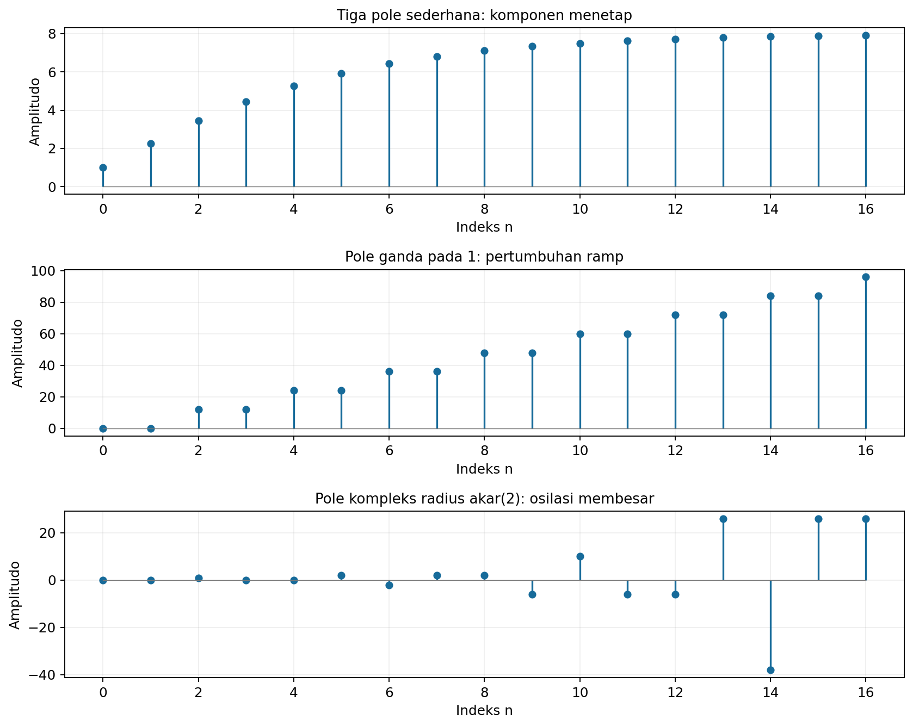

Program [`07_pecahan_parsial.py`](../Kode/pertemuan-06/07_pecahan_parsial.py) juga membandingkan ketiga rumus waktu tersebut dengan koefisien deret dari fungsi rasionalnya. Gambar memperlihatkan komponen menetap, pertumbuhan ramp, dan osilasi yang membesar sesuai letak serta orde pole.

### Contoh 11: satu ekspresi, tiga sinyal

Gunakan kembali $X(z)=1/(1-1.5z^{-1}+0.5z^{-2})$. Pecahan parsialnya adalah:

$$
X(z)=\frac{2z}{z-1}-\frac{z}{z-0.5}.
$$

**Untuk ROC $|z|>1$**, kedua pole dibaca sebagai komponen sisi kanan. Maka:

$$
x[n]=\left(2-(0.5)^n\right)u[n].
$$

**Untuk ROC $|z|<0.5$**, kedua pole dibaca sebagai komponen sisi kiri. Karena $z/(z-p)$ dengan ROC bagian dalam berpasangan dengan $-p^nu[-n-1]$, hasilnya:

$$
x[n]=\left(-2+(0.5)^n\right)u[-n-1].
$$

**Untuk ROC $0.5<|z|<1$**, pole pada 0.5 dibaca sebagai sisi kanan, sedangkan pole pada 1 sebagai sisi kiri. Dengan demikian:

$$
x[n]=-2u[-n-1]-(0.5)^nu[n].
$$

Semua pilihan memiliki ekspresi rasional yang sama, tetapi distribusi sampel terhadap waktu berbeda. Dua hasil pertama juga sesuai dengan koefisien pembagian pada Contoh 6.

Setelah ditulis dalam pangkat positif, fungsi ini adalah $z^2/[(z-0.5)(z-1)]$. Jadi, terdapat zero berorde dua pada asal, yang ditandai angka 2 di dekat lingkaran zero pada gambar.

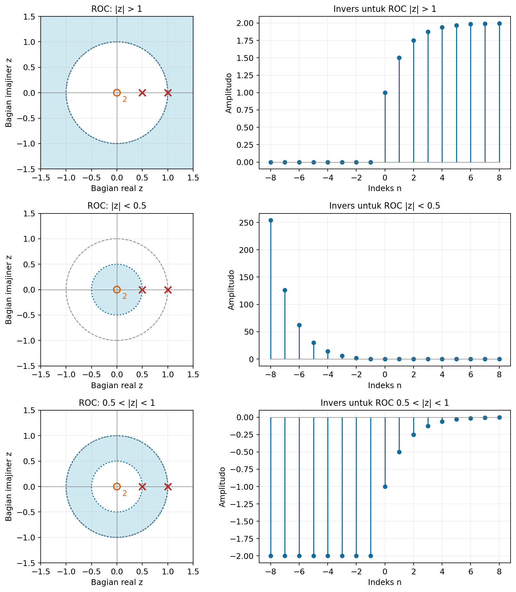

Program [`08_tiga_roc.py`](../Kode/pertemuan-06/08_tiga_roc.py) menghitung jumlah transformasi dari masing-masing barisan pada satu titik di dalam ROC-nya. Evaluasi tersebut memeriksa sekaligus arah waktu, tanda, dan nilai transformasinya.

### Integral invers kompleks

Integral invers mengambil koefisien $z^{-n}$ dari deret transformasi. Kontur $C$ mengelilingi asal sekali berlawanan arah jarum jam dan seluruh lintasannya harus berada di dalam ROC; daerah yang dilingkupinya tidak harus seluruhnya termasuk ROC.

$$
\boxed{x[n]=\frac{1}{2\pi j}\oint_C X(z)z^{n-1}dz.}
$$

Untuk memahami rumus ini, substitusikan $X(z)=\sum_m x[m]z^{-m}$. Integral menjadi jumlah $x[m]$ dikalikan integral $z^{n-m-1}/(2\pi j)$, yang bernilai 1 jika $m=n$ dan nol untuk indeks lain.

Hasil tersebut dapat diperiksa dengan parameter $z=\rho e^{j\theta}$ dan $dz=jz d\theta$. Faktor eksponensial $e^{j(n-m)\theta}$ berjumlah rata-rata nol selama satu putaran jika $n\ne m$, sehingga hanya koefisien $x[n]$ yang tertinggal.

Untuk fungsi rasional, integral dapat dihitung dengan menjumlahkan **residu** dari $R_n(z)=X(z)z^{n-1}$ di dalam kontur. Pada pole sederhana $p$, residunya adalah $\lim_{z\to p}(z-p)R_n(z)$.

Jika $p$ berorde $m$, bentuk $G_p(z)=(z-p)^mR_n(z)$ tidak singular pada $p$. Residunya adalah $G_p^{(m-1)}(p)/(m-1)!$; rumus ini berasal dari koefisien $(z-p)^{-1}$ dalam ekspansi lokal.

### Contoh 12: invers eksponensial melalui residu

Ambil $X(z)=z/(z-a)$ dengan $a\ne0$ dan ROC $|z|>|a|$. Pilih lingkaran $|z|=\rho>|a|$, sehingga integrannya menjadi $R_n(z)=z^n/(z-a)$.

Untuk $n\geq0$, hanya ada pole di $z=a$ di dalam kontur. Residu pada pole itu adalah $a^n$, sehingga $x[n]=a^n$ pada indeks nonnegatif.

Untuk $n=-q<0$, terdapat pole tambahan di $z=0$ yang berorde $q$. Residu di $a$ adalah $a^{-q}$, sedangkan residu di nol dapat dihitung dari turunan fungsi $1/(z-a)$:

$$
\frac{d^{q-1}}{dz^{q-1}}\frac{1}{z-a}=\frac{(-1)^{q-1}(q-1)!}{(z-a)^q}.
$$

Evaluasi pada nol dan pembagian dengan $(q-1)!$ menghasilkan $-a^{-q}$. Kedua residu saling menghilangkan, sehingga $x[n]=0$ untuk semua $n<0$, dan hasil akhirnya adalah $a^nu[n]$.

Sebagai contoh, pada $n=-1$ residunya $1/a$ dan $-1/a$. Pada $n=-2$ residunya $1/a^2$ dan $-1/a^2$; pole tambahan di nol tidak boleh diabaikan.

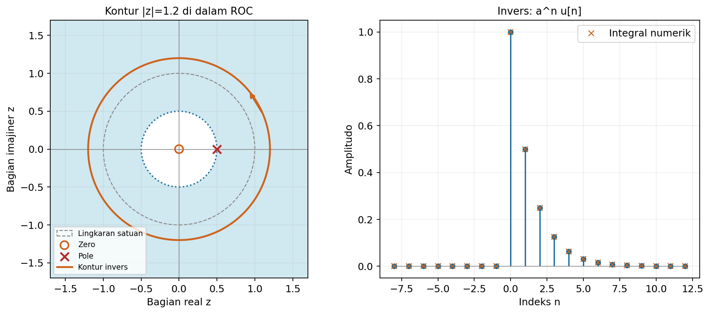

Program [`09_integral_invers.py`](../Kode/pertemuan-06/09_integral_invers.py) memparameterkan lingkaran dan memeriksa integral tanpa pustaka integral kompleks khusus. Untuk $M$ titik seragam $\theta_m=2\pi m/M$, rumus numeriknya adalah:

$$
x[n]\approx\frac{\rho^n}{M}\sum_{m=0}^{M-1}X(\rho e^{j\theta_m})e^{jn\theta_m}.
$$

Faktor $\rho^n$ berasal dari $z^{n}$ setelah $dz=jz d\theta$ disubstitusikan. Menghilangkannya akan menghasilkan amplitudo yang salah untuk kontur selain lingkaran satuan.

---

## Transformasi Z satu sisi

### Definisi dan informasi waktu negatif

Transformasi Z satu sisi, atau *unilateral*, didefinisikan dengan batas bawah indeks nol. Kita membedakannya dari transformasi dua sisi menggunakan superskrip $+$.

$$
X^{+}(z)=\mathcal{Z}^{+}\{x[n]\}=\sum_{n=0}^{\infty}x[n]z^{-n}.
$$

Transformasi ini sama dengan transformasi dua sisi dari $x[n]u[n]$. Dua sinyal yang berbeda hanya pada $n<0$ mempunyai $X^{+}$ yang sama, sehingga transformasi satu sisi menentukan secara unik bagian sinyal pada $n\geq0$, bukan seluruh riwayat sinyal.

ROC-nya bertipe sisi luar jika ekor nonnegatifnya tak berhingga dan transformasinya ada. Untuk bagian nonnegatif yang berhingga, ROC dapat mencakup seluruh bidang kecuali nol; untuk impuls pada nol, ROC bahkan mencakup nol.

### Contoh 13: transformasi satu sisi dua sinyal berhingga

Gunakan kedua sinyal pada Contoh 3. Sinyal pertama dimulai pada $n=0$, sehingga seluruh sampelnya masuk ke transformasi satu sisi:

$$
X_1^{+}(z)=1+2z^{-1}+5z^{-2}+7z^{-3}+z^{-5}.
$$

Pada sinyal kedua, sampel $1$ dan $2$ berada pada $n=-2,-1$, sehingga tidak ikut dijumlahkan. Sampel yang tersisa memberi:

$$
X_2^{+}(z)=5+7z^{-1}+z^{-3}.
$$

Keduanya memiliki ROC selain $z=0$ dan mencakup limit di tak berhingga. Dibandingkan dengan $X_2(z)$ dua sisi, suku $z^2+2z$ sudah tidak ada karena informasi waktu negatif tidak dimasukkan.

### Pergeseran ke kanan pada transformasi satu sisi

Ambil $y[n]=x[n-k]$ dengan bilangan bulat $k>0$. Ganti indeks dengan $m=n-k$, sehingga batas bawah jumlah berubah menjadi $-k$:

$$
Y^{+}(z)=z^{-k}\sum_{m=-k}^{\infty}x[m]z^{-m}.
$$

Pisahkan indeks negatif $-k,\ldots,-1$ dari bagian nonnegatif. Jika indeks negatif ditulis sebagai $m=-r$, hasilnya:

$$
\boxed{Y^{+}(z)=z^{-k}\left(X^{+}(z)+\sum_{r=1}^{k}x[-r]z^r\right).}
$$

Untuk $k=1$, bentuknya adalah $\mathcal{Z}^{+}\{x[n-1]\}=z^{-1}X^{+}(z)+x[-1]$. Untuk $k=2$, bentuknya menjadi $z^{-2}X^{+}(z)+x[-1]z^{-1}+x[-2]$.

Suku tambahan membawa sampel waktu negatif yang masuk ke jendela nonnegatif setelah pergeseran. Jika sinyal asal kausal, semua sampel tersebut nol dan barulah rumusnya menyederhana menjadi $z^{-k}X^{+}(z)$.

### Pergeseran ke kiri pada transformasi satu sisi

Ambil $y[n]=x[n+k]$ dengan $k>0$. Dengan $m=n+k$, batas bawah jumlah menjadi $k$, sehingga:

$$
Y^{+}(z)=z^k\sum_{m=k}^{\infty}x[m]z^{-m}.
$$

Jumlah mulai dari $k$ diperoleh dari jumlah mulai nol dengan mengurangi $k$ suku awal. Dengan demikian:

$$
\boxed{Y^{+}(z)=z^k\left(X^{+}(z)-\sum_{m=0}^{k-1}x[m]z^{-m}\right).}
$$

Untuk $k=1$, hasilnya $zX^{+}(z)-zx[0]$. Untuk $k=2$, hasilnya $z^2X^{+}(z)-z^2x[0]-zx[1]$; pengurangan ini tetap diperlukan meskipun sinyal kausal.

### Contoh 14: pergeseran eksponensial dengan riwayat negatif

Ambil $x[n]=a^n$ untuk semua indeks bulat dengan $a\ne0$. Transformasi satu sisinya ada untuk $|z|>|a|$ dan bernilai $X^{+}(z)=1/(1-az^{-1})$, walaupun sinyal dua sisinya tidak memiliki ROC absolut yang tidak kosong.

**Pergeseran kanan dua sampel.** Karena $x[-1]=a^{-1}$ dan $x[-2]=a^{-2}$, rumus pergeserannya memberikan:

$$
X_1^{+}(z)=\frac{z^{-2}}{1-az^{-1}}+a^{-1}z^{-1}+a^{-2}.
$$

Gabungkan ketiga suku dengan penyebut yang sama. Pembilangnya adalah $z^{-2}+a^{-1}z^{-1}(1-az^{-1})+a^{-2}(1-az^{-1})=a^{-2}$, sehingga:

$$
X_1^{+}(z)=\frac{a^{-2}}{1-az^{-1}},\qquad |z|>|a|.
$$

Hasil tersebut sesuai dengan $x[n-2]=a^{n-2}=a^{-2}a^n$. Sampel awalnya bukan nol karena sinyal asal mempunyai riwayat pada indeks negatif.

**Pergeseran kiri dua sampel.** Dengan $x[0]=1$ dan $x[1]=a$, rumusnya adalah:

$$
X_2^{+}(z)=\frac{z^2}{1-az^{-1}}-z^2-az.
$$

Setelah disatukan, pembilangnya $z^2-(z^2+az)(1-az^{-1})=a^2$. Maka:

$$
X_2^{+}(z)=\frac{a^2}{1-az^{-1}},\qquad |z|>|a|,
$$

sesuai $x[n+2]=a^{n+2}$. Jika sinyal asal diganti menjadi $a^nu[n]$, pergeseran kanan justru mempunyai dua nol awal dan transformasi $z^{-2}/(1-az^{-1})$; kedua sinyal asal itu memiliki transformasi satu sisi sama, tetapi riwayat negatifnya berbeda.

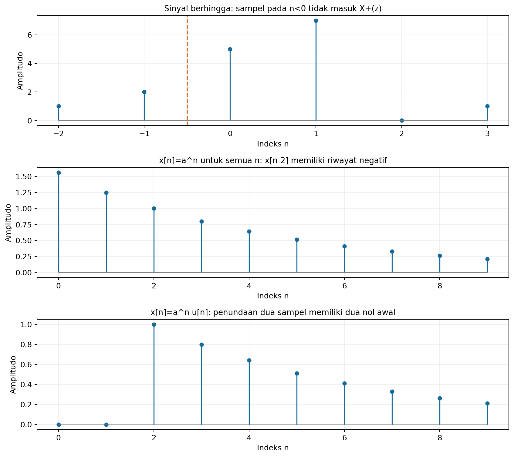

Program [`10_satu_sisi.py`](../Kode/pertemuan-06/10_satu_sisi.py) memeriksa suku batas kanan dan kiri terhadap penjumlahan langsung. Gambar juga membandingkan pergeseran eksponensial yang memiliki riwayat negatif dengan pergeseran eksponensial kausal.

Potongan berikut memeriksa penundaan dua sampel untuk eksponensial yang memiliki riwayat negatif. Kedua suku batas dipertahankan, kemudian hasilnya dibandingkan dengan jumlah transformasi pada indeks nonnegatif.

```python
import numpy as np

a = 0.8
z = 1.3 + 0.2j
n = np.arange(180)
Xp = 1/(1-a/z)
Y = z**(-2)*Xp + a**(-1)/z + a**(-2)
Y_num = np.sum(a**(n-2)*z**(-n))
assert np.allclose(Y, Y_num)
print(Y_num)
```

### Hubungan dengan keadaan awal dan nilai akhir

Sebagai penghubung, pada persamaan $y[n]=0.5y[n-1]+2x[n]$ untuk $n\geq0$, transformasi satu sisi memberi $Y^{+}(z)=0.5(z^{-1}Y^{+}(z)+y[-1])+2X^{+}(z)$. Setelah dikumpulkan:

$$
Y^{+}(z)=\frac{2X^{+}(z)}{1-0.5z^{-1}}+\frac{0.5y[-1]}{1-0.5z^{-1}}.
$$

Suku pertama adalah respons akibat masukan dengan keadaan awal nol, sedangkan suku kedua membawa keadaan awal. Identitas ini menjelaskan manfaat aturan pergeseran satu sisi tanpa memperluas pembahasan ke metode respons keadaan awal yang lebih lanjut.

Teorema nilai akhir juga berlaku untuk $X^{+}(z)$ dengan syarat pole yang sama seperti sebelumnya. Nilai sampel negatif tidak masuk langsung ke definisi, tetapi dapat memengaruhi keluaran melalui suku batas pada persamaan sistem.

---

## Rangkuman pasangan dan sifat

Untuk transformasi dua sisi, semua baris tabel berikut harus dilengkapi ROC yang sesuai. Pergeseran waktu mempertahankan daerah pada radius positif berhingga, dengan nol dan tak berhingga diperiksa secara terpisah.

| Operasi | Transformasi dua sisi |
|---|---|
| $\alpha x_1[n]+\beta x_2[n]$ | $\alpha X_1(z)+\beta X_2(z)$; ROC mencakup irisan. |
| $x[n-n_0]$ | $z^{-n_0}X(z)$ |
| $a^nx[n]$ | $X(z/a)$; radius ROC dikalikan $\lvert a\rvert$. |
| $nx[n]$ | $-zX'(z)$ |
| $x[n]\ast h[n]$ | $X(z)H(z)$; ROC mencakup irisan. |
| Nilai awal sinyal kausal | $x[0]=\lim_{z\to\infty}X(z)$ |
| Nilai akhir dengan syarat pole | $\lim_{n\to\infty}x[n]=\lim_{z\to1}(1-z^{-1})X(z)$ |

Pada transformasi satu sisi, rumus pergeseran harus menyertakan suku batas. Rumus dua sisi dapat dipakai untuk penundaan satu sisi hanya jika sampel riwayat yang muncul semuanya nol.

---

## Cek pemahaman

Jawab pertanyaan berikut dengan satu alasan matematis atau satu contoh. Pertanyaan ini dapat digunakan untuk menghubungkan kembali lima bagian materi.

- Mengapa ekspresi $z/(z-0.5)$ saja belum menentukan sinyal secara unik?
- Kapan transformasi Z dapat dievaluasi pada lingkaran satuan untuk memperoleh DTFT?
- Mengapa transformasi satu sisi dari $x[n-1]$ dapat memuat $x[-1]$ meskipun jumlah definisinya dimulai pada nol?

---

## Latihan hitungan tangan

### 1. Eksponensial sisi kanan dan sisi kiri

Hitung transformasi Z dan ROC dari $x_1[n]=(0.6)^nu[n]$ serta $x_2[n]=-(0.6)^nu[-n-1]$. Tentukan pole dan zero, lalu jelaskan sinyal mana yang mempunyai DTFT biasa dengan mengevaluasi apakah lingkaran satuan termasuk ROC.

### 2. Sinyal berhingga dan pergeseran

Sinyal bernilai $2,-1,3,4$ pada indeks $-1,0,1,2$ dan nol di luar indeks itu. Tentukan $X(z)$, ROC, serta transformasi $x[n-2]$; tuliskan juga semua sampel hasil pergeserannya beserta indeksnya.

### 3. Linearitas dan ROC cincin

Untuk $x[n]=(0.4)^nu[n]-2^nu[-n-1]$, tentukan $X(z)$ dan ROC. Ulangi pertanyaan keberadaan ROC jika basis sisi kanan diganti menjadi 3, lalu jelaskan mengapa manipulasi pecahan rasional tetap harus disertai pemeriksaan konvergensi.

### 4. Perkalian eksponensial dan indeks

Mulai dari pasangan $a^nu[n]\leftrightarrow z/(z-a)$, turunkan transformasi $n(0.5)^nu[n]$ serta $n(0.75)^nu[n]$. Tentukan ROC, orde pole, dan nilai awal masing-masing tanpa menjumlahkan deret dari awal.

### 5. Nilai awal dan nilai akhir

Gunakan teorema nilai awal dan nilai akhir pada $X(z)=z/[(z-1)(z-0.5)]$ dengan ROC $|z|>1$. Tentukan syarat pole yang digunakan; kemudian jelaskan mengapa prosedur nilai akhir tidak dapat diterapkan untuk $Y(z)=z/(z+1)$ dengan ROC $|z|>1$.

### 6. Fungsi sistem LTI

Sistem kausal pada keadaan awal nol memenuhi $y[n]-0.75y[n-1]=x[n]+x[n-1]$. Tentukan $H(z)$, pole, zero, ROC kausal, respons impuls, dan nilai $H(e^{j\Omega})$ pada $\Omega=0$ serta $\Omega=\pi$.

### 7. Pembagian langsung dan tiga ROC

Untuk $X(z)=1/(1-1.5z^{-1}+0.5z^{-2})$, hitung lima koefisien pertama ekspansi dalam $z^{-1}$ dan empat koefisien tak nol pertama dalam $z$. Kemudian tentukan invers untuk ROC $|z|>1$, $|z|<0.5$, dan $0.5<|z|<1$.

### 8. Pecahan parsial dengan pole berulang

Diberikan $X(z)=z/[(z-0.5)^2(z-1)]$ dengan ROC $|z|>1$. Uraikan $X(z)/z$ ke pecahan parsial, tentukan invers kausal, dan periksa nilai awalnya; gunakan pasangan $az/(z-a)^2\leftrightarrow na^nu[n]$ dengan faktor skala yang tepat.

### 9. Integral invers sederhana

Untuk $X(z)=z/(z-a)$ dengan $0<a<1$ dan ROC $|z|>a$, pilih kontur lingkaran radius $\rho>a$. Hitung integral invers untuk $n=0,1,-1,-2$ dengan residu dan tunjukkan semua pole integran yang berada di dalam kontur.

### 10. Transformasi satu sisi dan suku batas

Diketahui $x[n]=(0.8)^n$ untuk semua indeks bulat. Hitung transformasi satu sisi $x[n]$, $x[n-2]$, dan $x[n+2]$ melalui aturan pergeseran; bandingkan hasil penundaan dengan penundaan dari $(0.8)^nu[n]$ dan jelaskan peran dua sampel riwayat negatif.

---

## Latihan pemrograman

### 1. Jumlah transformasi dan konvergensi

Buat fungsi yang menerima sampel, indeks waktu, dan nilai kompleks $z$, lalu menghitung jumlah transformasi berhingga. Untuk eksponensial sisi kanan dan sisi kiri, tambah panjang pemotongan dan bandingkan hasil pada titik di dalam serta di luar ROC; jangan menganggap jumlah pemotongan sebagai bukti adanya transformasi tak berhingga.

### 2. Gambar pole, zero, dan ROC

Gambar tiga ROC untuk fungsi pada latihan hitungan 7, lengkap dengan pole, zero, dan lingkaran satuan. Untuk setiap ROC, gambar sampel sinyal inversnya dan periksa transformasi numerik pada satu titik yang benar-benar berada di dalam daerah tersebut.

### 3. Sifat transformasi

Untuk sinyal berhingga yang memiliki indeks negatif dan positif, verifikasi linearitas, pergeseran, dan perkalian eksponensial pada sedikitnya lima titik kompleks. Periksa juga transformasi $nx[n]$ dengan turunan numerik terhadap $z$ dan laporkan galat perbandingannya.

### 4. Pole dan bentuk sinyal

Gambar sinyal kausal dengan pole $0.5,-0.5,1,1.1$ dan pasangan $0.9e^{\pm j\pi/3}$. Bandingkan dengan komponen dari pole berulang seperti $n(0.9)^n$ serta $n\cos(\pi n/3)$, lalu jelaskan pengaruh radius, sudut, dan orde pole.

### 5. Fungsi sistem dan persamaan selisih

Simulasikan respons impuls sistem pada latihan hitungan 6 melalui perulangan persamaan selisih. Bandingkan dengan rumus analitik serta nilai fungsi sistem pada beberapa titik kompleks, kemudian gambar respons frekuensi pada lingkaran satuan.

### 6. Koefisien melalui pembagian

Buat fungsi rekursif yang menghasilkan koefisien deret dari perbandingan polinomial dalam $q=z^{-1}$. Uji pada ketiga fungsi di Contoh 10 dan bandingkan koefisiennya dengan rumus invers yang diberikan, termasuk suku impuls pada kasus pole kompleks.

### 7. Verifikasi pecahan parsial

Hitung koefisien pole sederhana melalui evaluasi rumus limit yang sudah disederhanakan. Untuk pole ganda, gunakan nilai dan turunan fungsi $G$; periksa identitas pecahan pada titik kompleks yang jauh dari pole dan jelaskan mengapa sekadar mencocokkan hasil pada satu titik belum cukup sebagai pembuktian aljabar.

### 8. Integral invers numerik

Implementasikan integral invers sepanjang $z=\rho e^{j\theta}$. Untuk eksponensial kausal, variasikan jumlah titik $M$ serta radius $\rho$ di dalam ROC dan bandingkan galat pada indeks negatif, nol, serta positif; gunakan rumus dengan faktor $\rho^n$.

### 9. Transformasi satu sisi dan pergeseran

Verifikasi kedua rumus pergeseran satu sisi untuk eksponensial yang memiliki sampel negatif dan untuk eksponensial kausal. Tampilkan sampel awal sebelum dan sesudah penundaan, lalu periksa suku koreksi dari $x[-1]$, $x[-2]$, $x[0]$, dan $x[1]$.

### 10. Respons keadaan nol dan keadaan awal

Untuk sistem $y[n]=0.5y[n-1]+2x[n]$, gunakan masukan $x[n]=u[n]$ dan kondisi $y[-1]=3$. Bandingkan iterasi langsung dengan penjumlahan respons akibat masukan pada keadaan awal nol dan respons yang berasal dari keadaan awal, menggunakan rumus satu sisi yang sudah diturunkan.

---

## Rangkuman

Transformasi Z menyatakan sinyal waktu diskret melalui variabel kompleks dan harus selalu dibaca bersama ROC-nya. Evaluasi pada lingkaran satuan memberikan DTFT jika lingkaran itu termasuk ROC.

Sifat transformasi mengubah pergeseran menjadi faktor pangkat $z$, konvolusi menjadi perkalian, serta perkalian indeks waktu menjadi diferensiasi. Fungsi sistem $H(z)$ adalah transformasi respons impuls dan dapat diturunkan dari persamaan selisih untuk hubungan masukan-keluaran pada keadaan awal nol.

Invers dapat dicari melalui deret pangkat, pecahan parsial, atau integral kontur. ROC menentukan arah waktu setiap komponen, sedangkan letak dan orde pole menentukan bentuk eksponensial, osilasi, serta faktor polinomial terhadap indeks.

Transformasi satu sisi hanya menjumlahkan sampel pada $n\geq0$. Pergeseran mengubah batas penjumlahan, sehingga sampel riwayat atau sampel awal muncul sebagai suku tambahan yang harus dipertahankan.

---

## Referensi

1. Gunawan, D., dan Juwono, F. H. *Dasar Pengolahan Sinyal Digital*, Bab 5, pembahasan pendahuluan, sifat transformasi Z, fungsi sistem LTI, invers, dan transformasi satu sisi.

2. Oppenheim, A. V. [MIT OpenCourseWare: The z-Transform](https://ocw.mit.edu/courses/res-6-007-signals-and-systems-spring-2011/resources/lecture-22-the-z-transform/).

3. Oppenheim, A. V. [MIT OpenCourseWare: Properties of the z-Transform and Analysis of Difference Equations](https://ocw.mit.edu/courses/res-6-007-signals-and-systems-spring-2011/resources/lecture-23-mapping-continuous-time-filters-to-discrete-time-filters/).

Perhatian: Semua rumus menggunakan transformasi dua sisi kecuali ketika superskrip $+$ atau keterangan satu sisi dinyatakan. Notasi frekuensi diskret $\Omega$, ROC, dan definisi $u[n]$ digunakan secara konsisten di seluruh contoh.
