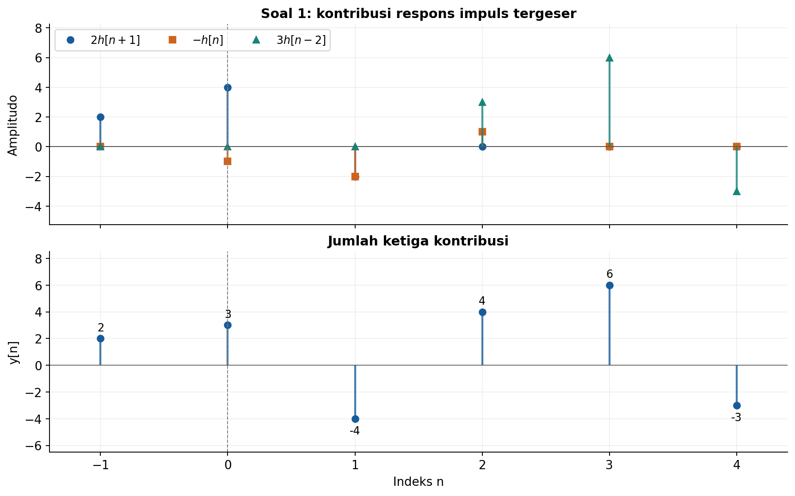
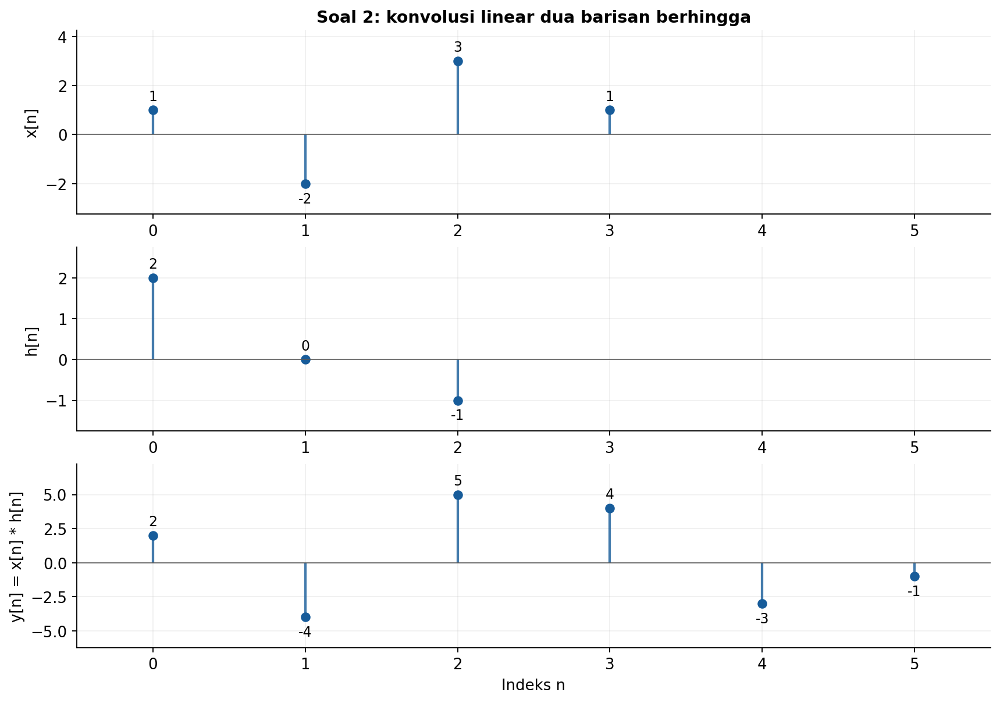
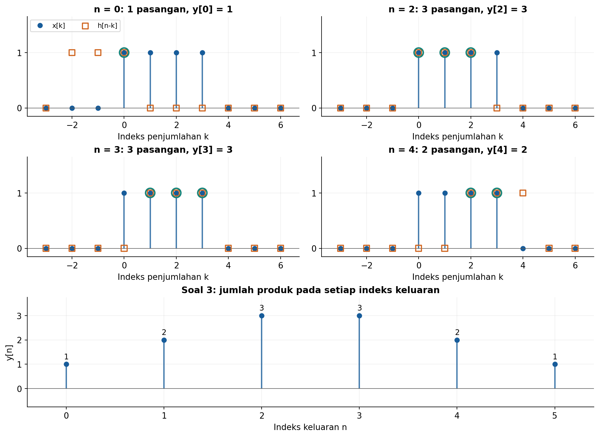
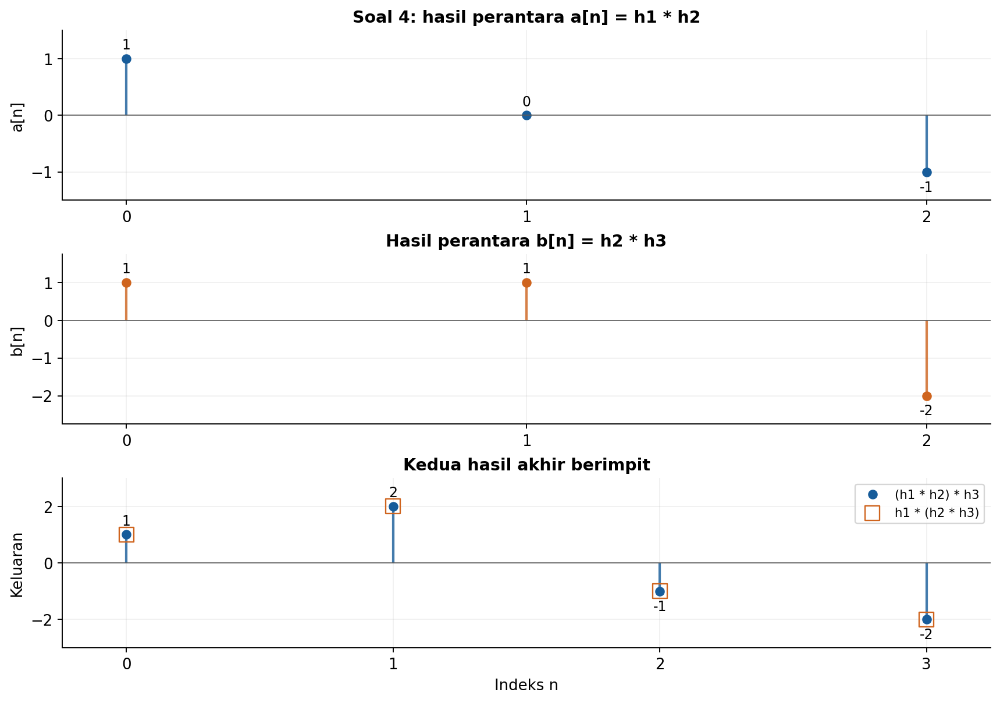
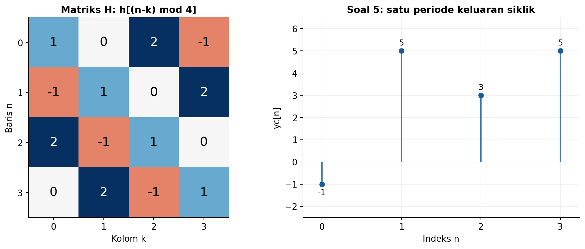
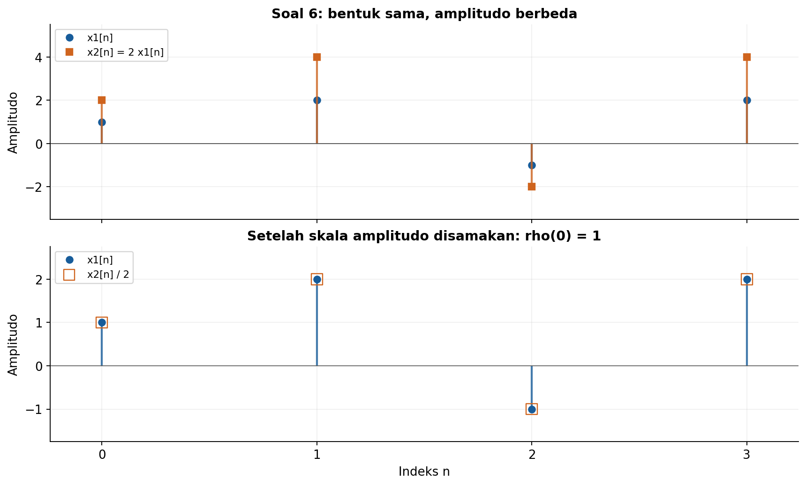
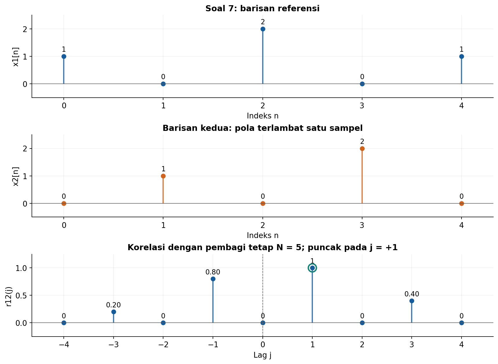
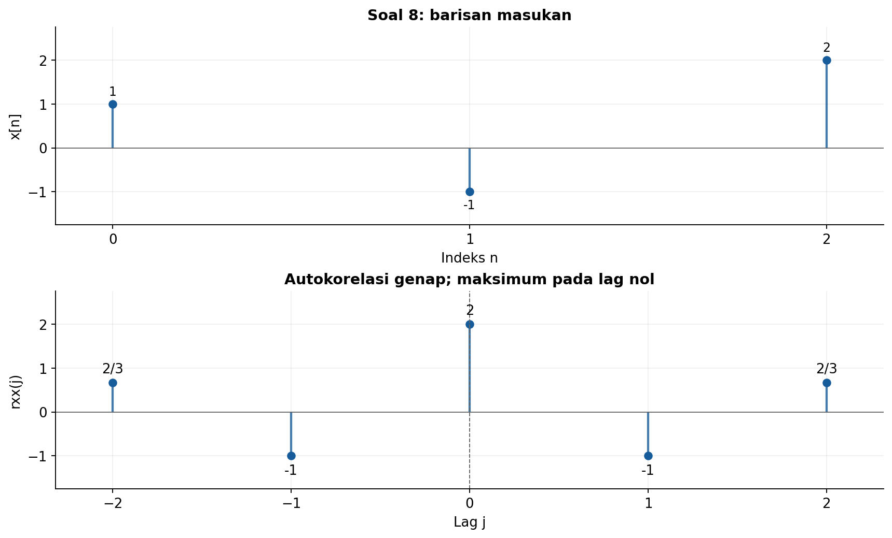
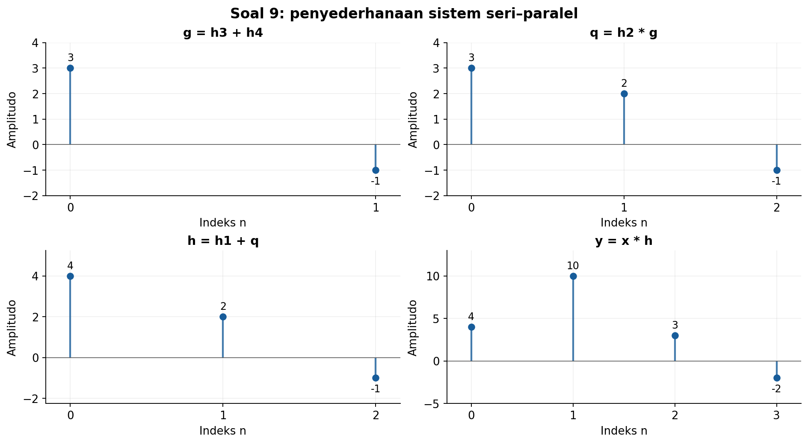
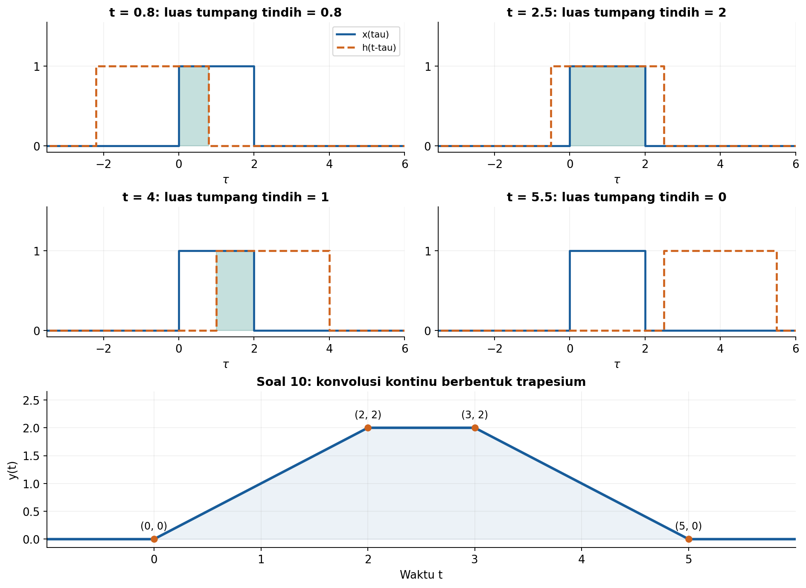

# Solusi Latihan Hitungan Tangan Kuliah 3

## Konvolusi, Korelasi, dan Interkoneksi Sistem LTI

**Konvensi yang digunakan.** Jika tidak dinyatakan lain, elemen pertama suatu barisan berada pada $n=0$, dan sampel di luar barisan bernilai nol. Semua sistem LTI diasumsikan berada dalam keadaan awal diam ketika keluarannya dihitung melalui respons impuls. Unit step diskret memenuhi $u[n]=1$ untuk $n\geq0$ dan $u[n]=0$ untuk $n<0$.

Untuk korelasi, kita menggunakan definisi dalam catatan kuliah:

$$
r_{12}(j)=\frac{1}{N}\sum_{n=0}^{N-1}x_1[n]x_2[n+j].
$$

Pembagi $N$ tetap sama pada seluruh *lag*, termasuk ketika jumlah pasangan yang bertumpang tindih berkurang. Koefisien korelasi pada soal 6 menggunakan normalisasi energi tanpa pengurangan rerata, sesuai definisi dalam catatan.

---

## 1. Dekomposisi impuls dan respons LTI

### Soal

Diberikan $x[n]=2\delta[n+1]-\delta[n]+3\delta[n-2]$ dan respons impuls $h[n]=\{1,2,-1\}$ dengan indeks nol pada elemen pertama. Tuliskan keluaran sebagai kombinasi respons impuls tergeser, lalu hitung seluruh sampel tak nol $y[n]$.

### Penyelesaian

**Langkah 1: baca posisi setiap impuls.** Bentuk $\delta[n-n_0]$ menempatkan impuls pada $n=n_0$. Karena itu, $\delta[n+1]=\delta[n-(-1)]$ berada pada $n=-1$.

| Lokasi $n$ | $-1$ | $0$ | $1$ | $2$ |
| ---: | ---: | ---: | ---: | ---: |
| $x[n]$ | $2$ | $-1$ | $0$ | $3$ |

Respons impuls bernilai $h[0]=1$, $h[1]=2$, dan $h[2]=-1$. Di luar indeks tersebut, $h[n]=0$.

**Langkah 2: gunakan linearitas dan invariansi waktu.** Respons sistem terhadap $a\delta[n-n_0]$ adalah $a h[n-n_0]$. Oleh sebab itu,

$$
\boxed{y[n]=2h[n+1]-h[n]+3h[n-2].}
$$

Suku pertama memajukan respons impuls satu sampel, suku kedua mengalikan respons dengan $-1$, dan suku ketiga menunda respons dua sampel sekaligus mengalikannya dengan $3$. Kita harus menjumlahkan ketiganya pada indeks $n$ yang sama.

**Langkah 3: tentukan rentang indeks keluaran.** Sampel pertama masukan berada pada $n=-1$ dan sampel terakhirnya pada $n=2$. Karena respons impuls berada pada $0\leq n\leq2$, keluaran hanya mungkin tak nol dari $-1+0=-1$ sampai $2+2=4$.

| $n$ | $2h[n+1]$ | $-h[n]$ | $3h[n-2]$ | $y[n]$ |
| ---: | ---: | ---: | ---: | ---: |
| $-1$ | $2$ | $0$ | $0$ | $2$ |
| $0$ | $4$ | $-1$ | $0$ | $3$ |
| $1$ | $-2$ | $-2$ | $0$ | $-4$ |
| $2$ | $0$ | $1$ | $3$ | $4$ |
| $3$ | $0$ | $0$ | $6$ | $6$ |
| $4$ | $0$ | $0$ | $-3$ | $-3$ |

Sebagai contoh, pada $n=2$ diperoleh $y[2]=2h[3]-h[2]+3h[0]=0-(-1)+3=4$. Jadi, seluruh sampel tak nol adalah

$$
\boxed{y[-1]=2,\quad y[0]=3,\quad y[1]=-4,\quad y[2]=4,\quad y[3]=6,\quad y[4]=-3.}
$$

Hasil tersebut juga dapat ditulis sebagai dekomposisi impuls berikut. Bentuk ini menghindari keraguan mengenai posisi indeks nol pada barisan keluaran.

$$
y[n]=2\delta[n+1]+3\delta[n]-4\delta[n-1]+4\delta[n-2]+6\delta[n-3]-3\delta[n-4].
$$



Panel atas memperlihatkan ketiga kontribusi respons, sedangkan panel bawah menunjukkan hasil penjumlahannya. Garis vertikal pada $n=0$ membantu membedakan pergeseran ke kiri dan ke kanan.

---

## 2. Konvolusi linear langsung

### Soal

Hitung $y[n]=x[n]*h[n]$ untuk $x[n]=\{1,-2,3,1\}$ dan $h[n]=\{2,0,-1\}$, dengan indeks nol pada elemen pertama. Tunjukkan perhitungan setiap sampel dan periksa panjang keluarannya memakai $N=N_1+N_2-1$.

### Penyelesaian

**Langkah 1: tentukan indeks dan panjang keluaran.** Masukan memiliki empat sampel pada $0\leq n\leq3$, sedangkan respons impuls memiliki tiga sampel pada $0\leq n\leq2$. Dengan demikian,

$$
N=4+3-1=6,
\qquad 0\leq n\leq5.
$$

**Langkah 2: tuliskan penjumlahan konvolusi.** Kita memakai

$$
y[n]=\sum_{k=-\infty}^{\infty}x[k]h[n-k].
$$

Karena $h[0]=2$, $h[1]=0$, dan $h[2]=-1$, hanya pasangan dengan $n-k=0$ atau $n-k=2$ yang dapat memberi kontribusi. Bentuk ringkasnya adalah

$$
y[n]=2x[n]-x[n-2].
$$

**Langkah 3: hitung setiap sampel.** Suku yang berada di luar barisan diganti dengan nol. Seluruh enam sampel diperoleh sebagai berikut:

$$
\begin{aligned}
y[0]&=x[0]h[0]=(1)(2)=2,\\
y[1]&=x[0]h[1]+x[1]h[0]=(1)(0)+(-2)(2)=-4,\\
y[2]&=x[0]h[2]+x[1]h[1]+x[2]h[0]\\
&=(1)(-1)+(-2)(0)+(3)(2)=5,\\
y[3]&=x[1]h[2]+x[2]h[1]+x[3]h[0]\\
&=(-2)(-1)+(3)(0)+(1)(2)=4,\\
y[4]&=x[2]h[2]+x[3]h[1]=(3)(-1)+(1)(0)=-3,\\
y[5]&=x[3]h[2]=(1)(-1)=-1.
\end{aligned}
$$

Maka hasil akhirnya, dengan elemen pertama pada $n=0$, adalah

$$
\boxed{y[n]=\{2,-4,5,4,-3,-1\},\qquad n=0,1,\ldots,5.}
$$

Sebagai pemeriksaan tambahan, jumlah sampel hasil konvolusi sama dengan hasil kali jumlah sampel kedua barisan. Di sini, $\sum_n y[n]=2-4+5+4-3-1=3$, sedangkan $(\sum_n x[n])(\sum_n h[n])=(1-2+3+1)(2+0-1)=3$.



Grafik keluaran memiliki enam lokasi sampel, sesuai panjang yang dihitung. Operasi $2x[n]-x[n-2]$ juga memperlihatkan bagaimana sampel keluaran setelah masukan berakhir masih dapat bernilai tak nol.

---

## 3. Konvolusi grafis

### Soal

Diberikan $x[n]=u[n]-u[n-4]$ dan $h[n]=u[n]-u[n-3]$. Gunakan prosedur lipat–geser–kali–jumlah untuk memperoleh bentuk ruas $y[n]$, lalu buat sketsa hasilnya.

### Penyelesaian

**Langkah 1: tentukan kedua pulsa.** Selisih dua unit step menghasilkan pulsa diskret berhingga. Sinyal $x[n]$ bernilai satu pada $n=0,1,2,3$, sedangkan $h[n]$ bernilai satu pada $n=0,1,2$.

$$
x[n]=\{1,1,1,1\},\qquad h[n]=\{1,1,1\}.
$$

**Langkah 2: lipat dan geser respons impuls.** Sebagai fungsi indeks penjumlahan $k$, $h[-k]$ bernilai satu pada $-2\leq k\leq0$. Setelah digeser menjadi $h[n-k]$, syaratnya berubah menjadi

$$
0\leq n-k\leq2
\quad\Longleftrightarrow\quad
n-2\leq k\leq n.
$$

Sementara itu, $x[k]$ bernilai satu pada $0\leq k\leq3$. Produk $x[k]h[n-k]$ bernilai satu hanya pada indeks bulat yang berada di kedua rentang tersebut.

**Langkah 3: kalikan dan jumlahkan.** Batas indeks yang bertumpang tindih adalah

$$
\max(0,n-2)\leq k\leq\min(3,n).
$$

Karena setiap produk yang tak nol bernilai satu, $y[n]$ adalah banyaknya indeks bulat dalam interval itu. Jika batas bawah melebihi batas atas, tidak ada pasangan yang berkontribusi dan $y[n]=0$.

| Indeks keluaran $n$ | Indeks $k$ yang bertumpang tindih | Jumlah produk $y[n]$ |
| ---: | --- | ---: |
| $n<0$ | Tidak ada | $0$ |
| $0$ | $0$ | $1$ |
| $1$ | $0,1$ | $2$ |
| $2$ | $0,1,2$ | $3$ |
| $3$ | $1,2,3$ | $3$ |
| $4$ | $2,3$ | $2$ |
| $5$ | $3$ | $1$ |
| $n>5$ | Tidak ada | $0$ |

**Langkah 4: tuliskan fungsi ruas.** Berikut adalah bentuk ruas untuk $n$ bulat; setiap baris menyatakan nilai fungsi pada rentang yang bersangkutan. Penyajian tabel dipakai agar bentuk ruas mudah dibaca pada GitHub.

| Rentang $n$ | Nilai $y[n]$ |
| --- | --- |
| $n<0$ | $0$ |
| $0\leq n<2$ | $n+1$ |
| $2\leq n\leq3$ | $3$ |
| $3<n\leq5$ | $6-n$ |
| $n>5$ | $0$ |

Jadi,

$$
\boxed{y[n]=\{1,2,3,3,2,1\},\qquad n=0,1,\ldots,5.}
$$

Panjangnya $4+3-1=6$ sampel. Nilai maksimum $3$ terjadi ketika ketiga sampel satu pada respons impuls seluruhnya bertumpang tindih dengan pulsa masukan.



Empat panel pertama memperlihatkan $x[k]$ dan $h[n-k]$ untuk beberapa nilai $n$. Panel terakhir menunjukkan sketsa seluruh sampel keluaran; nilainya menghitung jumlah sampel yang bertumpang tindih, bukan panjang interval kontinu.

---

## 4. Sifat konvolusi dan interkoneksi

### Soal

Misalkan $h_1[n]=\{1,1\}$, $h_2[n]=\{1,-1\}$, dan $h_3[n]=\{1,2\}$. Hitung $(h_1\ast h_2)\ast h_3$ dan $h_1\ast(h_2\ast h_3)$ secara terpisah untuk memverifikasi sifat asosiatif.

### Penyelesaian

Semua barisan pada soal ini dimulai pada $n=0$. Kita menghitung kedua urutan pengelompokan secara mandiri, lalu membandingkan hasilnya.

**Cara pertama: hitung $a[n]=h_1[n]*h_2[n]$.** Kedua barisan panjangnya dua, sehingga $a[n]$ memiliki $2+2-1=3$ sampel:

$$
\begin{aligned}
a[0]&=(1)(1)=1,\\
a[1]&=(1)(-1)+(1)(1)=0,\\
a[2]&=(1)(-1)=-1.
\end{aligned}
$$

Jadi $a[n]=\{1,0,-1\}$. Selanjutnya, hitung $y_A[n]=a[n]*h_3[n]$ yang panjangnya $3+2-1=4$:

$$
\begin{aligned}
y_A[0]&=(1)(1)=1,\\
y_A[1]&=(1)(2)+(0)(1)=2,\\
y_A[2]&=(0)(2)+(-1)(1)=-1,\\
y_A[3]&=(-1)(2)=-2.
\end{aligned}
$$

Dengan pengelompokan pertama, diperoleh

$$
(h_1*h_2)*h_3=\{1,2,-1,-2\}.
$$

**Cara kedua: hitung $b[n]=h_2[n]*h_3[n]$.** Perhitungan tiga sampelnya adalah

$$
\begin{aligned}
b[0]&=(1)(1)=1,\\
b[1]&=(1)(2)+(-1)(1)=1,\\
b[2]&=(-1)(2)=-2.
\end{aligned}
$$

Jadi $b[n]=\{1,1,-2\}$. Selanjutnya, hitung $y_B[n]=h_1[n]*b[n]$:

$$
\begin{aligned}
y_B[0]&=(1)(1)=1,\\
y_B[1]&=(1)(1)+(1)(1)=2,\\
y_B[2]&=(1)(-2)+(1)(1)=-1,\\
y_B[3]&=(1)(-2)=-2.
\end{aligned}
$$

Dengan demikian, kedua pengelompokan menghasilkan nilai yang sama pada setiap indeks:

```math
\boxed{(h_1*h_2)*h_3=h_1*(h_2*h_3)=\{1,2,-1,-2\}.}
```

Perhitungan ini memverifikasi sifat asosiatif untuk barisan pada soal. Dalam hubungan tiga sistem seri, kita dapat menggabungkan dua blok pertama atau dua blok terakhir terlebih dahulu tanpa mengubah respons impuls total.



Hasil perantara $a[n]$ dan $b[n]$ berbeda karena pasangan yang dikonvolusikan berbeda. Kedua keluaran akhir tetap sama, sebagaimana terlihat pada panel terakhir.

---

## 5. Konvolusi siklik

### Soal

Hitung konvolusi siklik panjang empat antara $x[n]=\{2,1,0,3\}$ dan $h[n]=\{1,-1,2,0\}$. Kerjakan dengan pergeseran siklik dan dengan matriks sirkulan, lalu bandingkan kedua hasilnya.

### Penyelesaian

**Langkah 1: tuliskan definisi konvolusi siklik.** Untuk $N=4$, indeks respons impuls dibaca modulo empat:

$$
y_c[n]=\sum_{k=0}^{3}x[k]h[(n-k)\bmod4],\qquad n=0,1,2,3.
$$

Sebagai contoh, indeks $-1$ dibaca sebagai $3$ dan indeks $-2$ dibaca sebagai $2$. Karena itu, sampel yang melewati ujung barisan kembali masuk dari ujung lainnya.

**Cara pertama: pergeseran siklik.** Untuk setiap $n$, tuliskan $h[(n-k)\bmod4]$ dalam urutan $k=0,1,2,3$. Kalikan baris tersebut dengan $x=\{2,1,0,3\}$, lalu jumlahkan.

| $n$ | $h[(n-k)\bmod4]$ untuk $k=0,1,2,3$ | Perhitungan $y_c[n]$ | Hasil |
| ---: | --- | --- | ---: |
| $0$ | $\{1,0,2,-1\}$ | $(2)(1)+(1)(0)+(0)(2)+(3)(-1)$ | $-1$ |
| $1$ | $\{-1,1,0,2\}$ | $(2)(-1)+(1)(1)+(0)(0)+(3)(2)$ | $5$ |
| $2$ | $\{2,-1,1,0\}$ | $(2)(2)+(1)(-1)+(0)(1)+(3)(0)$ | $3$ |
| $3$ | $\{0,2,-1,1\}$ | $(2)(0)+(1)(2)+(0)(-1)+(3)(1)$ | $5$ |

Maka satu periode keluarannya adalah $\{-1,5,3,5\}$. Jika dipandang sebagai barisan periodik, berlaku $y_c[n+4]=y_c[n]$.

**Cara kedua: matriks sirkulan.** Elemen baris $n$ dan kolom $k$ pada matriks adalah $h[(n-k)\bmod4]$. Dengan urutan indeks yang sama seperti tabel, kita memperoleh

```math
\begin{bmatrix}
y_c[0]\\y_c[1]\\y_c[2]\\y_c[3]
\end{bmatrix}
=
\begin{bmatrix}
1&0&2&-1\\
-1&1&0&2\\
2&-1&1&0\\
0&2&-1&1
\end{bmatrix}
\begin{bmatrix}2\\1\\0\\3\end{bmatrix}
=
\begin{bmatrix}-1\\5\\3\\5\end{bmatrix}.
```

Setiap baris perkalian matriks tepat sama dengan satu perhitungan pergeseran siklik. Jadi, kedua metode memberikan

$$
\boxed{y_c[n]=\{-1,5,3,5\},\qquad n=0,1,2,3.}
$$

**Pemeriksaan dengan konvolusi linear.** Konvolusi linear dari kedua larik panjang empat menghasilkan $\{2,-1,3,5,-3,6,0\}$ pada $n=0,\ldots,6$. Untuk memperoleh hasil siklik panjang empat, sampel pada indeks $4,5,6$ ditambahkan ke indeks $0,1,2$:

$$
\begin{aligned}
y_c[0]&=2+(-3)=-1,\\
y_c[1]&=-1+6=5,\\
y_c[2]&=3+0=3,\\
y_c[3]&=5.
\end{aligned}
$$

Pemeriksaan ini menjelaskan mengapa hasil siklik berbeda dari konvolusi linear. Panjang siklik pada soal memang ditetapkan empat, sehingga kontribusi yang melewati indeks tiga harus dilipat kembali.



Panel kiri memperlihatkan nilai respons impuls yang dipakai pada tiap pasangan indeks. Panel kanan menampilkan satu periode hasilnya.

---

## 6. Korelasi silang dan koefisien korelasi

### Soal

Diberikan $x_1[n]=\{1,2,-1,2\}$ dan $x_2[n]=\{2,4,-2,4\}$. Hitung $r_{12}(0)$ dan $\rho_{12}(0)$ menggunakan definisi pada catatan, lalu jelaskan makna nilai koefisien yang diperoleh.

### Penyelesaian

**Langkah 1: hitung korelasi pada lag nol.** Kedua barisan memiliki $N=4$ sampel. Pada $j=0$, sampel yang dikalikan berada pada indeks yang sama:

$$
\begin{aligned}
r_{12}(0)
&=\frac{1}{4}\sum_{n=0}^{3}x_1[n]x_2[n]\\
&=\frac{(1)(2)+(2)(4)+(-1)(-2)+(2)(4)}{4}\\
&=\frac{2+8+2+8}{4}=5.
\end{aligned}
$$

**Langkah 2: hitung energi kedua barisan.** Energi yang diperlukan untuk normalisasi adalah jumlah kuadrat sampelnya:

$$
\begin{aligned}
E_1&=1^2+2^2+(-1)^2+2^2=10,\\
E_2&=2^2+4^2+(-2)^2+4^2=40.
\end{aligned}
$$

**Langkah 3: gunakan definisi koefisien korelasi.** Pembagi normalisasi pada catatan adalah $(1/N)\sqrt{E_1E_2}$. Substitusinya memberikan

$$
\rho_{12}(0)
=\frac{r_{12}(0)}{\frac{1}{4}\sqrt{(10)(40)}}
=\frac{5}{\frac{1}{4}(20)}=1.
$$

Dengan demikian,

$$
\boxed{r_{12}(0)=5,\qquad\rho_{12}(0)=1.}
$$

**Makna hasil.** Pada setiap indeks, $x_2[n]=2x_1[n]$. Kedua barisan memiliki bentuk dan tanda yang sama, dengan faktor skala positif, sehingga koefisien ternormalisasinya mencapai satu. Nilai ini tidak mensyaratkan amplitudo kedua barisan identik.

Definisi yang digunakan adalah korelasi ternormalisasi tanpa pengurangan rerata. Koefisien Pearson menggunakan data yang telah dikurangi reratanya; kita tidak mengganti definisi soal dengan definisi tersebut.



Panel pertama menunjukkan $x_2[n]$ memiliki amplitudo dua kali $x_1[n]$. Setelah $x_2[n]$ dibagi dua, sampelnya berimpit dengan $x_1[n]$, sesuai hubungan proporsional yang menghasilkan $\rho_{12}(0)=1$.

---

## 7. Korelasi terhadap lag

### Soal

Diberikan $x_1[n]=\{1,0,2,0,1\}$ dan $x_2[n]=\{0,1,0,2,0\}$. Hitung $r_{12}(j)$ untuk $-4\leq j\leq4$ dengan normalisasi tetap $1/N$, lalu tentukan *lag* puncaknya dan tafsirkan arah pergeserannya.

### Penyelesaian

**Langkah 1: tuliskan definisi dan aturan indeks.** Dengan $N=5$, kita memakai

$$
r_{12}(j)=\frac{1}{5}\sum_{n=0}^{4}x_1[n]x_2[n+j].
$$

Sampel $x_2[n+j]$ bernilai nol jika $n+j<0$ atau $n+j>4$. Sementara itu, $x_1[n]$ hanya tak nol pada $n=0,2,4$, sehingga penjumlahan dapat dipersingkat menjadi

$$
5r_{12}(j)=x_2[j]+2x_2[j+2]+x_2[j+4].
$$

**Langkah 2: evaluasi sembilan lag.** Tabel berikut menampilkan ketiga kontribusi dalam bentuk ringkas tersebut. Pembagi tetap lima digunakan pada semua baris.

| $j$ | $x_2[j]$ | $2x_2[j+2]$ | $x_2[j+4]$ | Jumlah produk | $r_{12}(j)$ |
| ---: | ---: | ---: | ---: | ---: | ---: |
| $-4$ | $0$ | $0$ | $0$ | $0$ | $0$ |
| $-3$ | $0$ | $0$ | $1$ | $1$ | $1/5$ |
| $-2$ | $0$ | $0$ | $0$ | $0$ | $0$ |
| $-1$ | $0$ | $2$ | $2$ | $4$ | $4/5$ |
| $0$ | $0$ | $0$ | $0$ | $0$ | $0$ |
| $1$ | $1$ | $4$ | $0$ | $5$ | $1$ |
| $2$ | $0$ | $0$ | $0$ | $0$ | $0$ |
| $3$ | $2$ | $0$ | $0$ | $2$ | $2/5$ |
| $4$ | $0$ | $0$ | $0$ | $0$ | $0$ |

Sebagai contoh, pada $j=1$ diperoleh

$$
\begin{aligned}
r_{12}(1)
&=\frac{1}{5}\bigl[x_1[0]x_2[1]+x_1[1]x_2[2]+x_1[2]x_2[3]\\
&\qquad+x_1[3]x_2[4]+x_1[4]x_2[5]\bigr]\\
&=\frac{(1)(1)+(0)(0)+(2)(2)+(0)(0)+(1)(0)}{5}\\
&=1.
\end{aligned}
$$

Urutan hasilnya, dengan *lag* berturut-turut $-4,-3,\ldots,4$, adalah

$$
\boxed{\left\{0,\frac{1}{5},0,\frac{4}{5},0,1,0,\frac{2}{5},0\right\}.}
$$

Di luar rentang $-4\leq j\leq4$, kedua rekaman tidak bertumpang tindih dan korelasinya nol. Nilai maksimum adalah

$$
\boxed{j_{\text{puncak}}=1,\qquad r_{12}(1)=1.}
$$

**Langkah 3: tafsirkan tanda lag.** Pada definisi $x_2[n+j]$, memilih $j=1$ berarti menggeser $x_2$ satu sampel ke kiri saat dibandingkan dengan $x_1$. Pergeseran ini menyelaraskan sampel satu dan dua pada kedua rekaman. Dengan demikian, pola pada $x_2$ **terlambat satu sampel** terhadap pola pada $x_1$.

Rekaman $x_2$ merupakan versi $x_1$ yang ditunda satu sampel lalu dipotong pada indeks terakhir rekaman. Sampel terakhir $x_1[4]=1$ akan muncul pada $x_2[5]$, tetapi indeks tersebut berada di luar data yang diberikan. Karena itu, nilai yang dipakai dalam perhitungan adalah $x_2[5]=0$.

Nilai $r_{12}(1)=1$ di sini adalah korelasi dengan pembagi lima, bukan koefisien korelasi ternormalisasi energi. Angka satu tersebut tidak boleh langsung ditafsirkan sebagai kesamaan sempurna kedua rekaman lengkap.



Puncak ditandai pada $j=1$, sedangkan garis putus-putus menunjukkan *lag* nol. Untuk mencocokkan konvensi ini dengan NumPy pada barisan real, gunakan `np.correlate(x2, x1, mode="full") / N`.

---

## 8. Autokorelasi

### Soal

Hitung autokorelasi lengkap dari $x[n]=\{1,-1,2\}$ untuk semua *lag* yang mungkin. Verifikasi bahwa nilai maksimum terjadi pada *lag* nol dan bahwa hasilnya genap.

### Penyelesaian

**Langkah 1: tentukan normalisasi dan rentang lag.** Kita mengikuti definisi pada catatan dengan $N=3$:

$$
r_{xx}(j)=\frac{1}{3}\sum_{n=0}^{2}x[n]x[n+j].
$$

Rentang pergeseran yang masih memungkinkan tumpang tindih adalah $-2\leq j\leq2$. Untuk $|j|\geq3$, tidak ada pasangan sampel yang bertumpang tindih sehingga hasilnya nol.

**Langkah 2: hitung semua nilai.** Pada setiap *lag*, kita menjumlahkan hanya pasangan yang masih berada dalam rekaman. Nilai di luar rekaman adalah nol.

$$
\begin{aligned}
r_{xx}(-2)&=\frac{x[2]x[0]}{3}=\frac{(2)(1)}{3}=\frac{2}{3},\\
r_{xx}(-1)&=\frac{x[1]x[0]+x[2]x[1]}{3}
=\frac{(-1)(1)+(2)(-1)}{3}=-1,\\
r_{xx}(0)&=\frac{x^2[0]+x^2[1]+x^2[2]}{3}
=\frac{1+1+4}{3}=2,\\
r_{xx}(1)&=\frac{x[0]x[1]+x[1]x[2]}{3}
=\frac{(1)(-1)+(-1)(2)}{3}=-1,\\
r_{xx}(2)&=\frac{x[0]x[2]}{3}=\frac{(1)(2)}{3}=\frac{2}{3}.
\end{aligned}
$$

Dengan urutan *lag* $-2,-1,0,1,2$, hasil lengkapnya adalah

$$
\boxed{r_{xx}(j)=\left\{\frac{2}{3},-1,2,-1,\frac{2}{3}\right\}.}
$$

**Langkah 3: periksa nilai maksimum.** Pada *lag* nol, setiap sampel dikalikan dengan dirinya sendiri. Nilainya $r_{xx}(0)=2$, lebih besar daripada $-1$ dan $2/3$, sehingga maksimum terjadi pada $j=0$.

**Langkah 4: periksa sifat genap.** Dari hasil hitungan, $r_{xx}(-1)=r_{xx}(1)=-1$ dan $r_{xx}(-2)=r_{xx}(2)=2/3$. Jadi,

$$
\boxed{r_{xx}(-j)=r_{xx}(j).}
$$

Jika autokorelasi ditulis sebagai jumlah produk tanpa faktor $1/3$, hasilnya adalah $\{2,-3,6,-3,2\}$. Kita tetap memakai hasil yang dibagi tiga agar konsisten dengan definisi pada catatan; nilainya pada *lag* nol adalah energi rata-rata per sampel, bukan selalu satu.



Grafik simetris terhadap $j=0$ dan memiliki puncak tertinggi di sana. Nilai negatif pada $j=\pm1$ berasal dari hasil kali pasangan sampel yang berlawanan tanda.

---

## 9. Sistem seri–paralel

### Soal

Suatu sistem mempunyai $h[n]=h_1[n]+h_2[n]*(h_3[n]+h_4[n])$, dengan $h_1=\{1\}$, $h_2=\{1,1\}$, $h_3=\{1,-1\}$, dan $h_4=\{2\}$. Hitung respons impuls total, kemudian hitung keluaran untuk $x[n]=\{1,2\}$.

### Penyelesaian

**Langkah 1: gabungkan cabang paralel $h_3$ dan $h_4$.** Penjumlahan respons impuls dilakukan pada indeks yang sama. Karena $h_4$ hanya memiliki satu sampel tak nol, kita menambahkan nol pada indeks berikutnya:

$$
g[n]=h_3[n]+h_4[n]
=\{1,-1\}+\{2,0\}
=\{3,-1\}.
$$

**Langkah 2: gabungkan hubungan seri dengan $h_2$.** Respons impuls cabang ini adalah $q[n]=h_2[n]*g[n]$. Hitung ketiga sampelnya:

$$
\begin{aligned}
q[0]&=(1)(3)=3,\\
q[1]&=(1)(-1)+(1)(3)=2,\\
q[2]&=(1)(-1)=-1.
\end{aligned}
$$

Dengan demikian, $q[n]=\{3,2,-1\}$. Panjangnya $2+2-1=3$ sampel.

**Langkah 3: jumlahkan dengan cabang langsung $h_1$.** Pada indeks $n=0,1,2$, $h_1$ dapat ditulis sebagai $\{1,0,0\}$. Respons impuls total menjadi

$$
\begin{aligned}
h[n]&=h_1[n]+q[n]\\
&=\{1,0,0\}+\{3,2,-1\}\\
&=\{4,2,-1\}.
\end{aligned}
$$

Jadi,

$$
\boxed{h[n]=\{4,2,-1\},\qquad n=0,1,2.}
$$

**Langkah 4: hitung keluaran $y[n]=x[n]*h[n]$.** Masukan panjangnya dua dan respons impuls panjangnya tiga, sehingga keluaran memiliki empat sampel:

$$
\begin{aligned}
y[0]&=(1)(4)=4,\\
y[1]&=(1)(2)+(2)(4)=10,\\
y[2]&=(1)(-1)+(2)(2)=3,\\
y[3]&=(2)(-1)=-2.
\end{aligned}
$$

Hasil akhirnya adalah

$$
\boxed{y[n]=\{4,10,3,-2\},\qquad n=0,1,2,3.}
$$

**Pemeriksaan melalui kedua cabang.** Keluaran cabang langsung adalah $x*h_1=\{1,2\}$, sedangkan keluaran cabang gabungan adalah $x*q=\{3,8,3,-2\}$. Setelah indeks disamakan, penjumlahannya adalah $\{1,2,0,0\}+\{3,8,3,-2\}=\{4,10,3,-2\}$, sesuai hasil di atas.



Penjumlahan dipakai untuk hubungan paralel, sedangkan konvolusi dipakai untuk hubungan seri. Memisahkan kedua operasi tersebut mencegah kesalahan ketika menyederhanakan diagram sistem.

---

## 10. Konvolusi kontinu

### Soal

Diberikan $x(t)=u(t)-u(t-2)$ dan $h(t)=u(t)-u(t-3)$. Tentukan titik perubahan tumpang tindih, turunkan $y(t)=x(t)*h(t)$ dalam bentuk fungsi ruas, dan buat sketsa hasilnya.

### Penyelesaian

**Langkah 1: kenali kedua pulsa.** Sinyal $x(t)$ bernilai satu pada interval $0<t<2$ dan nol di luarnya, sedangkan $h(t)$ bernilai satu pada $0<t<3$. Nilai tepat pada titik batas pulsa tidak memengaruhi integral karena kumpulan titik tersebut memiliki panjang nol.

**Langkah 2: tentukan batas tumpang tindih.** Definisi konvolusi adalah

$$
y(t)=\int_{-\infty}^{\infty}x(\tau)h(t-\tau)d\tau.
$$

Sebagai fungsi $\tau$, pulsa pertama tidak nol pada $0\leq\tau\leq2$. Pulsa kedua yang telah dilipat dan digeser memenuhi

$$
0\leq t-\tau\leq3
\quad\Longleftrightarrow\quad
t-3\leq\tau\leq t.
$$

Karena itu, batas bawah dan batas atas perpotongannya adalah

$$
L(t)=\max(0,t-3),\qquad U(t)=\min(2,t).
$$

Ketika $L(t)<U(t)$, integrannya bernilai satu pada interval tersebut, sehingga $y(t)=U(t)-L(t)$. Ketika $L(t)\geq U(t)$, luas tumpang tindihnya nol.

**Langkah 3: tentukan titik perubahan.** Interval tetap memiliki tepi pada $0$ dan $2$, sedangkan interval bergerak memiliki tepi pada $t-3$ dan $t$. Perubahan terjadi ketika tepi-tepi tersebut bertemu:

| Peristiwa | Persamaan tepi | Waktu $t$ |
| --- | --- | ---: |
| Tumpang tindih mulai muncul | $t=0$ | $0$ |
| Tepi kanan bergerak mencapai ujung pulsa pertama | $t=2$ | $2$ |
| Tepi kiri bergerak mencapai awal pulsa pertama | $t-3=0$ | $3$ |
| Tumpang tindih berakhir | $t-3=2$ | $5$ |

Jadi, titik perubahannya adalah $t=0,2,3,5$. Kita mengevaluasi integral pada setiap interval yang dibatasi titik-titik tersebut.

**Langkah 4: evaluasi integral per ruas.** Untuk $t<0$, interval bergerak seluruhnya berada sebelum pulsa pertama, sehingga tidak ada tumpang tindih dan $y(t)=0$.

Untuk $0\leq t\leq2$, batas bawahnya $0$ dan batas atasnya $t$. Luas tumpang tindih bertambah sebanding dengan $t$:

$$
y(t)=\int_{0}^{t}1 d\tau=[\tau]_{0}^{t}=t.
$$

Untuk $2<t\leq3$, seluruh pulsa pertama berada di dalam pulsa kedua yang telah digeser. Batas integralnya tetap $0$ dan $2$:

$$
y(t)=\int_{0}^{2}1 d\tau=[\tau]_{0}^{2}=2.
$$

Untuk $3<t\leq5$, tepi kiri interval bergerak masuk ke pulsa pertama. Batas bawah menjadi $t-3$ dan batas atas tetap $2$:

$$
y(t)=\int_{t-3}^{2}1 d\tau=[\tau]_{t-3}^{2}=2-(t-3)=5-t.
$$

Untuk $t>5$, kedua pulsa kembali tidak bertumpang tindih. Karena itu, $y(t)=0$.

**Langkah 5: tuliskan hasil fungsi ruas dan sketsanya.** Hasil lengkap dinyatakan pada tabel berikut. Nilai batas dipilih konsisten, dan rumus dari kedua sisi memberikan nilai yang sama pada setiap titik perubahan.

| Rentang waktu | Nilai $y(t)$ |
| --- | --- |
| $t<0$ | $0$ |
| $0\leq t\leq2$ | $t$ |
| $2<t\leq3$ | $2$ |
| $3<t\leq5$ | $5-t$ |
| $t>5$ | $0$ |

Bentuk tersebut merupakan fungsi trapesium yang melewati titik $(0,0)$, $(2,2)$, $(3,2)$, dan $(5,0)$. Di luar interval $[0,5]$, fungsi bernilai nol. Bentuk ringkas yang ekuivalen adalah

$$
\boxed{y(t)=\max\bigl(0,\min(2,t)-\max(0,t-3)\bigr).}
$$

**Pemeriksaan hasil.** Tinggi maksimum sama dengan panjang pulsa yang lebih pendek, yaitu dua, karena tinggi kedua pulsa masukan adalah satu. Luas hasil konvolusi juga harus sama dengan hasil kali luas kedua pulsa:

$$
\begin{aligned}
\int_{-\infty}^{\infty}y(t)dt
&=\frac{1}{2}(2)(2)+(1)(2)+\frac{1}{2}(2)(2)\\
&=2+2+2=6,\\
\left(\int x(t)dt\right)\left(\int h(t)dt\right)&=(2)(3)=6.
\end{aligned}
$$



Daerah berwarna pada empat panel pertama menunjukkan lokasi produk $x(\tau)h(t-\tau)$ bernilai satu. Pada panel terakhir, nilai konvolusi adalah luas daerah tersebut untuk setiap $t$.