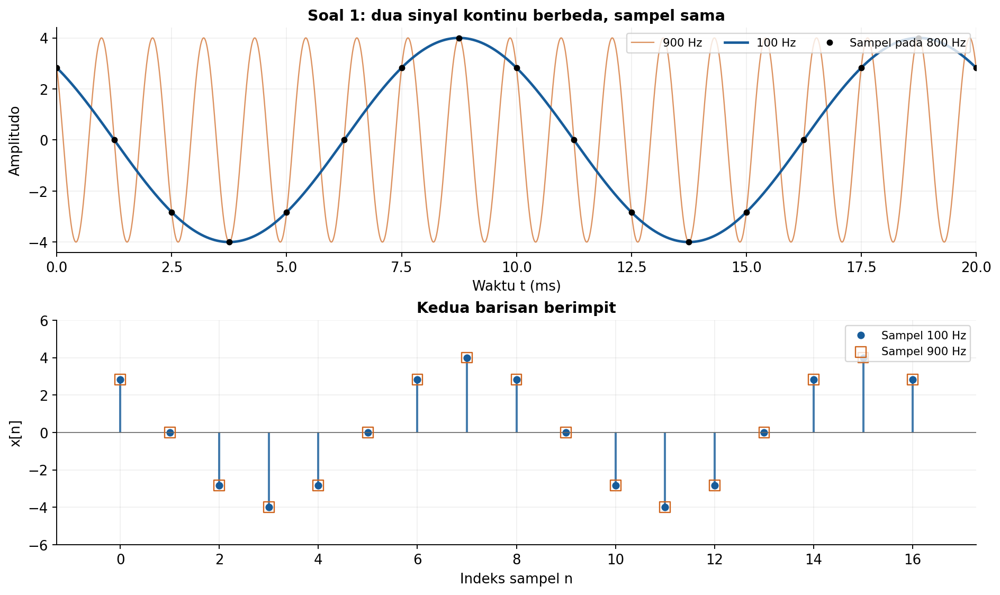
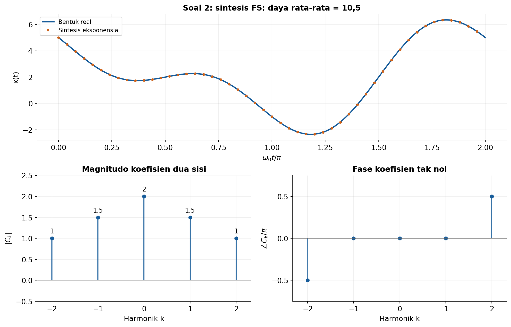
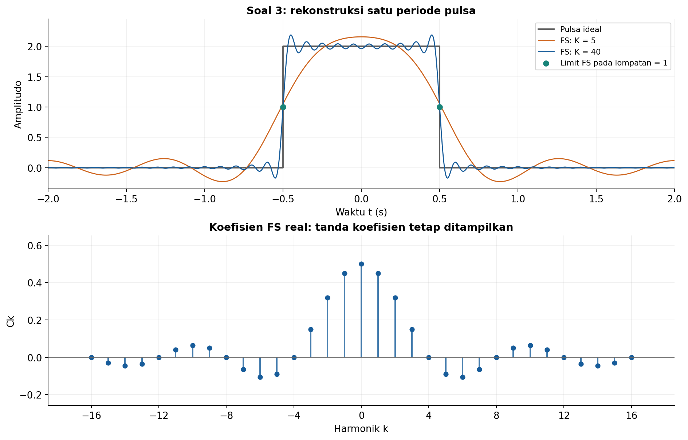
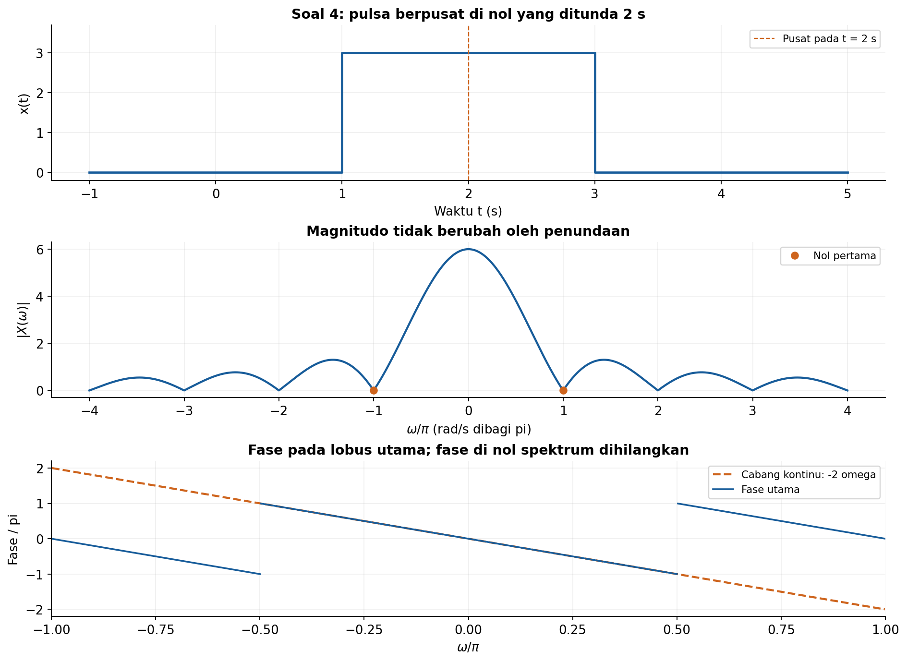
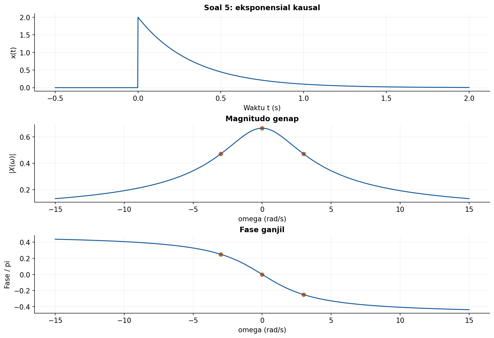
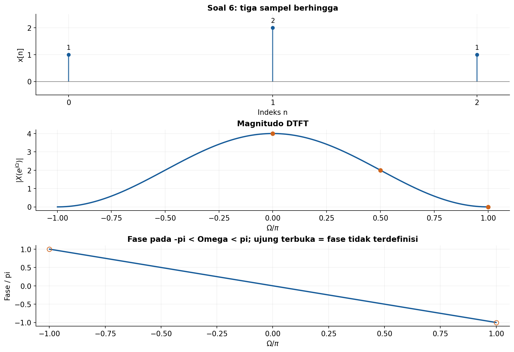
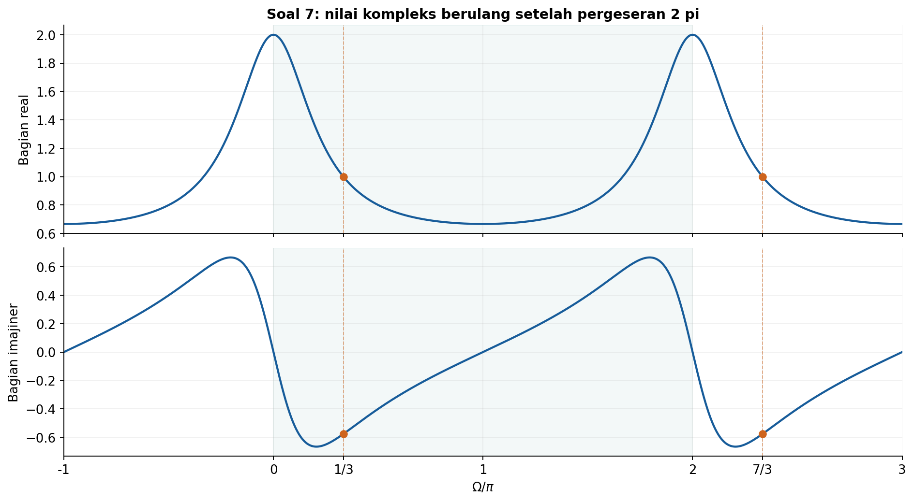
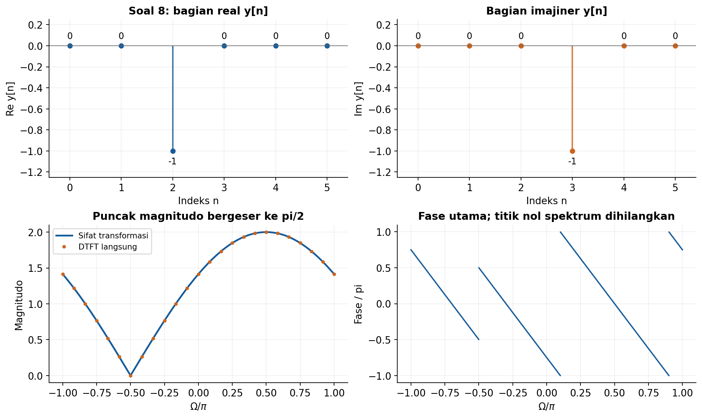
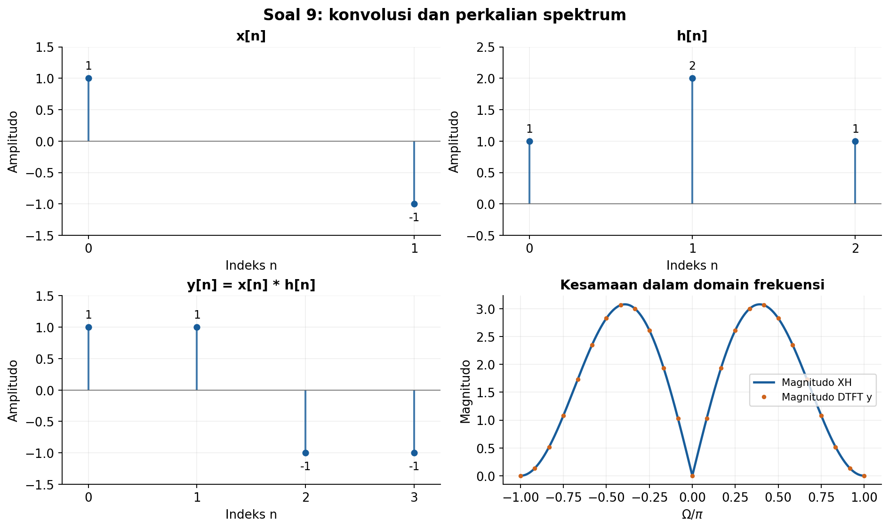
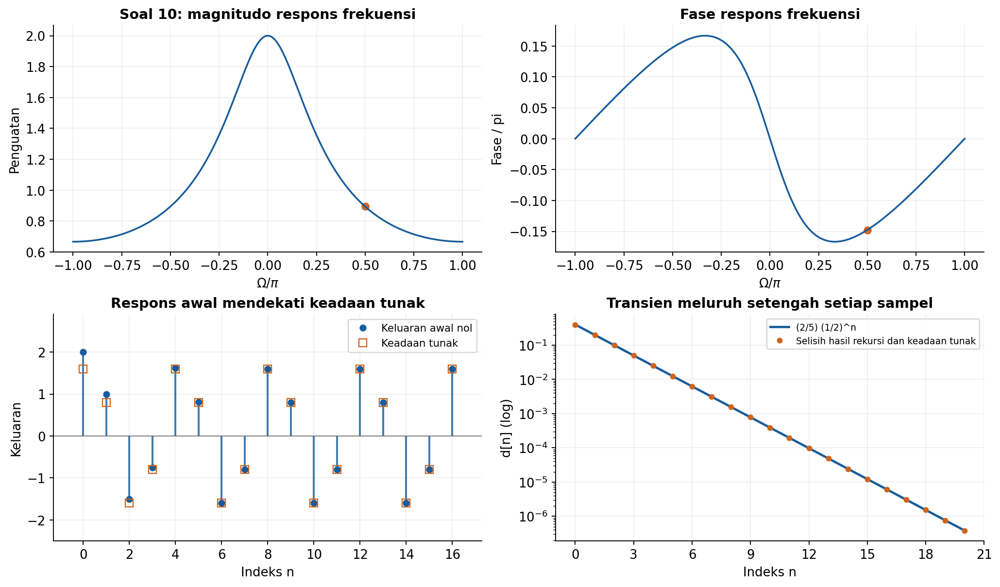

# Solusi Latihan Hitungan Tangan Kuliah 4

## Representasi Fourier: FS, FT, dan DTFT

### Konvensi dan notasi

Kita menggunakan $j=\sqrt{-1}$, frekuensi sudut kontinu $\omega$ dalam rad/s, dan frekuensi sudut diskret $\Omega$ dalam rad/sampel. Frekuensi biasa adalah $f=\omega/(2\pi)$ dalam Hz, sedangkan setelah sampling berlaku $\Omega=2\pi f/f_s$.

Pasangan analisis dan sintesis deret Fourier kompleks adalah

$$
C_k=\frac{1}{T_0}\int_{t_a}^{t_a+T_0}x(t)e^{-jk\omega_0t}dt,
\qquad x(t)=\sum_{k=-\infty}^{\infty}C_ke^{jk\omega_0t},
\qquad \omega_0=\frac{2\pi}{T_0}.
$$

Transformasi Fourier dan DTFT menggunakan tanda eksponen negatif pada transformasi maju:

$$
X(\omega)=\int_{-\infty}^{\infty}x(t)e^{-j\omega t}dt,
\qquad X(e^{j\Omega})=\sum_{n=-\infty}^{\infty}x[n]e^{-j\Omega n}.
$$

Fungsi sinc yang dipakai adalah $\text{sinc}(v)=\sin(\pi v)/(\pi v)$ untuk $v\ne0$, dengan $\text{sinc}(0)=1$. Fase selalu dinyatakan modulo $2\pi$, dan fase bilangan kompleks nol tidak terdefinisi. Dalam tabel, tanda “tidak terdefinisi” tidak boleh diganti dengan nol.

---

## 1. Sinusoid kompleks dan frekuensi sampling

### Soal

Uraikan $4\cos(200\pi t+\pi/4)$ menjadi dua eksponensial kompleks dan tentukan frekuensinya dalam Hz. Jika $f_s=800$ Hz, tentukan frekuensi diskretnya serta satu frekuensi analog berbeda yang menghasilkan sampel kosinus identik dengan fase awal yang sama.

### Penyelesaian

**Langkah 1: gunakan rumus Euler.** Identitas $\cos\theta=(e^{j\theta}+e^{-j\theta})/2$ membagi satu kosinus menjadi pasangan eksponensial kompleks. Dengan $\theta=200\pi t+\pi/4$, diperoleh

$$
\begin{aligned}
x(t)&=\frac{4}{2}\left[e^{j(200\pi t+\pi/4)}+e^{-j(200\pi t+\pi/4)}\right]\\
&=2e^{j\pi/4}e^{j200\pi t}+2e^{-j\pi/4}e^{-j200\pi t}.
\end{aligned}
$$

Jadi, koefisien pada frekuensi sudut $+200\pi$ adalah $2e^{j\pi/4}$, sedangkan pada $-200\pi$ adalah $2e^{-j\pi/4}$. Magnitudo setiap koefisien adalah dua, yaitu setengah amplitudo kosinus semula.

**Langkah 2: ubah rad/s menjadi Hz.** Frekuensi kosinusnya adalah

$$
\boxed{f=\frac{200\pi}{2\pi}=100\ \text{Hz}.}
$$

**Langkah 3: lakukan sampling.** Periode sampling adalah $T_s=1/800$ s, sehingga $t=nT_s$ memberikan

$$
\begin{aligned}
x[n]&=4\cos\left(200\pi\frac{n}{800}+\frac{\pi}{4}\right)\\
&=4\cos\left(\frac{\pi}{4}n+\frac{\pi}{4}\right).
\end{aligned}
$$

Dengan demikian,

$$
\boxed{\Omega=\frac{\pi}{4}\ \text{rad/sampel}.}
$$

Satu periode diskret terdiri atas delapan sampel karena $(\pi/4)N=2\pi$ memberikan $N=8$. Frekuensi diskret ekuivalen juga dapat ditulis sebagai $\pi/4+2\pi m$, dengan $m$ bilangan bulat.

**Langkah 4: pilih frekuensi analog yang memberikan sampel sama.** Ambil $f'=100+800=900$ Hz dengan amplitudo dan fase awal yang sama. Sampelnya memenuhi

$$
\begin{aligned}
x'[n]&=4\cos\left(2\pi\frac{900}{800}n+\frac{\pi}{4}\right)\\
&=4\cos\left(\frac{\pi}{4}n+2\pi n+\frac{\pi}{4}\right)\\
&=4\cos\left(\frac{\pi}{4}n+\frac{\pi}{4}\right)=x[n].
\end{aligned}
$$

Kesamaan terakhir berlaku karena $n$ bilangan bulat, sehingga $2\pi n$ adalah kelipatan satu putaran penuh. Maka salah satu jawaban yang diminta adalah

$$
\boxed{f'=900\ \text{Hz}.}
$$

Kurva waktu-kontinu kedua kosinus berbeda, tetapi titik-titik sampelnya berimpit. Ini merupakan contoh aliasing: data sampel saja tidak dapat membedakan kedua frekuensi tersebut tanpa informasi tambahan.

---

## 2. Koefisien FS sinusoid

### Soal

Tentukan seluruh koefisien FS tak nol untuk $x(t)=2+3\cos(\omega_0t)-2\sin(2\omega_0t)$. Tuliskan magnitudo dan fase setiap koefisien serta hitung daya rata-ratanya menggunakan hubungan Parseval.

### Penyelesaian

**Langkah 1: uraikan kosinus dan sinus.** Untuk suku kosinus, rumus Euler memberikan

$$
3\cos(\omega_0t)=\frac{3}{2}e^{j\omega_0t}+\frac{3}{2}e^{-j\omega_0t}.
$$

Untuk suku sinus, perhatikan bahwa $1/j=-j$, sehingga $-1/j=j$. Dengan demikian,

$$
\begin{aligned}
-2\sin(2\omega_0t)
&=-\frac{2}{2j}\left[e^{j2\omega_0t}-e^{-j2\omega_0t}\right]\\
&=je^{j2\omega_0t}-je^{-j2\omega_0t}.
\end{aligned}
$$

Gabungkan dengan komponen konstan dua. Bentuk sintesisnya menjadi

$$
x(t)=2+\frac{3}{2}e^{j\omega_0t}+\frac{3}{2}e^{-j\omega_0t}
+je^{j2\omega_0t}-je^{-j2\omega_0t}.
$$

**Langkah 2: baca koefisien setiap harmonik.** Koefisien $C_k$ adalah pengali eksponensial $e^{jk\omega_0t}$. Oleh karena itu,

$$
\boxed{C_0=2,\qquad C_1=C_{-1}=\frac{3}{2},\qquad C_2=j,\qquad C_{-2}=-j.}
$$

Semua koefisien untuk $k$ selain $0,\pm1,\pm2$ bernilai nol. Magnitudo dan fase koefisien tak nol dirangkum berikut.

| $k$ | $C_k$ | Magnitudo | Fase |
| ---: | --- | ---: | --- |
| $-2$ | $-j$ | $1$ | $-\pi/2$ |
| $-1$ | $3/2$ | $3/2$ | $0$ |
| $0$ | $2$ | $2$ | $0$ |
| $1$ | $3/2$ | $3/2$ | $0$ |
| $2$ | $j$ | $1$ | $\pi/2$ |

Karena sinyal real, pasangan koefisien memenuhi $C_{-k}=C_k^{*}$. Tabel memperlihatkan magnitudo pasangan yang sama serta fase yang berlawanan tanda.

**Langkah 3: gunakan Parseval.** Dengan konvensi koefisien FS pada catatan, daya rata-rata adalah jumlah kuadrat magnitudo semua koefisien:

$$
\begin{aligned}
P&=\sum_{k=-\infty}^{\infty}|C_k|^2\\
&=2^2+\left(\frac{3}{2}\right)^2+\left(\frac{3}{2}\right)^2+1^2+1^2\\
&=4+\frac{9}{4}+\frac{9}{4}+1+1
=\frac{21}{2}.
\end{aligned}
$$

Jadi,

$$
\boxed{P=10{,}5.}
$$

Sebagai pemeriksaan, daya komponen DC adalah $2^2=4$, daya kosinus adalah $3^2/2=4{,}5$, dan daya sinus adalah $(-2)^2/2=2$. Suku silang rata-ratanya nol karena komponen-komponen tersebut ortogonal selama satu periode, sehingga totalnya kembali $10{,}5$.

Spektrum yang digambar adalah spektrum koefisien FS dua sisi. Tinggi garis pada $k=\pm1$ adalah $3/2$, sedangkan amplitudo kosinus dalam waktu adalah tiga.

---

## 3. FS pulsa periodik

### Soal

Pulsa tinggi dua berulang dengan periode $T_0=4$ s dan bernilai tak nol pada $-0.5<t<0.5$ dalam setiap periode. Turunkan $C_k$, hitung $C_0,C_1,C_2,C_4$, dan tentukan nilai rekonstruksi FS tepat pada titik lompatan.

### Penyelesaian

**Langkah 1: tentukan parameter pulsa.** Tinggi pulsa adalah $A=2$, lebar pulsa $\tau=1$ s, dan periode pengulangannya empat sekon. Karena itu,

$$
\omega_0=\frac{2\pi}{4}=\frac{\pi}{2}\ \text{rad/s},
\qquad D=\frac{\tau}{T_0}=\frac{1}{4}.
$$

Kita dapat memilih interval satu periode $-2<t<2$. Di dalam interval ini, integran hanya tak nol pada $-1/2<t<1/2$.

**Langkah 2: hitung $C_0$ secara terpisah.** Pada $k=0$, eksponensial dalam integral bernilai satu. Koefisien DC sama dengan luas pulsa dibagi periode:

$$
C_0=\frac{1}{4}\int_{-1/2}^{1/2}2dt
=\frac{2}{4}\left[\frac{1}{2}-\left(-\frac{1}{2}\right)\right]
=\frac{1}{2}.
$$

**Langkah 3: hitung $C_k$ untuk $k\ne0$.** Definisi koefisien memberikan

$$
\begin{aligned}
C_k
&=\frac{1}{4}\int_{-1/2}^{1/2}2e^{-jk\pi t/2}dt\\
&=\frac{1}{2}\left[\frac{e^{-jk\pi t/2}}{-jk\pi/2}\right]_{-1/2}^{1/2}\\
&=\frac{1}{2}\frac{e^{-jk\pi/4}-e^{jk\pi/4}}{-jk\pi/2}\\
&=\frac{1}{2}\frac{-2j\sin(k\pi/4)}{-jk\pi/2}\\
&=\frac{2\sin(k\pi/4)}{k\pi}.
\end{aligned}
$$

Pembagian dengan $k$ pada langkah ini berlaku untuk $k\ne0$. Dengan fungsi sinc ternormalisasi, hasil seluruh indeks dapat digabungkan menjadi

$$
\boxed{C_k=\frac{1}{2}\text{sinc}\left(\frac{k}{4}\right),\qquad k\in\mathbb{Z}.}
$$

Pada $k=0$, rumus sinc menggunakan nilai limit dan memberikan $1/2$, sesuai perhitungan langsung. Tidak ada pembagian nol jika nilai khusus sinc pada nol digunakan.

**Langkah 4: evaluasi koefisien yang diminta.** Substitusi setiap indeks menghasilkan

$$
\begin{aligned}
C_0&=\frac{1}{2},\\
C_1&=\frac{2\sin(\pi/4)}{\pi}=\frac{\sqrt{2}}{\pi},\\
C_2&=\frac{2\sin(\pi/2)}{2\pi}=\frac{1}{\pi},\\
C_4&=\frac{2\sin(\pi)}{4\pi}=0.
\end{aligned}
$$

Pulsa ini real dan genap, sehingga koefisiennya juga real dan memenuhi $C_{-k}=C_k$. Tanda koefisien pada harmonik lainnya tetap penting: koefisien negatif menyatakan fase $\pi$ modulo $2\pi$.

**Langkah 5: tentukan nilai di titik lompatan.** Pada lompatan, FS konvergen ke rata-rata limit kiri dan kanan. Karena kedua nilainya adalah nol dan dua, diperoleh

$$
\boxed{x_{\text{FS}}(t_{\text{lompat}})=\frac{0+2}{2}=1.}
$$

Titik lompatan terjadi pada $t=4m-1/2$ dan $t=4m+1/2$, dengan $m$ bilangan bulat. Nilai limit rekonstruksi ini berlaku terlepas dari nilai yang dipilih untuk mendefinisikan pulsa tepat pada batasnya.

Penjumlahan FS berhingga menghasilkan riak di sekitar lompatan. Ketika jumlah harmonik bertambah, rekonstruksi di titik lompatan mendekati satu, sedangkan daerah riak menyempit sesuai perilaku Gibbs.

---

## 4. FT pulsa tertunda

### Soal

Sinyal $x(t)$ bernilai tiga pada $1<t<3$ dan nol di luar interval tersebut. Nyatakan sinyal sebagai pulsa berpusat di nol yang ditunda, lalu tentukan FT, magnitudo, fase pada lobus utama, serta lokasi nol pertama.

### Penyelesaian

**Langkah 1: tentukan pulsa dasar dan penundaannya.** Definisikan $p(t)$ sebagai pulsa tinggi tiga yang tidak nol pada $-1<t<1$. Pusat pulsa soal adalah $(1+3)/2=2$ s dan lebarnya dua sekon, sehingga

$$
\boxed{x(t)=p(t-2).}
$$

Jika $\text{rect}(v)=1$ untuk $|v|<1/2$ dan nol untuk $|v|>1/2$, maka $p(t)=3\text{rect}(t/2)$. Karena itu, sinyal juga dapat ditulis sebagai $x(t)=3\text{rect}((t-2)/2)$.

**Langkah 2: hitung FT pulsa dasar.** Pada $\omega\ne0$, integralnya adalah

$$
\begin{aligned}
P(\omega)
&=3\int_{-1}^{1}e^{-j\omega t}dt\\
&=3\frac{e^{-j\omega}-e^{j\omega}}{-j\omega}\\
&=\frac{6\sin\omega}{\omega}.
\end{aligned}
$$

Pada nol, $P(0)=6$, yaitu luas pulsa. Dengan sinc ternormalisasi, rumus yang berlaku untuk seluruh frekuensi adalah

$$
P(\omega)=6\text{sinc}\left(\frac{\omega}{\pi}\right).
$$

**Langkah 3: terapkan sifat penundaan.** Penundaan dua sekon memberikan faktor fase $e^{-j2\omega}$. Oleh karena itu,

$$
\boxed{X(\omega)=6e^{-j2\omega}\text{sinc}\left(\frac{\omega}{\pi}\right).}
$$

Hasil ini juga dapat diperiksa langsung dari integral $3\int_1^3e^{-j\omega t}dt$. Dengan memfaktorkan $e^{-j2\omega}$ dari selisih kedua eksponensial di batas integral, diperoleh $6e^{-j2\omega}\sin\omega/\omega$.

**Langkah 4: tentukan magnitudo.** Karena magnitudo eksponensial fase adalah satu, penundaan tidak mengubah magnitudo spektrum:

$$
\boxed{|X(\omega)|=6\left|\text{sinc}\left(\frac{\omega}{\pi}\right)\right|.}
$$

Di sini $X(0)=6$, sesuai luas sinyal tinggi tiga dengan lebar dua. Apabila amplitudo sinyal mempunyai satuan tertentu, FT-nya mempunyai satuan amplitudo dikalikan sekon.

**Langkah 5: tentukan fase pada lobus utama.** Lobus utama berada pada $-\pi<\omega<\pi$. Pada interval ini, $\sin\omega/\omega$ positif, termasuk nilai limit satu pada nol. Maka salah satu cabang fase kontinu adalah

$$
\boxed{\phi(\omega)=-2\omega,\qquad -\pi<\omega<\pi.}
$$

Persamaan ini menyatakan fase modulo $2\pi$. Jika fase utama harus berada pada $[-\pi,\pi)$, nilai $-2\omega$ dilipat ke rentang tersebut, sehingga grafik fase utama dapat meloncat ketika melewati batas rentangnya. Lompatan representasi fase tersebut tidak mengubah bilangan kompleks $X(\omega)$.

**Langkah 6: tentukan nol pertama.** Nol spektrum berasal dari $\sin\omega=0$ pada $\omega=m\pi$ dengan $m\ne0$. Titik $\omega=0$ bukan nol karena merupakan singularitas yang dapat dihilangkan dengan limit. Maka nol pertama di kedua sisi adalah

$$
\boxed{\omega=\pm\pi\ \text{rad/s},\qquad f=\pm\frac{1}{2}\ \text{Hz}.}
$$

Pada nol spektrum, fase tidak terdefinisi. Di luar lobus utama, perubahan tanda faktor sinc juga harus diperhitungkan ketika menentukan fase.

Fase kontinu pada lobus utama berbentuk garis dengan kemiringan $-2$, sesuai penundaan dua sekon. Grafik juga membandingkannya dengan fase utama untuk memperlihatkan perbedaan representasi sudut.

---

## 5. FT eksponensial

### Soal

Hitung FT $x(t)=2e^{-3t}u(t)$ langsung dari integral. Tentukan magnitudo dan fase pada $\omega=0$ serta $\omega=3$ rad/s, kemudian periksa simetri konjugatnya.

### Penyelesaian

**Langkah 1: tentukan batas integral.** Unit step membatasi sinyal pada $t\geq0$. FT-nya menjadi

$$
\begin{aligned}
X(\omega)
&=\int_{-\infty}^{\infty}2e^{-3t}u(t)e^{-j\omega t}dt\\
&=2\int_0^\infty e^{-(3+j\omega)t}dt\\
&=2\left[-\frac{e^{-(3+j\omega)t}}{3+j\omega}\right]_0^\infty.
\end{aligned}
$$

Karena $|e^{-(3+j\omega)t}|=e^{-3t}$, suku pada batas atas menuju nol. Suku pada batas bawah bernilai $-1/(3+j\omega)$, sehingga

$$
\boxed{X(\omega)=\frac{2}{3+j\omega}.}
$$

**Langkah 2: pisahkan magnitudo dan fase.** Magnitudo penyebut adalah $\sqrt{9+\omega^2}$. Bagian real penyebut selalu positif, sehingga fasenya dapat ditulis memakai arctangen tanpa ambiguitas kuadran:

$$
|X(\omega)|=\frac{2}{\sqrt{9+\omega^2}},
\qquad \angle X(\omega)=-\arctan\left(\frac{\omega}{3}\right).
$$

**Langkah 3: evaluasi dua frekuensi.** Pada $\omega=0$, $X(0)=2/3$ adalah bilangan real positif. Pada $\omega=3$ rad/s, kalikan pembilang dan penyebut dengan konjugat penyebut:

$$
X(3)=\frac{2}{3+3j}
=\frac{2(3-3j)}{3^2+3^2}
=\frac{1-j}{3}.
$$

Hasilnya dirangkum berikut. Fase pada $\omega=3$ negatif karena bagian imajiner $X(3)$ negatif.

| $\omega$ (rad/s) | $X(\omega)$ | Magnitudo | Fase |
| ---: | --- | --- | --- |
| $0$ | $2/3$ | $2/3$ | $0$ |
| $3$ | $(1-j)/3$ | $\sqrt{2}/3$ | $-\pi/4$ |

**Langkah 4: periksa simetri konjugat.** Mengganti $\omega$ dengan $-\omega$ menghasilkan

$$
X(-\omega)=\frac{2}{3-j\omega}
=\left(\frac{2}{3+j\omega}\right)^{*}
=X^{*}(\omega).
$$

Jadi, simetri konjugat terpenuhi, sesuai sifat FT sinyal real. Sebagai contoh, $X(-3)=(1+j)/3$ adalah konjugat $X(3)$. Magnitudo genap terhadap frekuensi, sedangkan fase pada cabang yang dipakai di sini bersifat ganjil.

Penanda pada $\omega=\pm3$ memperlihatkan magnitudo yang sama dan fase berlawanan. Nilai FT pada nol juga sama dengan luas sinyal, yaitu $\int_0^\infty2e^{-3t}dt=2/3$.

---

## 6. DTFT barisan berhingga

### Soal

Diberikan $x[n]=\{1,2,1\}$ dengan indeks nol pada elemen pertama. Turunkan DTFT dalam bentuk $4e^{-j\Omega}\cos^2(\Omega/2)$, lalu tentukan magnitudo dan fase pada $\Omega=0,\pi/2,\pi$ dengan memperhatikan fase pada nol spektrum.

### Penyelesaian

**Langkah 1: masukkan tiga sampel ke definisi DTFT.** Sampel tak nol terletak pada $n=0,1,2$. Karena itu,

$$
X(e^{j\Omega})=1+2e^{-j\Omega}+e^{-j2\Omega}.
$$

**Langkah 2: faktorkan eksponensial.** Bentuk kuadrat dapat ditulis sebagai $(1+e^{-j\Omega})^2$. Dengan memisahkan faktor fase setengah sampel, diperoleh

$$
\begin{aligned}
1+e^{-j\Omega}
&=e^{-j\Omega/2}\left(e^{j\Omega/2}+e^{-j\Omega/2}\right)\\
&=2e^{-j\Omega/2}\cos(\Omega/2).
\end{aligned}
$$

Kuadratkan seluruh faktor, termasuk eksponensialnya. Maka

$$
\begin{aligned}
X(e^{j\Omega})
&=\left[2e^{-j\Omega/2}\cos(\Omega/2)\right]^2\\
&=4e^{-j\Omega}\cos^2(\Omega/2).
\end{aligned}
$$

Jadi, bentuk yang diminta adalah

$$
\boxed{X(e^{j\Omega})=4e^{-j\Omega}\cos^2(\Omega/2).}
$$

**Langkah 3: tentukan magnitudo dan fase.** Faktor $\cos^2(\Omega/2)$ tidak negatif untuk semua frekuensi. Dengan demikian,

$$
|X(e^{j\Omega})|=4\cos^2(\Omega/2),
\qquad \angle X(e^{j\Omega})=-\Omega\pmod{2\pi},
$$

dengan rumus fase hanya berlaku jika $X(e^{j\Omega})\ne0$. Nol spektrum terjadi pada $\Omega=(2m+1)\pi$, dengan $m$ bilangan bulat.

**Langkah 4: evaluasi frekuensi yang diminta.** Perhitungan langsung menghasilkan

$$
\begin{aligned}
X(e^{j0})&=1+2+1=4,\\
X(e^{j\pi/2})&=1+2(-j)+(-1)=-2j,\\
X(e^{j\pi})&=1+2(-1)+1=0.
\end{aligned}
$$

Oleh karena itu,

| $\Omega$ (rad/sampel) | DTFT | Magnitudo | Fase |
| --- | --- | ---: | --- |
| $0$ | $4$ | $4$ | $0$ |
| $\pi/2$ | $-2j$ | $2$ | $-\pi/2$ |
| $\pi$ | $0$ | $0$ | Tidak terdefinisi |

Pada $\Omega=\pi$, kita tidak boleh langsung menyatakan fase $-\pi$ dari rumus $-\Omega$. Rumus tersebut mengalikan faktor amplitudo nol pada titik ini, sedangkan nol dapat ditulis dengan sembarang sudut dan tidak memiliki fase yang unik.

Grafik fase tidak menempatkan nilai fase pada $\Omega=\pm\pi$. Nilai sudut kecil yang mungkin diberikan komputer akibat galat pembulatan di sekitar nol tidak mempunyai makna sebagai fase spektrum pada nol yang tepat.

---

## 7. DTFT eksponensial dan periodisitas

### Soal

Tentukan DTFT $x[n]=(0.5)^nu[n]$ serta nilainya pada $\Omega=0$ dan $\Omega=\pi$. Tunjukkan bahwa nilainya pada $\Omega=\pi/3$ sama dengan nilainya pada $\Omega=7\pi/3$.

### Penyelesaian

**Langkah 1: gunakan deret geometri.** Karena $u[n]=0$ untuk $n<0$, definisi DTFT memberikan

$$
\begin{aligned}
X(e^{j\Omega})
&=\sum_{n=0}^{\infty}\left(\frac{1}{2}\right)^ne^{-j\Omega n}\\
&=\sum_{n=0}^{\infty}\left(\frac{1}{2}e^{-j\Omega}\right)^n.
\end{aligned}
$$

Rasio deret adalah $r=(1/2)e^{-j\Omega}$, dengan $|r|=1/2<1$. Jumlah sampai $n=N$ adalah $(1-r^{N+1})/(1-r)$, dan $r^{N+1}\to0$ ketika $N\to\infty$. Dengan demikian,

$$
\boxed{X(e^{j\Omega})=\frac{1}{1-\frac{1}{2}e^{-j\Omega}}.}
$$

**Langkah 2: evaluasi pada nol dan $\pi$.** Pada $\Omega=0$, faktor eksponensial bernilai satu; pada $\Omega=\pi$, nilainya minus satu. Oleh sebab itu,

$$
\boxed{X(e^{j0})=\frac{1}{1-1/2}=2,
\qquad X(e^{j\pi})=\frac{1}{1+1/2}=\frac{2}{3}.}
$$

Kedua nilai tersebut real positif sehingga fasenya nol. Magnitudonya masing-masing dua dan $2/3$.

**Langkah 3: hitung nilai pada $\pi/3$.** Kita gunakan

$$
e^{-j\pi/3}=\frac{1}{2}-j\frac{\sqrt{3}}{2}.
$$

Maka penyebut DTFT menjadi

$$
1-\frac{1}{2}e^{-j\pi/3}
=\frac{3}{4}+j\frac{\sqrt{3}}{4}.
$$

Dengan mengalikan konjugat penyebut, diperoleh

$$
\begin{aligned}
X(e^{j\pi/3})
&=\frac{4}{3+j\sqrt{3}}\\
&=\frac{4(3-j\sqrt{3})}{9+3}\\
&=1-j\frac{\sqrt{3}}{3}.
\end{aligned}
$$

**Langkah 4: buktikan kesamaan pada $7\pi/3$.** Karena $7\pi/3=\pi/3+2\pi$, berlaku

$$
e^{-j7\pi/3}=e^{-j\pi/3}e^{-j2\pi}=e^{-j\pi/3}.
$$

Penyebut kedua DTFT sama persis. Jadi,

$$
\boxed{X(e^{j7\pi/3})=X(e^{j\pi/3})=1-j\frac{\sqrt{3}}{3}.}
$$

Kesamaan ini berlaku pada bilangan kompleksnya, mencakup bagian real dan imajiner. Sebagai pemeriksaan, magnitudo keduanya $2/\sqrt{3}$ dan fasenya $-\pi/6$ modulo $2\pi$.

Penanda pada $\pi/3$ dan $7\pi/3$ mempunyai nilai real dan imajiner yang sama. Pengulangan ini memperlihatkan periode frekuensi $2\pi$ pada DTFT.

---

## 8. Pergeseran dan modulasi

### Soal

Diberikan $x[n]=\delta[n]+\delta[n-1]$ dan $y[n]=e^{j\pi n/2}x[n-2]$. Tentukan DTFT $y[n]$ dengan sifat transformasi, lalu verifikasi hasilnya menggunakan dua sampel tak nol secara langsung.

### Penyelesaian

**Langkah 1: tentukan DTFT sinyal awal.** Kedua sampel tak nolnya adalah $x[0]=x[1]=1$. Dari definisi,

$$
X(e^{j\Omega})=1+e^{-j\Omega}.
$$

**Langkah 2: terapkan penundaan dua sampel.** Definisikan $v[n]=x[n-2]$. Sifat penundaan memberikan

$$
V(e^{j\Omega})=e^{-j2\Omega}X(e^{j\Omega})
=e^{-j2\Omega}(1+e^{-j\Omega}).
$$

**Langkah 3: terapkan modulasi kompleks.** Karena $y[n]=e^{j\Omega_cn}v[n]$ dengan $\Omega_c=\pi/2$, seluruh argumen frekuensi pada $V$ digeser:

$$
\begin{aligned}
Y(e^{j\Omega})
&=V(e^{j(\Omega-\pi/2)})\\
&=e^{-j2(\Omega-\pi/2)}\left[1+e^{-j(\Omega-\pi/2)}\right].
\end{aligned}
$$

Perhatikan bahwa penggantian $\Omega\mapsto\Omega-\pi/2$ juga dilakukan pada faktor fase akibat penundaan. Dengan $e^{j\pi}=-1$ dan $e^{j\pi/2}=j$, diperoleh

$$
\begin{aligned}
Y(e^{j\Omega})
&=(-e^{-j2\Omega})(1+je^{-j\Omega})\\
&=-e^{-j2\Omega}-je^{-j3\Omega}.
\end{aligned}
$$

Maka hasil akhirnya adalah

$$
\boxed{Y(e^{j\Omega})=-e^{-j2\Omega}-je^{-j3\Omega}.}
$$

**Langkah 4: verifikasi dari sampel tak nol.** Sinyal yang ditunda adalah $x[n-2]=\delta[n-2]+\delta[n-3]$. Setelah modulasi,

$$
\begin{aligned}
y[2]&=e^{j\pi(2)/2}=e^{j\pi}=-1,\\
y[3]&=e^{j\pi(3)/2}=e^{j3\pi/2}=-j.
\end{aligned}
$$

Jadi, $y[n]=-\delta[n-2]-j\delta[n-3]$. DTFT langsung kedua impuls tersebut adalah

$$
Y(e^{j\Omega})=(-1)e^{-j2\Omega}+(-j)e^{-j3\Omega},
$$

tepat sama dengan hasil menggunakan sifat transformasi. Hasil $y[n]$ kompleks karena pembawa modulasinya eksponensial kompleks.

Magnitudo spektrum mempunyai maksimum dua pada $\Omega=\pi/2$ modulo $2\pi$. Penundaan tidak mengubah magnitudo, sedangkan modulasi memindahkan lokasi spektrumnya dari frekuensi awal.

---

## 9. Konvolusi dalam domain frekuensi

### Soal

Ambil $x[n]=\{1,-1\}$ dan $h[n]=\{1,2,1\}$, dengan indeks nol pada elemen pertama. Kalikan DTFT keduanya untuk memperoleh $Y(e^{j\Omega})$, lalu baca koefisiennya untuk mendapatkan semua sampel keluaran dan periksa dengan konvolusi manual.

### Penyelesaian

**Langkah 1: tuliskan DTFT kedua barisan.** Karena indeks nol berada pada elemen pertama, diperoleh

$$
X(e^{j\Omega})=1-e^{-j\Omega},
\qquad H(e^{j\Omega})=1+2e^{-j\Omega}+e^{-j2\Omega}.
$$

**Langkah 2: kalikan dalam domain frekuensi.** Teorema konvolusi memberikan $Y=XH$. Untuk merapikan perkalian, tulis sementara $q=e^{-j\Omega}$:

$$
\begin{aligned}
Y&=(1-q)(1+2q+q^2)\\
&=(1+2q+q^2)-(q+2q^2+q^3)\\
&=1+q-q^2-q^3.
\end{aligned}
$$

Kembalikan $q$ ke bentuk eksponensial. Hasilnya adalah

$$
\boxed{Y(e^{j\Omega})=1+e^{-j\Omega}-e^{-j2\Omega}-e^{-j3\Omega}.}
$$

**Langkah 3: baca koefisien sebagai sampel keluaran.** Dalam definisi DTFT, pengali $e^{-j\Omega n}$ adalah $y[n]$. Dengan demikian,

$$
\boxed{y[0]=1,\quad y[1]=1,\quad y[2]=-1,\quad y[3]=-1.}
$$

Semua sampel di luar indeks $0,1,2,3$ bernilai nol. Panjang keluaran adalah $2+3-1=4$ sampel, sesuai hasil perkalian.

**Langkah 4: periksa dengan konvolusi manual.** Gunakan $y[n]=\sum_kx[k]h[n-k]$. Karena hanya ada dua sampel masukan, bentuknya juga dapat diringkas sebagai $y[n]=h[n]-h[n-1]$.

$$
\begin{aligned}
y[0]&=(1)(1)=1,\\
y[1]&=(1)(2)+(-1)(1)=1,\\
y[2]&=(1)(1)+(-1)(2)=-1,\\
y[3]&=(-1)(1)=-1.
\end{aligned}
$$

Maka hasil konvolusi manual adalah

$$
\boxed{y[n]=\{1,1,-1,-1\},\qquad n=0,1,2,3.}
$$

Hasil ini sama dengan pembacaan koefisien spektrum. Sebagai pemeriksaan tambahan, $Y(e^{j0})=1+1-1-1=0$, sesuai $X(e^{j0})=1-1=0$.

Program gambar memeriksa kesamaan $Y=XH$ menggunakan nilai kompleks pada seluruh kisi frekuensi. Dengan cara ini, pemeriksaan mencakup fase dan magnitudo, meskipun panel spektrum hanya menampilkan magnitudo agar mudah dibaca.

---

## 10. Respons frekuensi LTI

### Soal

Sistem kausal stabil memenuhi $y[n]=0.5y[n-1]+x[n]$ dengan kondisi awal nol. Tentukan respons frekuensi serta respons keadaan tunak terhadap $x[n]=2\cos(\pi n/2)$ yang dinyalakan pada $n=0$, lalu jelaskan mengapa respons awal dapat berbeda dari rumus keadaan tunak.

### Penyelesaian

**Langkah 1: tentukan respons impuls.** Dengan masukan $\delta[n]$, kausalitas dan keadaan awal nol memberikan $h[-1]=0$. Pada $n=0$, $h[0]=1$; untuk $n\geq1$, berlaku $h[n]=(1/2)h[n-1]$. Oleh karena itu,

$$
h[n]=\left(\frac{1}{2}\right)^nu[n].
$$

Respons ini mutlak terjumlahkan karena $\sum_{n=0}^{\infty}(1/2)^n=2$. Maka DTFT respons impuls ada dan merupakan respons frekuensi sistem:

$$
\boxed{H(e^{j\Omega})=\frac{1}{1-\frac{1}{2}e^{-j\Omega}}.}
$$

Hasil ini konsisten dengan persamaan selisih: pergeseran satu sampel memberikan faktor $e^{-j\Omega}$. Susunan $(1-(1/2)e^{-j\Omega})Y=X$ menghasilkan rasio yang sama untuk hubungan masukan-keluaran keadaan nol.

**Langkah 2: evaluasi pada frekuensi masukan.** Frekuensi sinusoid adalah $\Omega_0=\pi/2$ rad/sampel. Karena $e^{-j\pi/2}=-j$,

$$
\begin{aligned}
H(e^{j\pi/2})
&=\frac{1}{1+j/2}\\
&=\frac{1-j/2}{1+1/4}
=\frac{4}{5}-j\frac{2}{5}.
\end{aligned}
$$

Magnitudo dan fasenya adalah

$$
|H(e^{j\pi/2})|
=\sqrt{\left(\frac{4}{5}\right)^2+\left(-\frac{2}{5}\right)^2}
=\frac{2}{\sqrt{5}},
$$

$$
\angle H(e^{j\pi/2})=-\arctan\left(\frac{1}{2}\right).
$$

**Langkah 3: tentukan respons keadaan tunak.** Sistem LTI mengalikan amplitudo sinusoid dengan magnitudo respons frekuensi serta menambahkan fasenya. Karena amplitudo masukan adalah dua, diperoleh

$$
\boxed{y_{\text{ss}}[n]=\frac{4}{\sqrt{5}}
\cos\left(\frac{\pi n}{2}-\arctan\frac{1}{2}\right).}
$$

Amplitudonya sekitar $1{,}7889$ dan tambahan fasenya sekitar $-0{,}46365$ rad. Dengan identitas kosinus selisih sudut, bentuk yang ekuivalen adalah

$$
y_{\text{ss}}[n]=\frac{8}{5}\cos\left(\frac{\pi n}{2}\right)
+\frac{4}{5}\sin\left(\frac{\pi n}{2}\right).
$$

**Langkah 4: bandingkan respons awal.** Masukan yang sebenarnya dinyalakan pada $n=0$, sehingga dapat ditulis sebagai $2\cos(\pi n/2)u[n]$. Sistem berada dalam keadaan awal nol, yaitu $y[-1]=0$. Dari persamaan selisih,

$$
y[0]=\frac{1}{2}y[-1]+2\cos0=2.
$$

Sementara itu, rumus keadaan tunak memberikan $y_{\text{ss}}[0]=8/5$. Dengan demikian, pada sampel pertama terdapat selisih

$$
y[0]-y_{\text{ss}}[0]=2-\frac{8}{5}=\frac{2}{5}.
$$

Rumus keadaan tunak menggambarkan sinusoid keluaran yang akan diperoleh jika respons sinusoidal telah terbentuk. Pada saat masukan baru dinyalakan, keadaan internal sistem belum sama dengan keadaan yang diperlukan untuk respons tersebut. Akibatnya terdapat respons transien.

**Langkah 5: hitung transien secara eksplisit.** Untuk $n\geq1$, baik $y[n]$ maupun $y_{\text{ss}}[n]$ memenuhi persamaan selisih dengan masukan yang sama. Definisikan $d[n]=y[n]-y_{\text{ss}}[n]$; setelah kedua persamaan dikurangkan, diperoleh

$$
d[n]=\frac{1}{2}d[n-1].
$$

Dengan $d[0]=2/5$, solusi rekursinya adalah

$$
d[n]=\frac{2}{5}\left(\frac{1}{2}\right)^n,\qquad n\geq0.
$$

Jadi, respons lengkap setelah masukan dinyalakan adalah

$$
\boxed{y[n]=\frac{4}{\sqrt{5}}\cos\left(\frac{\pi n}{2}-\arctan\frac{1}{2}\right)
+\frac{2}{5}\left(\frac{1}{2}\right)^n,\qquad n\geq0.}
$$

Sebelum masukan dinyalakan, $y[n]=0$ untuk $n<0$. Suku transien meluruh menjadi setengah pada setiap sampel, sehingga respons akhirnya mendekati $y_{\text{ss}}[n]$.

| $n$ | $x[n]$ | $y[n]$ dari rekursi | $y_{\text{ss}}[n]$ | $d[n]$ |
| ---: | ---: | ---: | ---: | ---: |
| $0$ | $2$ | $2$ | $8/5$ | $2/5$ |
| $1$ | $0$ | $1$ | $4/5$ | $1/5$ |
| $2$ | $-2$ | $-3/2$ | $-8/5$ | $1/10$ |
| $3$ | $0$ | $-3/4$ | $-4/5$ | $1/20$ |
| $4$ | $2$ | $13/8$ | $8/5$ | $1/40$ |
| $5$ | $0$ | $13/16$ | $4/5$ | $1/80$ |

Tabel memeriksa respons lengkap melalui beberapa langkah rekursi pertama. Perbedaan respons awal dan keadaan tunak sesuai dengan suku transien yang diturunkan, sehingga tidak bertentangan dengan penggunaan respons frekuensi.

