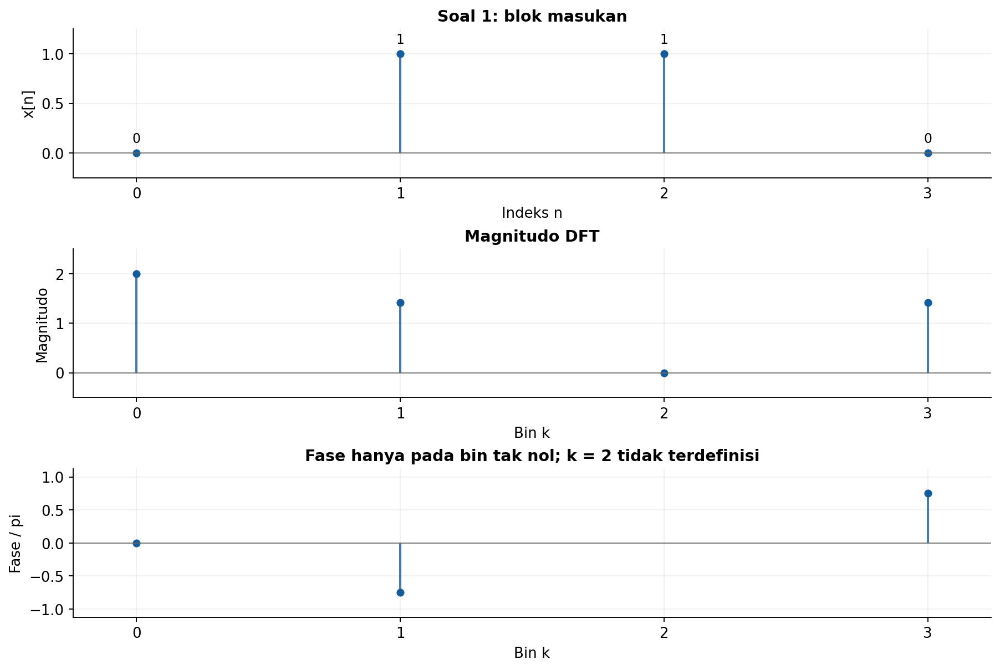
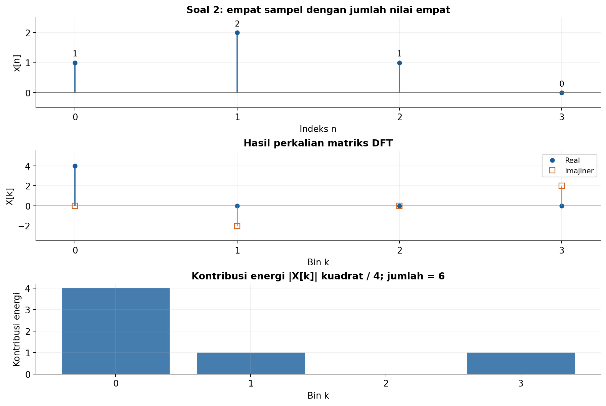
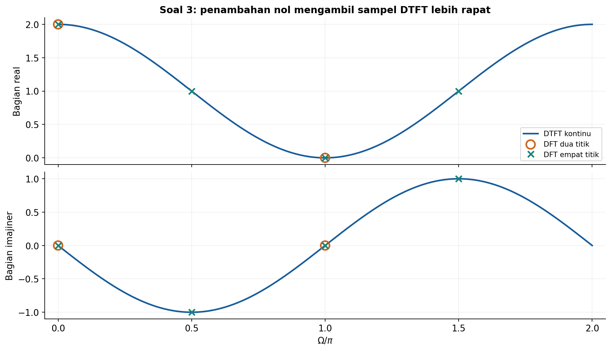
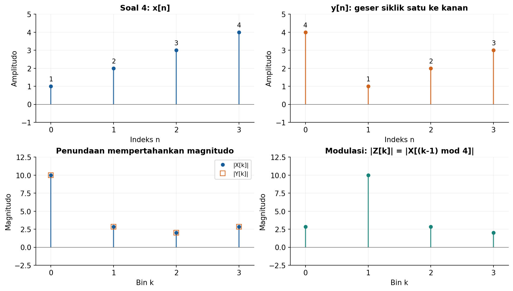
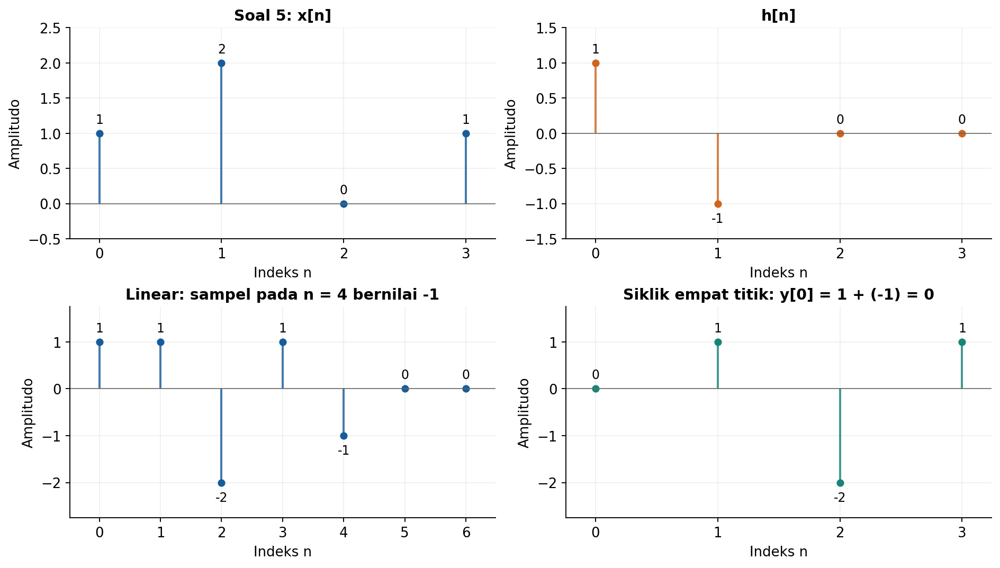
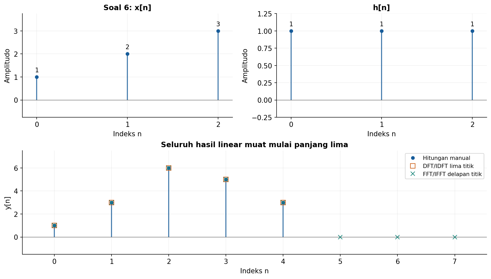
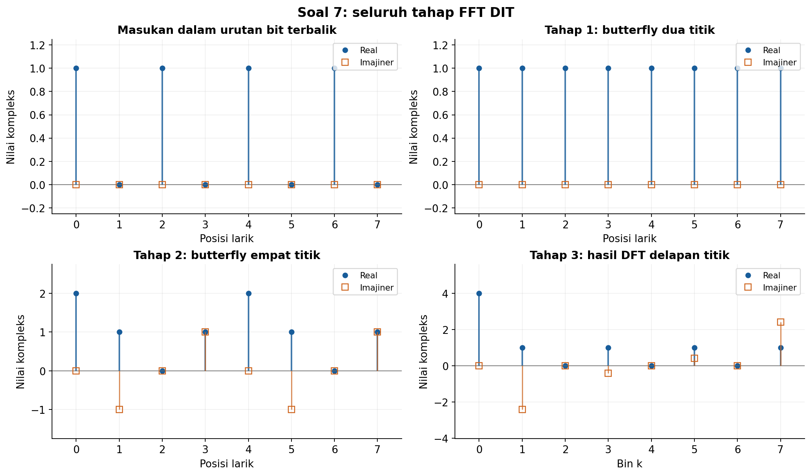
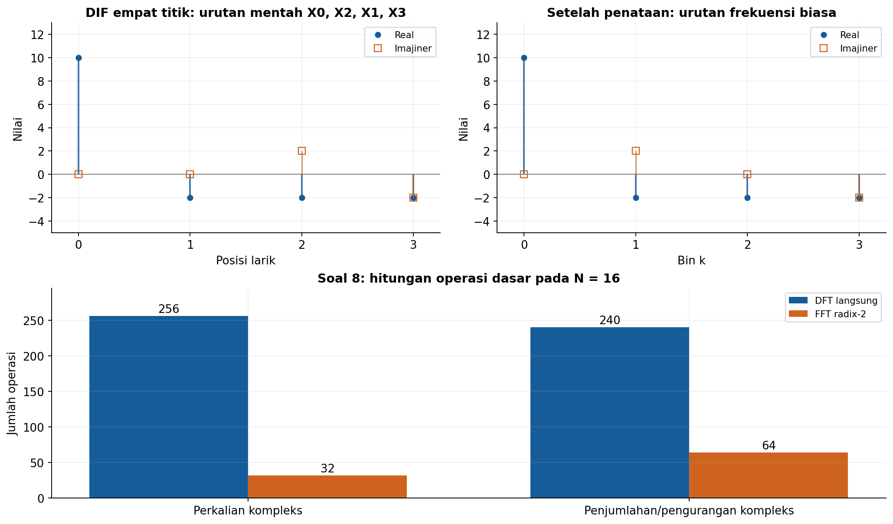
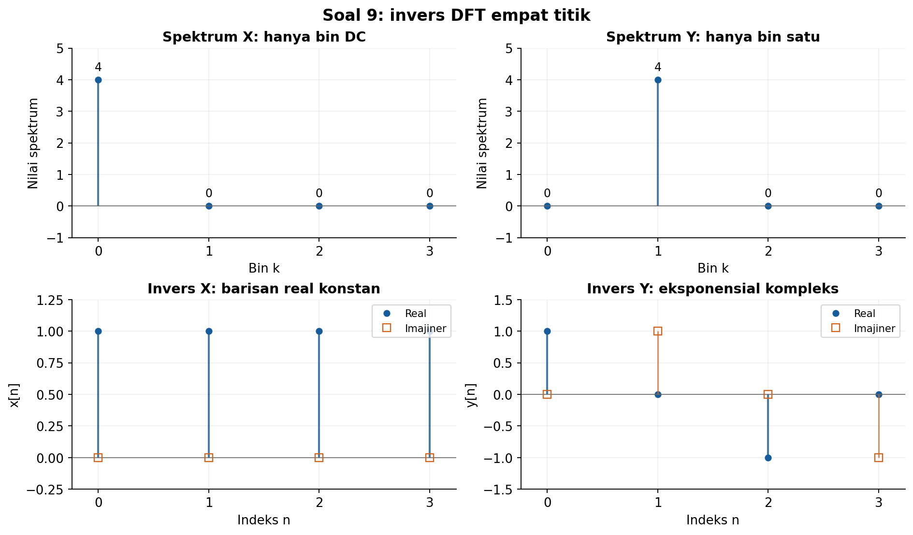
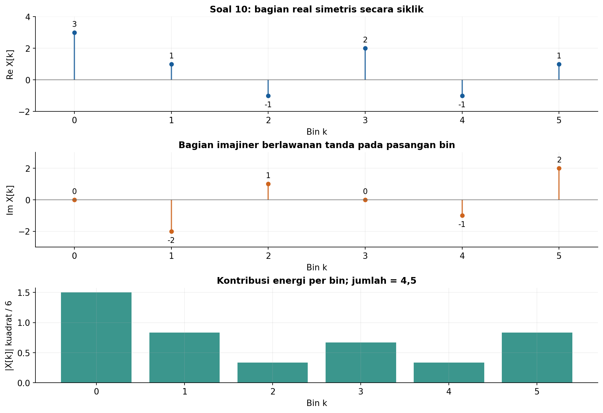

# Solusi Latihan Hitungan Tangan Kuliah 5

## DFT, FFT, Invers DFT/FFT, dan Sifat Representasi Fourier

### Konvensi yang digunakan

Elemen pertama setiap blok berada pada $n=0$. DFT maju memakai eksponen negatif tanpa faktor normalisasi, sedangkan IDFT memakai eksponen positif dan faktor $1/N$:

$$
X[k]=\sum_{n=0}^{N-1}x[n]W_N^{kn},
\qquad W_N=e^{-j2\pi/N},
$$

$$
x[n]=\frac{1}{N}\sum_{k=0}^{N-1}X[k]W_N^{-kn}.
$$

Notasi $(a)_N$ berarti sisa pembagian $a$ oleh $N$ yang dipilih dalam $0,1,\ldots,N-1$. Energi blok dihitung dengan Parseval dalam bentuk

$$
E=\sum_{n=0}^{N-1}|x[n]|^2
=\frac{1}{N}\sum_{k=0}^{N-1}|X[k]|^2.
$$

Semua fase dinyatakan dalam modulo $2\pi$, sedangkan fase pada bin bernilai nol tidak terdefinisi. FFT menghitung DFT yang sama dengan algoritma lebih efisien. FFT bukan representasi frekuensi yang berbeda.

---

## 1. DFT empat titik

### Soal

Diberikan $x[n]=\{0,1,1,0\}$. Hitung keempat nilai DFT, magnitudo, dan fasenya.

### Penyelesaian

**Langkah 1: tentukan faktor DFT.** Panjang blok adalah $N=4$, sehingga $W_4=e^{-j\pi/2}=-j$. Pangkat-pangkatnya berulang sebagai $1,-j,-1,j$.

Hanya $x[1]=1$ dan $x[2]=1$ yang tidak nol. Maka definisi DFT dapat disederhanakan menjadi

$$
X[k]=W_4^k+W_4^{2k}.
$$

**Langkah 2: hitung setiap bin.** Substitusikan $k=0,1,2,3$ dan gunakan periodisitas pangkat $W_4$:

$$
\begin{aligned}
X[0]&=1+1=2,\\
X[1]&=-j-1=-1-j,\\
X[2]&=-1+1=0,\\
X[3]&=j-1=-1+j.
\end{aligned}
$$

Jadi,

$$
\boxed{X=\{2,-1-j,0,-1+j\}.}
$$

**Langkah 3: tentukan magnitudo dan fase.** Untuk $a+jb$, magnitudo adalah $\sqrt{a^2+b^2}$, sedangkan fase harus memperhatikan kuadran. Nilai $-1-j$ berada di kuadran III dan $-1+j$ di kuadran II.

| $k$ | $X[k]$ | Magnitudo | Fase utama |
| ---: | --- | --- | --- |
| $0$ | $2$ | $2$ | $0$ |
| $1$ | $-1-j$ | $\sqrt{2}$ | $-3\pi/4$ |
| $2$ | $0$ | $0$ | Tidak terdefinisi |
| $3$ | $-1+j$ | $\sqrt{2}$ | $3\pi/4$ |

Pada bin $k=2$, fase tidak boleh diisi nol karena nilai spektrumnya tepat nol. Sebagai pemeriksaan, $X[3]=X^{*}[1]$, sesuai simetri konjugat DFT sinyal real, dan $X[0]=2$ sama dengan jumlah sampel masukan.



Grafik fase hanya menampilkan bin tak nol. Nilai fase yang mungkin diberikan komputer pada bin nol tidak dipakai untuk menafsirkan sinyal.

---

## 2. Matriks DFT

### Soal

Bentuk matriks DFT empat titik dan gunakan untuk menghitung DFT $x[n]=\{1,2,1,0\}$. Tentukan jumlah sampel, rata-rata blok, dan energi blok menggunakan hasil DFT.

### Penyelesaian

**Langkah 1: bentuk matriksnya.** Pada $N=4$, setiap elemen baris $k$ dan kolom $n$ bernilai $W_4^{kn}$, dengan $W_4=-j$. Vektor frekuensi diperoleh dengan perkalian

```math
\begin{bmatrix}X[0]\\X[1]\\X[2]\\X[3]\end{bmatrix}
=
\begin{bmatrix}
1&1&1&1\\
1&-j&-1&j\\
1&-1&1&-1\\
1&j&-1&-j
\end{bmatrix}
\begin{bmatrix}1\\2\\1\\0\end{bmatrix}.
```

**Langkah 2: hitung hasil setiap baris.** Perkalian matriks memberikan empat penjumlahan berikut:

$$
\begin{aligned}
X[0]&=(1)(1)+(1)(2)+(1)(1)+(1)(0)=4,\\
X[1]&=(1)(1)+(-j)(2)+(-1)(1)+(j)(0)=-2j,\\
X[2]&=(1)(1)+(-1)(2)+(1)(1)+(-1)(0)=0,\\
X[3]&=(1)(1)+(j)(2)+(-1)(1)+(-j)(0)=2j.
\end{aligned}
$$

Dengan demikian,

$$
\boxed{X=\{4,-2j,0,2j\}.}
$$

**Langkah 3: tentukan banyak sampel dan jumlah nilainya.** Blok memiliki $N=4$ sampel. Jumlah nilai sampelnya diperoleh dari bin DC, karena faktor eksponensial pada $k=0$ seluruhnya satu:

$$
\boxed{N=4,\qquad\sum_{n=0}^{3}x[n]=X[0]=4.}
$$

Kedua besaran tersebut kebetulan bernilai sama pada soal ini, tetapi maknanya berbeda. Nilai $N$ menyatakan banyak elemen blok, sedangkan $X[0]$ menyatakan jumlah amplitudo seluruh elemen.

**Langkah 4: hitung rata-rata dan energi dari DFT.** Rata-rata blok adalah

$$
\boxed{\bar{x}=\frac{X[0]}{N}=\frac{4}{4}=1.}
$$

Dengan Parseval, energi bloknya adalah

$$
\begin{aligned}
E&=\frac{1}{4}\left(|4|^2+|-2j|^2+|0|^2+|2j|^2\right)\\
&=\frac{16+4+0+4}{4}=6.
\end{aligned}
$$

Jadi $\boxed{E=6}$. Pemeriksaan langsung memberi $1^2+2^2+1^2+0^2=6$, sesuai hasil domain frekuensi.



Panel energi menampilkan $|X[k]|^2/N$, bukan $|X[k]|^2$ tanpa normalisasi. Jumlah tinggi seluruh batang energi adalah enam.

---

## 3. DFT sebagai sampel DTFT

### Soal

Untuk $x[n]=\{1,1\}$, turunkan DTFT dan hitung DFT dua titik. Tambahkan nol sehingga panjangnya empat, hitung DFT empat titik, lalu tunjukkan bahwa keempat nilai merupakan sampel DTFT semula pada $\Omega=0,\pi/2,\pi,3\pi/2$.

### Penyelesaian

**Langkah 1: turunkan DTFT.** Sampel tak nol berada pada $n=0,1$. Karena itu,

$$
\begin{aligned}
X(e^{j\Omega})&=1+e^{-j\Omega}\\
&=e^{-j\Omega/2}\left(e^{j\Omega/2}+e^{-j\Omega/2}\right)\\
&=2e^{-j\Omega/2}\cos(\Omega/2).
\end{aligned}
$$

DTFT ini merupakan fungsi kontinu dari frekuensi dan mengulang setiap $2\pi$. DFT mengambil nilainya pada sejumlah frekuensi tertentu.

**Langkah 2: hitung DFT dua titik.** Dengan $N=2$, frekuensi yang diambil adalah $\Omega_k=2\pi k/2$, yaitu $0$ dan $\pi$. Hasilnya

$$
X_2[0]=1+1=2,\qquad X_2[1]=1+e^{-j\pi}=0.
$$

Jadi $\boxed{X_2=\{2,0\}}$. Subskrip dua menyatakan panjang DFT, bukan sinyal waktu yang berbeda pada lokasi sampel tak nol.

**Langkah 3: tambahkan nol dan hitung DFT empat titik.** Blok masukan menjadi $x_4=\{1,1,0,0\}$. Karena dua suku tambahan bernilai nol, rumus transformasinya tetap $1+e^{-j\Omega}$, tetapi kini dievaluasi pada empat frekuensi:

| $k$ | $\Omega_k=2\pi k/4$ | $X(e^{j\Omega_k})$ | $X_4[k]$ |
| ---: | --- | --- | --- |
| $0$ | $0$ | $1+1$ | $2$ |
| $1$ | $\pi/2$ | $1-j$ | $1-j$ |
| $2$ | $\pi$ | $1-1$ | $0$ |
| $3$ | $3\pi/2$ | $1+j$ | $1+j$ |

Dengan demikian,

$$
\boxed{X_4=\{2,1-j,0,1+j\},\qquad X_4[k]=X(e^{j2\pi k/4}).}
$$

Penambahan nol memperapat pengambilan sampel frekuensi dari jarak $\pi$ menjadi $\pi/2$. Operasi ini tidak menambah data pengukuran atau mempersempit bentuk spektrum DTFT blok semula.



Kedua panel menampilkan bagian real dan imajiner, sehingga kesamaan yang diperiksa adalah kesamaan bilangan kompleks. Membandingkan magnitudo saja belum cukup untuk memeriksa kesamaan transformasi secara lengkap.

---

## 4. Pergeseran waktu dan frekuensi siklik

### Soal

Ambil $x=\{1,2,3,4\}$ dengan DFT $X$. Tuliskan $y[n]=x[(n-1)_4]$ dan $z[n]=e^{j\pi n/2}x[n]$, lalu tentukan DFT keduanya dari sifat pergeseran; hitung $X$ seperlunya untuk memberikan hasil numerik.

### Penyelesaian

**Langkah 1: hitung DFT awal.** Dengan $W_4=-j$, diperoleh

$$
\begin{aligned}
X[0]&=1+2+3+4=10,\\
X[1]&=1-2j-3+4j=-2+2j,\\
X[2]&=1-2+3-4=-2,\\
X[3]&=1+2j-3-4j=-2-2j.
\end{aligned}
$$

Maka $X=\{10,-2+2j,-2,-2-2j\}$. Kita memakai hasil yang sama untuk kedua sifat pergeseran berikut.

**Langkah 2: tuliskan pergeseran waktu siklik.** Indeks yang dibaca untuk $n=0,1,2,3$ adalah $3,0,1,2$. Jadi,

$$
\boxed{y=\{4,1,2,3\}.}
$$

Penundaan siklik satu sampel memberikan faktor fase $W_4^k$. Dengan demikian,

$$
Y[k]=W_4^kX[k]=e^{-j\pi k/2}X[k].
$$

| $k$ | $W_4^k$ | Perhitungan $Y[k]$ | Hasil |
| ---: | --- | --- | --- |
| $0$ | $1$ | $(1)(10)$ | $10$ |
| $1$ | $-j$ | $(-j)(-2+2j)$ | $2+2j$ |
| $2$ | $-1$ | $(-1)(-2)$ | $2$ |
| $3$ | $j$ | $(j)(-2-2j)$ | $2-2j$ |

Jadi,

$$
\boxed{Y=\{10,2+2j,2,2-2j\}.}
$$

**Langkah 3: tuliskan hasil modulasi.** Faktor $e^{j\pi n/2}$ pada $n=0,1,2,3$ adalah $1,j,-1,-j$. Mengalikannya dengan sampel awal menghasilkan

$$
\boxed{z=\{1,2j,-3,-4j\}.}
$$

Karena $e^{j\pi n/2}=e^{j2\pi(1)n/4}$, modulasi ini menggeser spektrum satu bin ke kanan. Tanda pergeseran dapat dibaca langsung dari penggabungan eksponen:

$$
e^{j2\pi n/4}e^{-j2\pi kn/4}=e^{-j2\pi(k-1)n/4}.
$$

Oleh karena itu,

$$
Z[k]=X[(k-1)_4].
$$

Urutan bin yang diambil adalah $X[3],X[0],X[1],X[2]$. Dengan hasil numerik awal,

$$
\boxed{Z=\{-2-2j,10,-2+2j,-2\}.}
$$

Pergeseran waktu mempertahankan magnitudo pada setiap bin, yaitu $|Y[k]|=|X[k]|$. Modulasi memindahkan lokasi bin, sehingga $|Z[k]|=|X[(k-1)_4]|$.



Pada pergeseran siklik, sampel terakhir dipindahkan ke awal tanpa membuang informasi. Pada modulasi, blok waktu menjadi kompleks dan bin DC semula berpindah ke indeks satu.

---

## 5. Konvolusi siklik

### Soal

Hitung konvolusi siklik empat titik dari $x=\{1,2,0,1\}$ dan $h=\{1,-1,0,0\}$ secara langsung. Periksa menggunakan perkalian DFT dan jelaskan mengapa hasilnya berbeda dari konvolusi linear kedua blok tersebut.

### Penyelesaian

**Langkah 1: sederhanakan penjumlahan siklik.** Karena hanya $h[0]=1$ dan $h[1]=-1$ yang tidak nol, rumus

$$
y_c[n]=\sum_{m=0}^{3}x[m]h[(n-m)_4]
$$

menjadi

$$
y_c[n]=x[n]-x[(n-1)_4].
$$

**Langkah 2: hitung empat sampel.** Sampel sebelum indeks nol dibaca kembali dari ujung blok, yaitu $x[(-1)_4]=x[3]=1$. Maka

$$
\begin{aligned}
y_c[0]&=x[0]-x[3]=1-1=0,\\
y_c[1]&=x[1]-x[0]=2-1=1,\\
y_c[2]&=x[2]-x[1]=0-2=-2,\\
y_c[3]&=x[3]-x[2]=1-0=1.
\end{aligned}
$$

Jadi,

$$
\boxed{y_c=\{0,1,-2,1\}.}
$$

**Langkah 3: periksa melalui DFT.** DFT kedua blok adalah

$$
X=\{4,1-j,-2,1+j\},
\qquad H=\{0,1+j,2,1-j\}.
$$

Sebagai contoh, $X[1]=1-2j+j=1-j$ dan $H[1]=1-(-j)=1+j$. Perkalian per bin memberikan

$$
\begin{aligned}
Y_c[0]&=(4)(0)=0,\\
Y_c[1]&=(1-j)(1+j)=2,\\
Y_c[2]&=(-2)(2)=-4,\\
Y_c[3]&=(1+j)(1-j)=2.
\end{aligned}
$$

Dengan $Y_c=\{0,2,-4,2\}$, rumus IDFT dapat disederhanakan menjadi

$$
y_c[n]=\frac{1}{4}\left[2j^n-4(-1)^n+2(-j)^n\right].
$$

Evaluasinya untuk seluruh indeks adalah

$$
\begin{aligned}
y_c[0]&=(2-4+2)/4=0,\\
y_c[1]&=(2j+4-2j)/4=1,\\
y_c[2]&=(-2-4-2)/4=-2,\\
y_c[3]&=(-2j+4+2j)/4=1.
\end{aligned}
$$

Hasilnya sama dengan perhitungan langsung. Faktor $1/4$ digunakan pada IDFT, bukan pada DFT maju atau perkalian spektrumnya.

**Langkah 4: bandingkan dengan konvolusi linear.** Dalam pembacaan linear, sampel di luar blok bernilai nol. Karena itu, $y_{\text{lin}}[n]=x[n]-x[n-1]$ memberikan

$$
\begin{aligned}
y_{\text{lin}}[0]&=1-0=1,\\
y_{\text{lin}}[1]&=2-1=1,\\
y_{\text{lin}}[2]&=0-2=-2,\\
y_{\text{lin}}[3]&=1-0=1,\\
y_{\text{lin}}[4]&=0-1=-1.
\end{aligned}
$$

Di luar lima indeks tersebut, hasilnya nol. Jika kedua larik tetap dinyatakan panjang empat, keluaran konvolusi linear panjang $4+4-1=7$ ditulis sebagai

$$
y_{\text{lin}}=\{1,1,-2,1,-1,0,0\}.
$$

Dua nol terakhir berasal dari nol di ujung $h$; panjang rentang hasil yang dapat tak nol sebenarnya lima. Pada konvolusi siklik panjang empat, sampel indeks empat dilipat dan dijumlahkan ke indeks nol:

$$
y_c[0]=y_{\text{lin}}[0]+y_{\text{lin}}[4]=1+(-1)=0.
$$

Inilah penyebab kedua hasil berbeda. Perkalian DFT empat titik menghasilkan konvolusi siklik empat titik, sehingga sampel di luar blok hasil kembali masuk melalui modulo.



Perbedaan pada indeks nol bukan kesalahan pembulatan. Perbedaan tersebut berasal dari definisi dua operasi dan panjang blok yang digunakan.

---

## 6. Konvolusi linear dengan DFT

### Soal

Untuk $x=\{1,2,3\}$ dan $h=\{1,1,1\}$, tentukan panjang DFT minimum dan hitung keluaran linear secara manual.

### Penyelesaian

**Langkah 1: tentukan panjang hasil.** Kedua barisan memiliki panjang tiga, dengan sampel awal dan akhir yang tidak nol. Panjang konvolusi linearnya adalah

$$
L_y=L_x+L_h-1=3+3-1=5.
$$

Agar perkalian DFT tidak melipat sampel hasil ke awal blok, panjang transformasi harus memenuhi $P\geq5$. Jadi,

$$
\boxed{P_{\min}=5.}
$$

DFT tidak mensyaratkan panjang berupa pangkat dua. Jika perhitungannya dibatasi pada FFT radix-2, panjang terkecil yang memenuhi syarat adalah delapan, tetapi panjang DFT minimum pada soal tetap lima.

**Langkah 2: hitung konvolusi manual.** Gunakan $y[n]=\sum_kx[k]h[n-k]$. Untuk setiap indeks hasil, diperoleh

$$
\begin{aligned}
y[0]&=(1)(1)=1,\\
y[1]&=(1)(1)+(2)(1)=3,\\
y[2]&=(1)(1)+(2)(1)+(3)(1)=6,\\
y[3]&=(2)(1)+(3)(1)=5,\\
y[4]&=(3)(1)=3.
\end{aligned}
$$

Dengan demikian,

$$
\boxed{y=\{1,3,6,5,3\},\qquad n=0,1,2,3,4.}
$$

**Langkah 3: hubungkan dengan DFT lima titik.** Setelah penambahan nol, masukan menjadi $x_P=\{1,2,3,0,0\}$ dan $h_P=\{1,1,1,0,0\}$. Dengan $q=W_5^k$, spektrumnya adalah

$$
X_P[k]=1+2q+3q^2,\qquad H_P[k]=1+q+q^2.
$$

Perkalian kedua polinom memberi

$$
\begin{aligned}
Y_P[k]
&=(1+2q+3q^2)(1+q+q^2)\\
&=1+3q+6q^2+5q^3+3q^4.
\end{aligned}
$$

Pangkat tertinggi adalah empat, sehingga semua sampel hasil muat dalam satu blok lima titik. IDFT lima titik mengembalikan koefisien $\{1,3,6,5,3\}$ tanpa pelipatan, sesuai hitungan manual.



Grafik memperlihatkan kesamaan hasil kedua cara. Dengan panjang delapan, hasil tetap sama pada lima sampel pertama dan diikuti tiga nol hingga ketelitian numerik.

---

## 7. FFT DIT delapan titik

### Soal

Hitung FFT DIT $x=\{1,1,1,1,0,0,0,0\}$ dengan tiga tahap butterfly. Tuliskan urutan bit terbalik, hasil setiap tahap, dan semua bin akhirnya; periksa komponen DC serta pasangan konjugat.

### Penyelesaian

**Langkah 1: tetapkan bentuk algoritma.** Kita menggunakan DIT iteratif radix-2 dengan masukan dalam urutan bit terbalik dan keluaran akhir dalam urutan frekuensi biasa. Karena $N=8=2^3$, diperlukan tiga tahap dengan panjang blok berturut-turut $L=2,4,8$.

Satu butterfly pada blok panjang $L$ mengubah pasangan $(a,b)$ menjadi

$$
(a,b)\longmapsto(a+w b,\ a-w b),\qquad w=W_L^r.
$$

Nilai $a$ dan $b$ harus diambil dari tahap sebelumnya sebelum keduanya diperbarui. Satu hasil perkalian $wb$ digunakan bersama oleh keluaran jumlah dan selisih.

**Langkah 2: lakukan pembalikan tiga bit.** Indeks masukan ditata ulang sebagai berikut:

| Indeks sebelum pembalikan | Tiga bit | Bit dibalik | Indeks yang dibaca |
| ---: | --- | --- | ---: |
| $0$ | `000` | `000` | $0$ |
| $1$ | `001` | `100` | $4$ |
| $2$ | `010` | `010` | $2$ |
| $3$ | `011` | `110` | $6$ |
| $4$ | `100` | `001` | $1$ |
| $5$ | `101` | `101` | $5$ |
| $6$ | `110` | `011` | $3$ |
| $7$ | `111` | `111` | $7$ |

Jadi urutan indeksnya adalah $0,4,2,6,1,5,3,7$. Dengan nilai masukan pada soal, larik sebelum tahap pertama adalah

$$
a^{(0)}=\{x[0],x[4],x[2],x[6],x[1],x[5],x[3],x[7]\}
=\{1,0,1,0,1,0,1,0\}.
$$

**Tahap 1: butterfly dua titik.** Pasangan posisi adalah $(0,1)$, $(2,3)$, $(4,5)$, dan $(6,7)$. Semua pasangan memiliki nilai $(1,0)$ dan memakai $w=W_2^0=1$, sehingga

$$
(1,0)\longmapsto(1+0,1-0)=(1,1).
$$

Maka hasil tahap pertama adalah

$$
\boxed{a^{(1)}=\{1,1,1,1,1,1,1,1\}.}
$$

**Tahap 2: butterfly empat titik.** Terdapat dua blok identik, masing-masing $\{1,1,1,1\}$. Dalam setiap blok, posisi lokal nol dipasangkan dengan dua, sedangkan posisi lokal satu dipasangkan dengan tiga.

| Posisi lokal pasangan | $a$ | $b$ | $w$ | $a+wb$ | $a-wb$ |
| --- | ---: | ---: | --- | --- | --- |
| $(0,2)$ | $1$ | $1$ | $1$ | $2$ | $0$ |
| $(1,3)$ | $1$ | $1$ | $-j$ | $1-j$ | $1+j$ |

Jadi, setiap blok menjadi $\{2,1-j,0,1+j\}$. Karena ada dua blok yang sama, hasil tahap kedua adalah

$$
\boxed{a^{(2)}=\{2,1-j,0,1+j,2,1-j,0,1+j\}.}
$$

**Tahap 3: butterfly delapan titik.** Pasangkan posisi $r$ dengan $r+4$ untuk $r=0,1,2,3$. Faktor yang dipakai adalah

$$
W_8^0=1,\qquad W_8^1=\frac{1-j}{\sqrt{2}},\qquad
W_8^2=-j,\qquad W_8^3=-\frac{1+j}{\sqrt{2}}.
$$

Dua hasil perkalian yang memerlukan perhatian adalah

$$
\frac{1-j}{\sqrt{2}}(1-j)
=\frac{1-2j+j^2}{\sqrt{2}}=-j\sqrt{2},
$$

$$
-\frac{1+j}{\sqrt{2}}(1+j)
=-\frac{1+2j+j^2}{\sqrt{2}}=-j\sqrt{2}.
$$

Karena $j^2=-1$, bagian real pada kedua pembilang saling meniadakan. Seluruh butterfly tahap terakhir adalah

| $r$ | $a=a^{(2)}[r]$ | $b=a^{(2)}[r+4]$ | $wb$ | $X[r]=a+wb$ | $X[r+4]=a-wb$ |
| ---: | --- | --- | --- | --- | --- |
| $0$ | $2$ | $2$ | $2$ | $4$ | $0$ |
| $1$ | $1-j$ | $1-j$ | $-j\sqrt{2}$ | $1-j(1+\sqrt{2})$ | $1+j(\sqrt{2}-1)$ |
| $2$ | $0$ | $0$ | $0$ | $0$ | $0$ |
| $3$ | $1+j$ | $1+j$ | $-j\sqrt{2}$ | $1-j(\sqrt{2}-1)$ | $1+j(1+\sqrt{2})$ |

Tuliskan hasil dalam urutan $k=0,1,\ldots,7$, bukan menurut urutan pasangan pada setiap baris tabel. Semua bin akhirnya adalah

| $k$ | $X[k]$ eksak | Nilai pendekatan |
| ---: | --- | --- |
| $0$ | $4$ | $4$ |
| $1$ | $1-j(1+\sqrt{2})$ | $1-2{,}4142j$ |
| $2$ | $0$ | $0$ |
| $3$ | $1-j(\sqrt{2}-1)$ | $1-0{,}4142j$ |
| $4$ | $0$ | $0$ |
| $5$ | $1+j(\sqrt{2}-1)$ | $1+0{,}4142j$ |
| $6$ | $0$ | $0$ |
| $7$ | $1+j(1+\sqrt{2})$ | $1+2{,}4142j$ |

**Pemeriksaan DC dan simetri.** Komponen DC harus sama dengan jumlah masukan, yaitu $X[0]=1+1+1+1=4$. Karena masukan real, berlaku

```math
X[7]=X^{*}[1],\qquad X[6]=X^{*}[2]=0,\qquad X[5]=X^{*}[3].
```

Bin yang berpasangan dengan dirinya sendiri, yaitu $X[0]$ dan $X[4]$, juga real. Semua hasil di atas memenuhi pemeriksaan tersebut.



Panel menampilkan bagian real dan imajiner setiap larik tahap. Pada tahap akhir, indeks posisi sudah sama dengan indeks frekuensi $k$.

---

## 8. FFT DIF dan jumlah operasi

### Soal

Untuk $x=\{1,2,3,4\}$, kerjakan DIF empat titik dan tuliskan keluaran mentah serta urutan frekuensi biasanya. Untuk $N=16$, bandingkan jumlah perkalian dan penjumlahan DFT langsung dengan FFT radix-2 memakai hitungan dasar yang digunakan pada kuliah.

### Penyelesaian

**Langkah 1: gunakan masukan berurutan biasa.** DIF iteratif yang dibahas pada kuliah menerima $\{1,2,3,4\}$ dan menghasilkan keluaran mentah dalam urutan bit terbalik. Butterfly DIF mengubah pasangan $(a,b)$ menjadi

$$
(a,b)\longmapsto(a+b,\ (a-b)w).
$$

**Tahap 1: blok empat titik.** Pasangkan posisi nol dengan dua, lalu posisi satu dengan tiga. Faktor eksponensialnya $W_4^0=1$ dan $W_4^1=-j$:

| Pasangan posisi | $a$ | $b$ | $a+b$ | $(a-b)w$ |
| --- | ---: | ---: | ---: | --- |
| $(0,2)$ | $1$ | $3$ | $4$ | $(1-3)(1)=-2$ |
| $(1,3)$ | $2$ | $4$ | $6$ | $(2-4)(-j)=2j$ |

Hasilnya ditempatkan kembali pada posisi pasangannya. Larik setelah tahap pertama adalah

$$
a^{(1)}=\{4,6,-2,2j\}.
$$

**Tahap 2: dua blok dua titik.** Semua faktor pada tahap ini adalah satu. Dengan demikian,

$$
\begin{aligned}
(4,6)&\longmapsto(4+6,4-6)=(10,-2),\\
(-2,2j)&\longmapsto(-2+2j,-2-2j).
\end{aligned}
$$

Keluaran mentahnya adalah

$$
\boxed{X_{\text{mentah}}=\{10,-2,-2+2j,-2-2j\}.}
$$

**Langkah 2: tata ulang indeks frekuensi.** Untuk dua bit, urutan pembalikan bit adalah $0,2,1,3$. Keluaran mentah berurutan sebagai $X[0],X[2],X[1],X[3]$, sehingga urutan frekuensi biasa diperoleh dengan membaca posisi mentah $0,2,1,3$:

$$
\boxed{X=\{10,-2+2j,-2,-2-2j\}.}
$$

Nilai ini sama dengan DFT langsung pada soal 4. Penataan ulang hanya mengubah lokasi penyimpanan bin dan tidak mengubah nilai transformasinya.

**Langkah 3: hitung operasi untuk $N=16$.** Pada hitungan dasar DFT langsung, ada $N$ keluaran, masing-masing menggunakan $N$ perkalian dan $N-1$ penjumlahan kompleks. Jadi,

$$
M_{\text{DFT}}=N^2=16^2=256,
\qquad A_{\text{DFT}}=N(N-1)=16(15)=240.
$$

FFT radix-2 memiliki $\log_2 16=4$ tahap dan $16/2=8$ butterfly per tahap. Ada $4(8)=32$ butterfly, masing-masing satu perkalian kompleks dan dua penjumlahan/pengurangan kompleks:

$$
M_{\text{FFT}}=\frac{N}{2}\log_2N=8(4)=32,
\qquad A_{\text{FFT}}=N\log_2N=16(4)=64.
$$

| Metode, $N=16$ | Perkalian kompleks | Penjumlahan/pengurangan kompleks |
| --- | ---: | ---: |
| DFT langsung | $256$ | $240$ |
| FFT radix-2 | $32$ | $64$ |

Jumlah perkalian FFT pada hitungan ini delapan kali lebih kecil, sedangkan jumlah penjumlahannya $240/64=3{,}75$ kali lebih kecil. Perkalian sederhana dengan $1,-1,j,-j$ tetap dihitung; ini bukan hitungan operasi yang telah dioptimalkan atau pengukuran waktu eksekusi pustaka.



Grafik tahap DIF menggunakan data empat titik, sedangkan diagram jumlah operasi menggunakan $N=16$ sesuai bagian kedua soal. Kedua ukuran ini sengaja dibedakan dalam label gambar.

---

## 9. IDFT dan IFFT

### Soal

Diberikan $X=\{4,0,0,0\}$ dan $Y=\{0,4,0,0\}$. Hitung invers masing-masing dengan IDFT empat titik, lalu tunjukkan langkah konjugasi-FFT-konjugasi-pembagian untuk salah satunya dan jelaskan mengapa invers $Y$ tidak real.

### Penyelesaian

**Langkah 1: hitung invers $X$.** Satu-satunya bin tak nol terletak pada $k=0$. Karena eksponensialnya selalu satu, rumus IDFT memberi

$$
x[n]=\frac{1}{4}\sum_{k=0}^{3}X[k]e^{j2\pi kn/4}
=\frac{1}{4}(4)=1.
$$

Jadi,

$$
\boxed{x=\{1,1,1,1\}.}
$$

**Langkah 2: hitung invers $Y$.** Sekarang hanya bin $k=1$ yang tidak nol. Maka

$$
y[n]=\frac{1}{4}(4)e^{j2\pi n/4}=e^{j\pi n/2}.
$$

Keempat sampelnya adalah

| $n$ | $e^{j\pi n/2}$ | $y[n]$ |
| ---: | --- | --- |
| $0$ | $e^{j0}$ | $1$ |
| $1$ | $e^{j\pi/2}$ | $j$ |
| $2$ | $e^{j\pi}$ | $-1$ |
| $3$ | $e^{j3\pi/2}$ | $-j$ |

Dengan demikian,

$$
\boxed{y=\{1,j,-1,-j\}.}
$$

**Langkah 3: periksa invers $Y$ melalui FFT maju.** Identitas yang dipakai adalah

```math
\text{IFFT}(Y)=\frac{1}{4}\left(\text{FFT}(Y^{*})\right)^{*}.
```

Urutan perhitungannya dapat ditulis lengkap sebagai berikut. Konjugasi pertama tidak mengubah angka pada soal karena seluruh elemen $Y$ real.

```math
\begin{aligned}
Y^{*}&=\{0,4,0,0\},\\
B=\text{FFT}(Y^{*})&=\{4,-4j,-4,4j\},\\
B^{*}&=\{4,4j,-4,-4j\},\\
\frac{B^{*}}{4}&=\{1,j,-1,-j\}.
\end{aligned}
```

Pada langkah FFT, hanya sampel indeks satu yang tidak nol, sehingga $B[n]=4W_4^n$. Konjugasi kedua membalik tanda bagian imajiner, dan pembagian dengan empat mengembalikan normalisasi IDFT.

**Langkah 4: jelaskan sifat kompleks hasilnya.** Invers real mensyaratkan simetri konjugat spektrum. Untuk empat titik, pasangan bin satu dan tiga harus memenuhi $Y[3]=Y^{*}[1]$.

Namun, pada soal $Y[1]=4$ dan $Y[3]=0$. Simetri tersebut tidak terpenuhi, sehingga inversnya tidak real. Walaupun semua angka pada spektrum $Y$ real, susunan binnya tidak memiliki simetri yang diperlukan untuk menghasilkan barisan waktu real.



Bin DC menghasilkan barisan konstan, sedangkan bin satu menghasilkan eksponensial kompleks yang berputar seperempat putaran setiap sampel. Bagian imajiner hasil kedua harus dipertahankan karena merupakan bagian dari sinyal yang diminta.

---

## 10. Simetri dan pilihan representasi

### Soal

Suatu barisan real memiliki DFT enam titik dengan $X[0]=3$, $X[1]=1-2j$, $X[2]=-1+j$, dan $X[3]=2$. Lengkapi dua bin lain dan hitung energi blok melalui Parseval; kemudian pilih representasi yang sesuai untuk pulsa kontinu tunggal, pulsa kontinu periodik, barisan aperiodik, dan blok enam sampel tersebut.

### Penyelesaian

**Langkah 1: gunakan simetri konjugat DFT real.** Untuk $N=6$, hubungan simetrinya adalah

$$
X[(6-k)_6]=X^{*}[k].
$$

Bin satu berpasangan dengan lima, sedangkan bin dua berpasangan dengan empat. Karena itu,

$$
\boxed{X[5]=1+2j,\qquad X[4]=-1-j.}
$$

Bin nol dan tiga berpasangan dengan dirinya sendiri, sehingga keduanya harus real. Nilai yang diberikan, yaitu tiga dan dua, sudah memenuhi syarat tersebut.

Spektrum lengkap dalam urutan biasa adalah

$$
\boxed{X=\{3,1-2j,-1+j,2,-1-j,1+2j\}.}
$$

**Langkah 2: hitung energi melalui Parseval.** Kuadrat magnitudo setiap bin adalah

| $k$ | $X[k]$ | $\lvert X[k]\rvert^2$ |
| ---: | --- | ---: |
| $0$ | $3$ | $9$ |
| $1$ | $1-2j$ | $1^2+(-2)^2=5$ |
| $2$ | $-1+j$ | $(-1)^2+1^2=2$ |
| $3$ | $2$ | $4$ |
| $4$ | $-1-j$ | $2$ |
| $5$ | $1+2j$ | $5$ |

Maka jumlah kuadrat magnitudo spektrumnya adalah $9+5+2+4+2+5=27$. Faktor Parseval untuk DFT maju tanpa normalisasi adalah $1/6$, sehingga

$$
\boxed{E=\frac{27}{6}=\frac{9}{2}=4{,}5.}
$$

Energi ini adalah jumlah kuadrat enam sampel waktu. Nilai kuadrat rata-ratanya adalah $E/N=3/4$, jika besaran tersebut juga diperlukan, dan berbeda dari energi blok.

**Langkah 3: pilih representasi sesuai jenis sinyal.** Pilihan berikut mengikuti jenis waktu dan periodisitas yang dimaksud dalam catatan. Istilah barisan pada soal dibaca sebagai sinyal waktu-diskret.

| Sinyal | Representasi yang sesuai | Alasan |
| --- | --- | --- |
| Pulsa kontinu tunggal | FT | Waktunya kontinu dan sinyal tidak berulang; variabel frekuensinya kontinu. |
| Pulsa kontinu periodik | FS | Pengulangan waktu menghasilkan harmonik pada kelipatan frekuensi dasar. |
| Barisan aperiodik | DTFT | Waktunya diskret, sedangkan frekuensi DTFT kontinu dan periodik dengan $2\pi$. |
| Blok enam sampel | DFT enam titik | Terdapat enam nilai waktu yang direpresentasikan oleh enam bin frekuensi. |

Untuk DTFT, keberadaan transformasi dipahami dengan syarat yang sesuai; barisan yang mutlak terjumlahkan mempunyai DTFT biasa yang kontinu. Blok enam sampel selalu mempunyai DFT, dan panjang enam tetap sah walaupun bukan pangkat dua.

Jika blok tersebut sengaja diperluas secara periodik, ia juga dapat dinyatakan melalui DTFS dengan koefisien $c[k]=X[k]/6$. Namun, untuk representasi blok enam sampel yang diminta, pilihannya adalah DFT; FFT hanyalah cara menghitungnya.



Bagian real pasangan bin bernilai sama, sedangkan bagian imajinernya berlawanan tanda. Panel energi menampilkan kontribusi $|X[k]|^2/6$ yang jumlahnya $4{,}5$.
